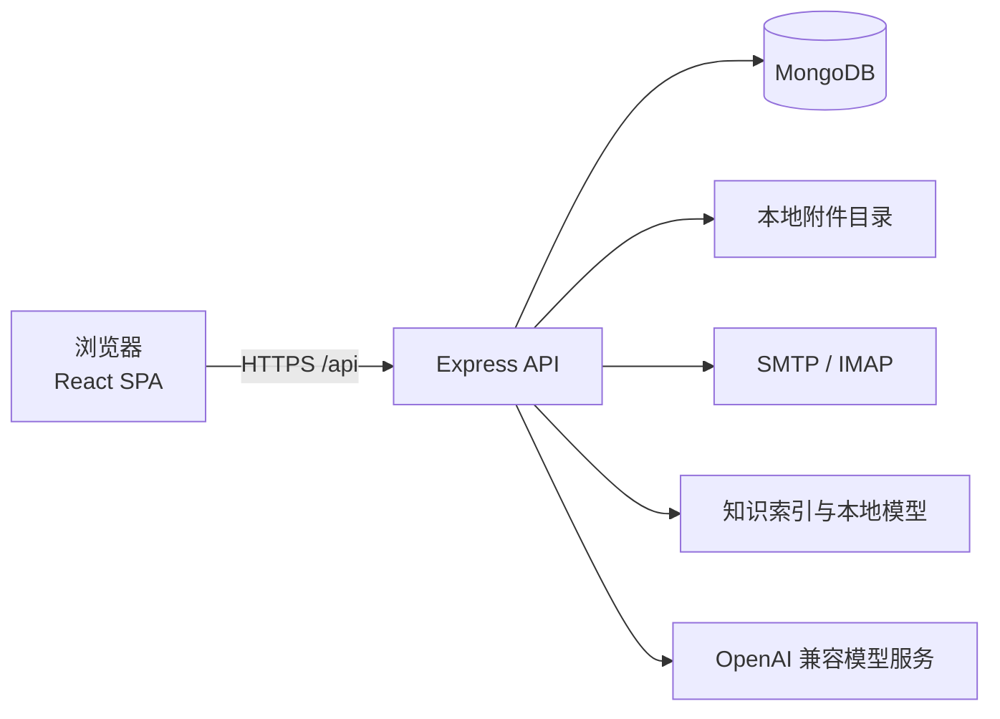

# Customer Dev Letter Manager

**外贸客户开发与邮件协作平台**

| 项目 | 内容 |
| --- | --- |
| 当前版本 | 2.6.0 |
| 文档更新 | 2026-11-04 |
| 运行环境 | Node.js >= 20.19，MongoDB 7.x 或 8.x |
| 部署方式 | 本机开发，Docker Compose 单机部署 |

Customer Dev Letter Manager 面向外贸业务团队，统一管理多项目客户资料、潜客开发、开发信、邮件往来、产品报价和知识库。系统以项目为数据边界，支持管理员与业务员分权协作，并提供本地开发和容器化部署方式。

## 目录

- [1. 项目定位](#1-项目定位)
- [2. 核心能力](#2-核心能力)
- [3. 技术架构](#3-技术架构)
- [4. 目录结构](#4-目录结构)
- [5. 快速开始](#5-快速开始)
- [6. 配置说明](#6-配置说明)
- [7. 常用命令](#7-常用命令)
- [8. API 概览](#8-api-概览)
- [9. 生产部署](#9-生产部署)
- [10. 安全与数据边界](#10-安全与数据边界)
- [11. 术语](#11-术语)
- [12. 相关文档](#12-相关文档)
- [13. 许可](#13-许可)

## 1. 项目定位

本系统用于外贸团队的日常客户开发与跟进。它把客户资料、开发信、邮件线程、报价和知识依据放在同一个项目工作空间中，减少在表格、邮箱和多个 AI 工具之间来回切换。

系统不替代邮件服务商，也不绕过客户许可。自动发送受审核结论、发送额度、客户状态和停止信号约束。

## 2. 核心能力

### 多项目工作空间

- 一套部署可管理多个外贸项目。
- 项目切换会同步切换客户、邮件、模板、跟进、附件、报价和 Dashboard 数据。
- 业务员只能访问被分配的项目和本人负责的客户；管理员可查看全部项目。
- 浏览器通过 `X-Project-Id` 传递当前项目，后端对业务查询再次校验项目范围。

### 客户与开发过程

- 客户档案、联系人、来源、优先级、标签和自定义业务字段。
- Excel 导入支持列名自动识别和手动映射。
- 客户详情包含跟进记录、附件、时间线、开发信、报价和待审核草稿。
- 支持客户状态流转、跟进提醒和重复客户检查。

### 今日开发与潜客池

- 按项目维护搜索方案、关键词和补全数量。
- 支持候选池、公共池、领取、放回和转为客户。
- 可通过公开官网资料补全公司、职位、国家、社交账号等字段。
- 候选转为客户前可预览将写入的客户资料。

### 开发信与审核

- 富文本开发信编辑器，支持模板、占位符和固定签名。
- 模板中心按首次开发、产品推荐、报价、跟进、节日等分类管理。
- 发送前支持编辑、预览和中英对照。
- 草稿审核保存审核结论和内容指纹。内容被修改后必须重新审核。
- 支持 AI 生成草稿、引用知识依据、检查占位符和发送前校验。

### 邮件中心

- 统一查看收件箱、发件记录、定时任务和客户邮件线程。
- 支持立即发送、定时发送、取消、失败重试和待核实状态。
- 支持 IMAP 增量收件、客户邮箱匹配、未知邮件处理、回复和附件。
- 支持 SMTP 真实发件和 Mock 模拟发件。
- HTML 邮件支持打开追踪和链接点击追踪。追踪数据只作互动参考。

### 产品与报价

- 按项目维护产品目录、SKU、规格、MOQ、交期和阶梯价。
- 支持产品 Excel 模板批量导入。
- 报价单支持多币种、状态流转和历史比较。
- 报价核对会对照产品目录、数量档位和历史报价，不调用模型编造价格。

### 知识库与 AI

- 项目知识文档上传、解析、索引和检索。
- 开发信可引用知识依据，并展示引用来源和风险提示。
- 支持关键词检索和本地语义检索。
- AI 配置、用量、诊断和每日额度由管理员管理。
- 支持 OpenAI 兼容的模型服务，可在管理界面覆盖服务端默认配置。

### 团队协作

- 管理员和业务员两级角色。
- 用户管理、项目分配、客户归属和邮箱绑定。
- Dashboard 展示客户漏斗、待跟进、开发信和邮件活动。
- 个人随手记按用户和项目隔离，并同步到服务端。

## 3. 技术架构



| 层次 | 技术 |
| --- | --- |
| 前端 | React 18、TypeScript、Vite 6、Tailwind CSS、Radix UI、Zustand、React Router、React Quill |
| 后端 | Node.js >= 20.19、Express 4、TypeScript、Mongoose 8、Zod |
| 数据库 | MongoDB 7.x 或 8.x |
| 邮件 | Nodemailer、ImapFlow、MailParser |
| 文档处理 | SheetJS、Mammoth、PDF Parse、PDFKit |
| AI | OpenAI 兼容 Chat Completions 服务，服务端密钥与项目级配置 |
| 部署 | Docker Compose、Nginx、PowerShell 运维脚本 |

## 4. 目录结构

```text
.
├── server/                  后端 API
│   ├── src/
│   │   ├── config/          环境变量、数据库和日志配置
│   │   ├── controllers/     HTTP 控制器
│   │   ├── middleware/      鉴权、校验、错误处理
│   │   ├── models/          Mongoose 数据模型
│   │   ├── routes/          REST 路由
│   │   ├── services/        客户、邮件、AI、知识库等业务逻辑
│   │   └── scripts/         管理员初始化和数据脚本
│   ├── tests/               服务端测试
│   ├── evaluation/          知识库评测
│   ├── parsers/             文档解析适配
│   ├── semantic/            本地语义检索适配
│   ├── uploads/             运行期附件，不提交 Git
│   └── .env.example         后端配置模板
├── web/                     前端 SPA
│   ├── src/components/      通用组件和业务组件
│   ├── src/pages/           页面
│   ├── src/router/          路由和权限守卫
│   ├── src/store/           Zustand 状态
│   ├── public/              静态资源
│   └── vite.config.ts       Vite 配置和 API 代理
├── docs/                    设计、验收和运维文档
├── scripts/                 备份、冒烟测试和审计脚本
├── compose.yaml             Docker Compose 单机编排
├── production.env.example   生产环境变量模板
└── package.json             根目录脚本
```

## 5. 快速开始

### 5.1 环境要求

- Node.js 20.19 或更高版本。
- npm，随 Node.js 安装。
- MongoDB 7.x 或 8.x，默认监听 `127.0.0.1:27017`。
- 可选：Docker Engine 和 Docker Compose v2，用于容器化部署。
- 可选：Python 环境和本地模型，用于知识库语义检索。
- 可选：SMTP 和 IMAP 账号，用于真实收发邮件。默认使用 Mock 发件。

### 5.2 安装依赖

在仓库根目录执行：

```bash
npm install
npm run install:all
```

`npm install` 安装根目录的 `concurrently`，`npm run install:all` 安装 `server` 和 `web` 的依赖。

### 5.3 配置后端

复制配置模板：

```powershell
# Windows PowerShell
Copy-Item server\.env.example server\.env
```

```bash
# macOS / Linux
cp server/.env.example server/.env
```

开发环境至少确认以下配置：

```dotenv
MONGODB_URI=mongodb://127.0.0.1:27017/cdlm
JWT_SECRET=请替换为至少32个字符的随机字符串
ADMIN_USERNAME=admin
ADMIN_PASSWORD=请替换为安全的初始密码
# 可选：给默认管理员绑定邮箱，用于忘记密码和邮件 2FA
ADMIN_EMAIL=
# mock 模式不会真实发信；本地测试时验证码/重置链接会打印到服务端控制台
MAIL_TRANSPORT=mock
APP_BASE_URL=http://localhost:5173
IMAP_ENABLED=false
```

`server/.env` 已被 Git 忽略。不要提交真实密钥、客户邮箱授权码或生产数据库地址。

### 5.4 启动 MongoDB

Windows 服务方式：

```powershell
Get-Service MongoDB
Start-Service MongoDB
```

也可以使用本机 `mongod`，或使用 `compose.yaml` 启动 MongoDB。数据库未启动时，API 会启动失败或健康检查返回 503。

### 5.5 启动前后端

```bash
npm run dev
```

启动后访问：

- 前端：`http://localhost:5173/`
- 后端 API：`http://127.0.0.1:5000/api`
- 健康检查：`http://127.0.0.1:5000/api/health`

首次启动会根据 `ADMIN_USERNAME` 和 `ADMIN_PASSWORD` 创建管理员。登录后可在用户管理页面创建业务员账号；建议同时为管理员绑定邮箱并开启邮件 2FA。忘记密码只对已绑定邮箱的账号发送重置链接。

### 5.6 局域网访问

Vite 已配置 `host: true`，后端默认监听 `0.0.0.0`。需要允许局域网前端访问时，确认 `server/.env` 包含：

```dotenv
HOST=0.0.0.0
CORS_ALLOW_PRIVATE_NETWORK=true
CORS_LAN_PORTS=5173,4173
```

其他设备使用 `http://<本机局域网IP>:5173/` 访问。局域网地址会随 DHCP 变化，且不要把开发端口直接暴露到公网。

## 6. 配置说明

完整配置项见 [server/.env.example](server/.env.example)。常用配置如下。

| 变量 | 默认值 | 说明 |
| --- | --- | --- |
| `NODE_ENV` | `development` | `development`、`test` 或 `production` |
| `HOST` | `0.0.0.0` | API 监听地址 |
| `PORT` | `5000` | API 端口 |
| `MONGODB_URI` | `mongodb://127.0.0.1:27017/cdlm` | MongoDB 连接地址 |
| `JWT_SECRET` | 无 | 登录令牌签名密钥，至少 32 个字符 |
| `JWT_ACCESS_EXPIRES_IN` | `15m` | 浏览器访问令牌有效期（HttpOnly cookie） |
| `JWT_REFRESH_EXPIRES_DAYS` | `30` | 刷新会话有效期，单位为天 |
| `COOKIE_SECURE` | `false` | HTTPS 部署时设为 `true`；生产环境默认自动启用 Secure cookie |
| `ADMIN_USERNAME` | `admin` | 首次启动创建的管理员账号 |
| `ADMIN_PASSWORD` | 无 | 管理员初始密码（至少 10 位；生产环境至少 16 位） |
| `ADMIN_EMAIL` | 空 | 可选，默认管理员邮箱；也可登录后在用户管理中设置 |
| `CORS_ORIGIN` | `http://localhost:5173` | 允许的前端来源，多个值用英文逗号分隔 |
| `APP_BASE_URL` | 空 | 密码重置邮件中的前端地址，留空时取 `CORS_ORIGIN` 第一项 |
| `CORS_ALLOW_PRIVATE_NETWORK` | `false` | 是否允许私有网段前端访问 |
| `MAIL_TRANSPORT` | `mock` | `mock` 或 `smtp`；邮件 2FA 和忘记密码在生产环境需设为 `smtp` |
| `SMTP_HOST` / `SMTP_PORT` | 空 / `587` | SMTP 服务地址和端口 |
| `SMTP_USER` / `SMTP_PASS` | 空 | SMTP 账号和授权码 |
| `SMTP_REQUIRE_TLS` | `true` | 是否要求 STARTTLS |
| `IMAP_ENABLED` | `false` | 是否启用后台收件 |
| `IMAP_HOST` / `IMAP_PORT` | 空 / `993` | IMAP 服务地址和端口 |
| `MAIL_CREDENTIAL_ENCRYPTION_KEY` | 空 | 邮箱凭据加密密钥，生产环境必须单独配置 |
| `TRACKING_BASE_URL` | `http://localhost:5000` | 邮件追踪使用的公网根地址 |
| `PUBLIC_BASE_URL` | 空 | 邮件品牌图片的公网根地址，留空时复用追踪地址 |
| `UPLOAD_DIR` | `server/uploads` | 客户附件和邮件附件的本地目录 |
| `MAX_ATTACHMENT_SIZE` | `15728640` | 单个附件大小上限，单位为字节 |
| `AI_PROVIDER` | `mock` | `mock` 或 `openai` |
| `OPENAI_API_KEY` | 空 | AI 服务密钥，仅保存在服务端 |
| `OPENAI_BASE_URL` | `https://api.openai.com/v1` | OpenAI 兼容服务地址 |
| `OPENAI_MODEL` | 服务端模板中的默认模型 | 主 Agent 模型名称 |
| `TRANSLATE_PROVIDER` | `ai` | 中英对照翻译使用 `ai` 或 `index` |
| `COMPANY_NAME` | Genesis 默认值 | 我方公司名称 |
| `COMPANY_WEBSITE` | Genesis 默认值 | 我方公司网站 |
| `COMPANY_MOQ` | `100 pcs` | 默认 MOQ 文案 |
| `SENDER_NAME` | `Genesis Sales Team` | 默认发件人签名 |

生产环境启动时，服务端会校验密钥强度。`JWT_SECRET` 必须至少 32 个字符，`ADMIN_PASSWORD` 至少 16 个字符，`MAIL_CREDENTIAL_ENCRYPTION_KEY` 必须单独生成且至少 32 个字符。

前端配置见 [web/.env.example](web/.env.example)：

| 变量 | 默认值 | 说明 |
| --- | --- | --- |
| `VITE_API_BASE_URL` | `/api` | 浏览器请求 API 的基础路径 |
| `VITE_API_PROXY_TARGET` | `http://127.0.0.1:5000` | Vite 开发代理目标 |
| `VITE_APP_TITLE` | 客户开发信管理工具 | 页面标题 |

`VITE_API_BASE_URL` 和 `VITE_APP_TITLE` 是构建期变量。修改后需要重新构建前端。

## 7. 常用命令

### 根目录

| 命令 | 说明 |
| --- | --- |
| `npm run dev` | 同时启动后端和前端开发服务 |
| `npm run dev:server` | 仅启动后端 |
| `npm run dev:web` | 仅启动前端 |
| `npm run build` | 构建后端和前端 |
| `npm start` | 启动已构建的后端 |
| `npm run typecheck` | 前后端 TypeScript 类型检查 |
| `npm run lint` | 前端 ESLint 检查 |
| `npm run seed` | 写入开发种子数据，仅在隔离数据库使用 |
| `npm run install:all` | 安装 server 和 web 依赖 |

### 服务端测试

```bash
npm run typecheck --prefix server
npm run test:mail --prefix server
npm run test:agent --prefix server
npm run test:ai-settings --prefix server
npm run test:security --prefix server
npm run test:health --prefix server
```

完整测试脚本见 [server/package.json](server/package.json)。

需要运行需要独立 MongoDB 的冒烟测试时，先启动测试夹具：

```bash
npm run test:fixture --prefix server
```

然后在另一个终端执行 `./scripts/smoke-test.ps1` 或对应的服务端测试。不要对真实业务数据库运行种子、重置或冒烟脚本。

## 8. API 概览

除公开接口外，API 使用登录鉴权。浏览器通过 `POST /api/auth/login` 获得两个 HttpOnly cookie：

- `cdlm_access`：短期访问令牌，默认 15 分钟。
- `cdlm_refresh`：刷新令牌，默认 30 天；服务端只保存其摘要，可随时撤销。

浏览器端的 `cdlm_access` 不会暴露给 JavaScript；写操作还需要从可读的 `cdlm_csrf` cookie 读取值，并在请求头回传：

```http
X-CSRF-Token: <csrf-token>
X-Project-Id: <projectId>
```

服务端在迁移期仍兼容已有 Bearer token（不经过 cookie，也不要求 CSRF 头）；新脚本建议使用 cookie jar，或改用 `/api/integrations/v1` 的独立服务凭证：

```http
Authorization: Bearer <token>
X-Project-Id: <projectId>
```

浏览器访问令牌过期时，前端会自动调用 `POST /api/auth/refresh` 轮换刷新令牌；可用 `POST /api/auth/logout` 注销当前会话。

账号可在「用户管理」中绑定邮箱并开启邮件 2FA。开启后，`POST /api/auth/login` 在密码正确时返回 `twoFactorRequired`、`challengeId` 和脱敏邮箱，不会签发 cookie；前端调用 `POST /api/auth/login/verify-2fa` 提交 6 位验证码后才创建会话。验证码 10 分钟有效，同一挑战最多尝试 5 次。

忘记密码流程：

1. `POST /api/auth/forgot-password` 提交用户名。无论账号是否存在都返回相同结果，避免账号枚举。
2. 账号有邮箱时会收到 30 分钟有效的重置链接；邮件由系统 `MAIL_*`/`SMTP_*` 通道发送，`mock` 模式会打印到服务端控制台。
3. `POST /api/auth/reset-password` 提交 `token` 和新密码；成功后撤销该账号的所有会话和未完成挑战。

主要路由分组：

| 前缀 | 用途 |
| --- | --- |
| `/api/health` | 健康检查，包含 `/live` 和 `/ready` |
| `/api/meta` | 枚举、占位符和公司元数据 |
| `/api/auth` | 登录、邮件 2FA、忘记/重置密码、刷新、注销和当前用户 |
| `/api/projects` | 项目工作空间 |
| `/api/customers` | 客户、跟进、附件和时间线 |
| `/api/website-research` | 客户官网资料研究 |
| `/api/letters` | 开发信、审核和发送 |
| `/api/templates` | 开发信模板 |
| `/api/mail` | 邮件、线程、附件和定时任务 |
| `/api/mail-accounts` | 用户发件邮箱 |
| `/api/products` | 产品目录 |
| `/api/quotations` | 报价单和报价核对 |
| `/api/prospecting` | 今日开发和潜客池 |
| `/api/outreach-automation` | 自动开发配置和执行 |
| `/api/knowledge-documents` | 知识文档 |
| `/api/knowledge-index` | 知识索引和检索 |
| `/api/agent` | AI Agent、翻译和诊断 |
| `/api/scratchpad` | 个人随手记 |
| `/api/users` | 用户管理，管理员专属 |
| `/api/audit-logs` | 登录与关键操作审计，管理员专属 |
| `/api/tracking` | 邮件打开和点击追踪，公开 token |
| `/api/integrations/v1` | 外部系统集成，独立服务凭证 |

业务接口统一返回 JSON；邮件追踪接口返回重定向或透明图片。错误响应包含 HTTP 状态码和错误信息。生产环境不要直接暴露 `/api`，应由同源反向代理转发。

## 9. 生产部署

### 9.1 直接构建

```bash
npm run build
npm start
```

构建产物：

- `server/dist/`：编译后的 Node 服务。
- `web/dist/`：静态前端资源。

使用 Nginx 托管 `web/dist`，并把 `/api` 反向代理到后端。前端路由需要回退到 `index.html`。

### 9.2 Docker Compose

Docker Compose 适合单机预演和内部部署。先准备独立的生产环境文件：

```powershell
Copy-Item production.env.example .env.production
```

填写所有占位值后执行：

```bash
docker compose --env-file .env.production config --quiet
docker compose --env-file .env.production build
docker compose --env-file .env.production up -d --wait
```

默认只把 Web 发布到 `127.0.0.1:8080`。公网访问必须由独立的 HTTPS 反向代理终止 TLS，不要把 API 或 MongoDB 端口直接发布到公网。

详细要求见 [Docker 运行说明](docs/operations/docker-runtime.md)。

### 9.3 备份

数据库备份和恢复演练见 [MongoDB 备份与恢复](docs/operations/mongo-backup.md)。备份 MongoDB、上传目录和加密密钥时必须分开保存。不要只备份数据库卷而遗漏附件和密钥。

## 10. 安全与数据边界

- 所有业务数据按项目隔离，业务员只能访问分配给自己的项目和客户。
- 新建用户默认是业务员（`user`），管理员角色必须由管理员显式授予。
- 新建/重置密码要求 10–72 位，并至少包含大小写字母、数字、符号中的三类；连续 5 次登录失败会锁定账号 15 分钟。
- 浏览器登录使用 HttpOnly access/refresh cookie，刷新令牌在服务端保存摘要并支持轮换、注销撤销；写操作使用 double-submit CSRF 校验。
- 可选的邮件 2FA 使用 6 位一次性验证码，验证码只保存带密钥的哈希摘要；忘记密码使用一次性重置令牌，均有时效和尝试次数限制。
- 登录成功/失败/注销、2FA 挑战、密码重置、用户管理和客户删除/导入/导出会写入审计日志；审计接口仅管理员可访问。
- 管理员专属功能同时在前端路由和后端接口校验。
- 邮箱授权码使用服务端密钥加密，API 不返回明文密钥。
- JWT、管理员密码和邮箱加密密钥不得写入代码、镜像或浏览器变量。
- 上传附件只通过鉴权接口下载，不开放静态目录。
- 邮件追踪 token 只保存摘要，不记录客户邮箱、IP 或 User-Agent。
- `.env`、`server/uploads/`、数据库备份、客户表格和含客户信息的截图都不得提交 Git。
- 生产日志可能包含客户信息，访问权限应限制在运维人员范围内。

## 11. 术语

| 术语 | 含义 |
| --- | --- |
| 项目 | 一套客户、邮件、模板和知识库的隔离边界 |
| 潜客 | 尚未转为正式客户的候选公司或联系人 |
| 开发信 | 面向客户发送的首次或后续商务邮件 |
| 模板 | 含占位符的可复用开发信内容 |
| 知识依据 | 开发信可引用的产品、公司和业务资料 |
| 审核结论 | 业务员对草稿标记的通过或不通过状态 |
| 发件通道 | Mock 模拟通道或真实 SMTP 通道 |

## 12. 相关文档

- [V2.6 多项目工作空间验收报告](docs/V2.6-多项目工作空间-验收报告.md)
- [自动开发设计](docs/outreach-autopilot.md)
- [客户草稿审核](docs/customer-draft-review.md)
- [开发信中英对照](docs/letter-bilingual-review.md)
- [产品目录与报价核对](docs/product-quote-playbook.md)
- [今日开发与潜客导入](docs/prospecting-profiles-and-import.md)
- [Docker 运行说明](docs/operations/docker-runtime.md)
- [MongoDB 备份与恢复](docs/operations/mongo-backup.md)

## 13. 许可

本仓库为内部业务工具，未附加开源许可证。
