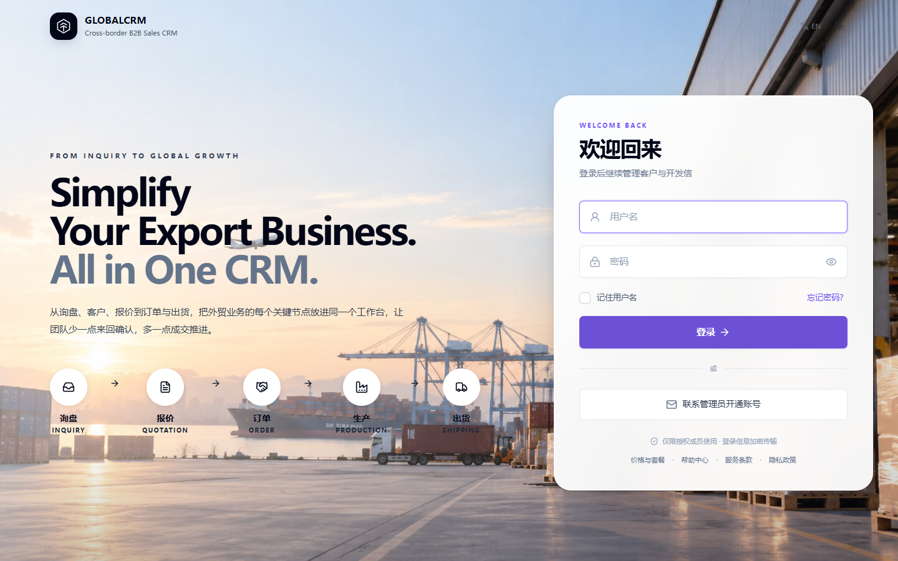
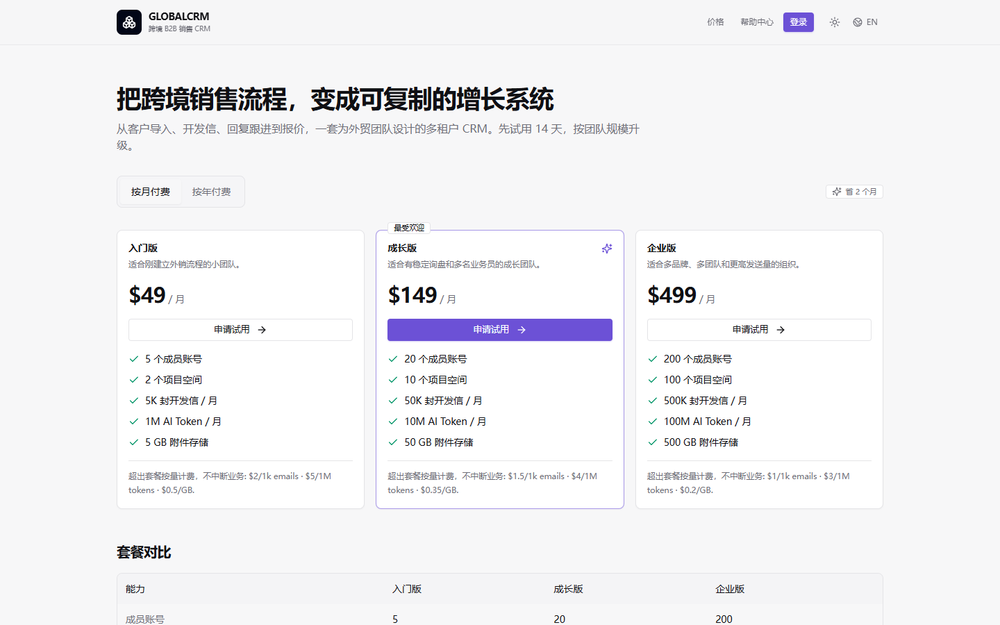
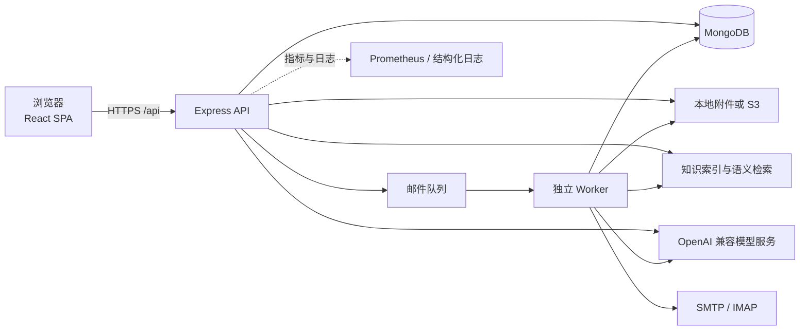

# GlobalCRM

**面向跨境 B2B 销售团队的自托管 CRM。把客户、开发信、邮件、报价、知识库和团队协作放进同一个工作区。**

[](https://github.com/D77-jpg/GlobalCRM/actions/workflows/integration-release-gate.yml)
[](https://nodejs.org/)
[](https://react.dev/)
[](https://www.mongodb.com/)
[](#license)
[](#contributing)

> 当前版本：`2.6.0` · 文档更新：`2026-11-04` · 状态：积极开发中

GlobalCRM is a self-hosted, multi-tenant CRM for cross-border B2B sales teams. It keeps customer development, personalized outreach, mailbox conversations, quotations, product knowledge and team permissions in one project workspace.

## 目录

- [为什么使用 GlobalCRM](#为什么使用-globalcrm)
- [核心功能](#核心功能)
- [界面预览](#界面预览)
- [技术架构](#技术架构)
- [快速开始](#快速开始)
- [配置](#配置)
- [常用命令](#常用命令)
- [生产部署](#生产部署)
- [API 与集成](#api-与集成)
- [安全与数据边界](#安全与数据边界)
- [项目结构](#项目结构)
- [文档](#文档)
- [Contributing](#contributing)
- [License](#license)
- [联系](#联系)

<p align="center">
  
</p>

## 为什么使用 GlobalCRM

外贸团队的日常工作通常散落在表格、邮箱、聊天工具和多个 AI 工具中。GlobalCRM 把这些动作收进一个可追溯的项目工作区：

- **一个工作台完成客户开发**：从潜客池、客户档案、开发信、回复跟进到报价，不必反复切换系统。
- **触达有边界**：审核、发送额度、退订、抑制名单和送达检查共同约束邮件发送。
- **AI 有依据**：开发信可以引用项目知识库，报价核对对照产品目录和历史价格，不让模型编造业务数据。
- **数据可自托管**：支持本机、Docker Compose 和独立 Worker 部署，组织和项目之间保持隔离。

## 核心功能

| 领域 | 能力 |
| --- | --- |
| 客户与潜客 | 客户档案、联系人、标签、来源、优先级、Excel 导入、重复检查、跟进提醒、时间线和附件 |
| 潜客开发 | 搜索方案、关键词、候选池、公共池、领取/放回、官网资料补全、转为客户 |
| 开发信 | 富文本编辑器、模板和占位符、固定签名、中英对照、AI 草稿、引用知识、发送前审核 |
| 邮件中心 | 收件箱、发件记录、邮件线程、定时发送、失败重试、IMAP 增量同步、SMTP 和 Mock 发件 |
| 邮件合规 | 可见退订链接、RFC 8058 一键退订、List-Unsubscribe、退信/投诉/人工抑制名单、SPF/DKIM/DMARC 检查、邮箱预热 |
| 产品与报价 | 产品目录、SKU、MOQ、交期、阶梯价、批量导入、多币种报价、历史比较和报价核对 |
| 知识库与 AI | 文档上传、解析、索引、关键词和语义检索、引用来源、AI 配置、用量和每日额度 |
| 组织与权限 | 组织/项目两级隔离、组织管理员、项目管理员、销售、只读、平台运营、套餐计量和账单草稿 |
| 部署与运维 | 版本化 MongoDB 迁移、API 和 Worker 分离、Prometheus 指标、备份恢复、Docker Compose |

## 界面预览

<p align="center">
  
</p>

## 技术架构



| 层次 | 技术 |
| --- | --- |
| 前端 | React 18、TypeScript、Vite 6、Tailwind CSS、Radix UI、Zustand、React Router、React Quill |
| 后端 | Node.js 20.19+、Express 4、TypeScript、Mongoose 8、Zod |
| 数据库 | MongoDB 7.x 或 8.x |
| 邮件 | Nodemailer、ImapFlow、MailParser |
| 文档处理 | SheetJS、Mammoth、PDF Parse、PDFKit |
| AI | OpenAI 兼容 Chat Completions 服务、服务端密钥、项目级配置 |
| 部署 | Docker Compose、Nginx、独立 Worker、Prometheus 文本指标 |

## 快速开始

### 环境要求

- Node.js `>= 20.19.0`
- npm，随 Node.js 安装
- MongoDB `7.x` 或 `8.x`，默认监听 `127.0.0.1:27017`
- 可选：Docker Engine 和 Docker Compose v2，用于容器化部署
- 可选：Python 环境和本地模型，用于知识库文档解析和语义检索
- 可选：SMTP 和 IMAP 账号，用于真实收发邮件；默认使用 Mock 发件

### 1. 克隆仓库

```bash
git clone https://github.com/D77-jpg/GlobalCRM.git
cd GlobalCRM
```

### 2. 安装依赖

```bash
npm install
npm run install:all
```

`npm install` 安装根目录的 `concurrently`，`npm run install:all` 安装 `server` 和 `web` 的依赖。

### 3. 配置环境

```powershell
# Windows PowerShell
Copy-Item server\.env.example server\.env
```

```bash
# macOS / Linux
cp server/.env.example server/.env
```

至少确认以下配置：

```dotenv
MONGODB_URI=mongodb://127.0.0.1:27017/cdlm
JWT_SECRET=请替换为至少32个字符的随机字符串
ADMIN_USERNAME=admin
ADMIN_PASSWORD=请替换为安全的初始密码
APP_BASE_URL=http://localhost:5173
MAIL_TRANSPORT=mock
IMAP_ENABLED=false
```

`server/.env` 已被 Git 忽略。不要提交真实密钥、客户邮箱授权码或生产数据库地址。

### 4. 初始化数据库

```bash
npm run migrate --prefix server
```

迁移会创建管理员账号，并初始化组织和项目数据。应用启动时只检查迁移状态，不会隐式修改数据库。

### 5. 启动开发服务

```bash
npm run dev
```

启动后访问：

- 前端：`http://localhost:5173/`
- API：`http://127.0.0.1:5000/api`
- 健康检查：`http://127.0.0.1:5000/api/health`

需要在开发环境启用独立后台 Worker 时：

```bash
# .env 中设置 RUN_BACKGROUND_JOBS=false
npm run dev:worker --prefix server
```

局域网访问时，确认 `server/.env` 中的 `CORS_ALLOW_PRIVATE_NETWORK=true` 和 `CORS_LAN_PORTS=5173,4173`，然后用本机局域网 IP 访问前端。不要将开发端口直接暴露到公网。

## 配置

完整配置项见 [`server/.env.example`](server/.env.example) 和 [`web/.env.example`](web/.env.example)。常用变量如下：

| 变量 | 默认值 | 说明 |
| --- | --- | --- |
| `NODE_ENV` | `development` | `development`、`test` 或 `production` |
| `APP_ENV` | `development` | 环境标识：`development`、`staging` 或 `production` |
| `MONGODB_URI` | `mongodb://127.0.0.1:27017/cdlm` | MongoDB 连接地址 |
| `PORT` | `5000` | API 监听端口 |
| `JWT_SECRET` | 无 | 登录令牌签名密钥，至少 32 个字符 |
| `ADMIN_USERNAME` | `admin` | 首次初始化创建的管理员账号 |
| `ADMIN_PASSWORD` | 无 | 管理员初始密码，生产环境至少 16 个字符 |
| `CORS_ORIGIN` | `http://localhost:5173` | 允许的前端来源，多个值用英文逗号分隔 |
| `APP_BASE_URL` | 空 | 密码重置邮件中的前端地址 |
| `MAIL_TRANSPORT` | `mock` | `mock` 或 `smtp` |
| `MAIL_CREDENTIAL_ENCRYPTION_KEY` | 空 | 邮箱授权码加密密钥，生产环境必须单独配置 |
| `PUBLIC_BASE_URL` | 空 | 邮件图片和退订链接的公网 HTTPS 根地址 |
| `UPLOAD_DIR` | `server/uploads` | 本地附件目录 |
| `STORAGE_PROVIDER` | `local` | `local` 或 `s3` |
| `AI_PROVIDER` | `mock` | `mock` 或 `openai` |
| `OPENAI_API_KEY` | 空 | AI 服务密钥，仅保存在服务端 |
| `RUN_BACKGROUND_JOBS` | `true` | API 是否内嵌后台任务；生产环境建议拆分 Worker |
| `GLOBALCRM_HTTP_PORT` | `8080` | Docker Compose 的宿主机 Web 端口 |

生产环境启动时会校验密钥强度。`JWT_SECRET` 必须至少 32 个字符，`ADMIN_PASSWORD` 至少 16 个字符，`MAIL_CREDENTIAL_ENCRYPTION_KEY` 必须单独生成且至少 32 个字符。

前端构建期变量：

| 变量 | 默认值 | 说明 |
| --- | --- | --- |
| `VITE_API_BASE_URL` | `/api` | 浏览器访问 API 的基础路径 |
| `VITE_API_PROXY_TARGET` | `http://127.0.0.1:5000` | Vite 开发代理目标 |
| `VITE_APP_TITLE` | `GlobalCRM` | 页面标题和品牌展示名 |

修改前端变量后需要重新构建前端。

## 常用命令

| 命令 | 说明 |
| --- | --- |
| `npm run dev` | 同时启动 API 和前端开发服务 |
| `npm run dev:server` | 仅启动 API |
| `npm run dev:web` | 仅启动前端 |
| `npm run dev:worker --prefix server` | 启动开发模式后台 Worker |
| `npm run build` | 构建 API 和前端 |
| `npm start` | 启动构建后的 API |
| `npm run start:worker --prefix server` | 启动构建后的独立 Worker |
| `npm run typecheck` | 前后端 TypeScript 类型检查 |
| `npm run lint` | 前端 ESLint 检查 |
| `npm run seed --prefix server` | 写入开发种子数据，仅限隔离数据库 |
| `npm run migrate --prefix server` | 执行数据库迁移 |

### 测试

```bash
npm run typecheck
npm run lint
npm run test:security --prefix server
npm run test:integration --prefix server
npm run test:e2e --prefix server
npm run test:p3 --prefix server
```

CI 使用 [integration-release-gate.yml](.github/workflows/integration-release-gate.yml)，覆盖服务端、前端、安全、集成、知识库评测和运维检查。提交 PR 前建议至少完成类型检查、构建、安全测试和集成测试。

## 生产部署

### 直接构建

```bash
npm run build
npm start
# 另开一个进程运行后台任务
npm run start:worker --prefix server
```

使用 Nginx 托管 `web/dist`，并把 `/api` 反向代理到 API 服务。前端路由需要回退到 `index.html`。生产环境建议将 API 和 Worker 分开运行，并配置 HTTPS、持久化附件存储和日志采集。

### Docker Compose

```powershell
Copy-Item production.env.example .env.production
# 填写全部占位值，确认数据库、密钥、域名和卷路径
docker compose -p globalcrm --env-file .env.production config --quiet
docker compose -p globalcrm --env-file .env.production build
docker compose -p globalcrm --env-file .env.production up -d --wait
```

Compose 会先运行一次性的 `migrate` 服务，成功后启动 API、Worker 和 Web。默认仅将 Web 发布到 `127.0.0.1:8080`，公网访问必须由独立的 HTTPS 反向代理终止 TLS。不要把 API 或 MongoDB 端口直接发布到公网。

部署前请阅读：

- [Docker 运行说明](docs/operations/docker-runtime.md)
- [MongoDB 备份与恢复](docs/operations/mongo-backup.md)
- [环境、迁移与发布](docs/P3-环境与发布.md)

## API 与集成

项目管理员可从“项目工作空间 → 集成与连接”自助管理 GlobalSite 服务凭证、轮换宽限期并查看请求摘要。
部署前的索引迁移与套餐规则见 [C2 凭证管理](docs/integration/C2-凭证管理.md)。明文凭证仅在创建或轮换时显示一次。

服务端默认监听 `http://127.0.0.1:5000`：

| 端点 | 用途 |
| --- | --- |
| `GET /api/health/live` | 进程存活检查 |
| `GET /api/health/ready` | 数据库可用且未进入 draining 状态 |
| `GET /api/health` | 数据库、进程内存、邮件通道和版本 |
| `/api/integrations/v1` | 外部系统集成，使用独立服务凭证 |

浏览器登录使用 HttpOnly 的 `cdlm_access` 和 `cdlm_refresh` cookie。写请求还需要从 `cdlm_csrf` cookie 读取值，并在请求头回传 `X-CSRF-Token` 和 `X-Project-Id`。外部系统使用 `Authorization: Bearer <token>` 和 `X-Project-Id`，接口契约见 [Integration API v1](docs/integration/README.md)。

生产环境应把 `/api` 放在同源反向代理后，并将 `PUBLIC_BASE_URL` 设为收件人可访问的 HTTPS 地址，否则退订链接会指向本地地址。

## 安全与数据边界

- 业务数据按组织和项目隔离。Mongoose 租户插件统一追加组织过滤，服务端再次校验项目范围。
- 浏览器登录使用 HttpOnly access/refresh cookie。写操作使用 double-submit CSRF 校验。
- 可选邮件 2FA；忘记密码使用一次性重置令牌，验证码和重置令牌均有时效和尝试次数限制。
- 生产密钥只放在环境变量或密钥管理系统中，不写入代码、镜像或浏览器变量。
- 附件只通过鉴权接口下载，不开放静态目录。
- 开发信默认附带可见退订链接和标准退订邮件头；退订、硬退信、投诉和人工抑制地址会进入不再发送名单。
- 邮件追踪只保存 token 摘要，不记录客户邮箱、IP 或 User-Agent。
- 不要提交 `.env`、`server/uploads/`、数据库备份、客户表格或含客户信息的截图。

发现安全问题请不要在公开 Issue 中披露可利用细节。请通过 `support@genesisgroup.cn` 联系维护者，并在邮件标题注明 `[GlobalCRM Security]`。当前邮箱为过渡联系方式，正式开源后将提供专用安全邮箱。

## 项目结构

```text
.
├── server/                  后端 API
│   ├── src/
│   │   ├── background/      后台任务运行时
│   │   ├── config/          环境变量、数据库和日志配置
│   │   ├── controllers/     HTTP 控制器
│   │   ├── middleware/      鉴权、租户上下文、校验和错误处理
│   │   ├── models/          Mongoose 模型与租户插件
│   │   ├── routes/          REST 路由
│   │   ├── services/        客户、邮件、AI、知识库、存储和计量
│   │   ├── worker.ts        独立 Worker 入口
│   │   └── scripts/         迁移、初始化和数据脚本
│   ├── tests/               服务端测试
│   ├── evaluation/          知识库评测
│   ├── parsers/             文档解析适配
│   ├── semantic/            本地语义检索适配
│   └── .env.example         后端配置模板
├── web/                     前端 SPA
│   ├── src/components/      通用组件和业务组件
│   ├── src/pages/           页面
│   ├── src/router/          路由和权限守卫
│   ├── src/store/           Zustand 状态
│   └── vite.config.ts       Vite 配置和 API 代理
├── docs/                    设计、验收和运维文档
├── scripts/                 备份、冒烟测试和审计脚本
├── compose.yaml             Docker Compose 单机编排
├── production.env.example   生产环境变量模板
└── package.json             根目录脚本
```

## 文档

- [品牌与命名规范](docs/brand-guidelines.md)
- [环境、迁移与发布](docs/P3-环境与发布.md)
- [Docker 运行说明](docs/operations/docker-runtime.md)
- [MongoDB 备份与恢复](docs/operations/mongo-backup.md)
- [Integration API v1](docs/integration/README.md)
- [知识库与销售 Agent 路线](docs/knowledge-agent-roadmap.md)
- [安全测试与外部渗透测试清单](docs/P3-安全测试与外部渗透测试清单.md)
- [压力与稳定性测试报告](docs/P3-压力与稳定性测试报告.md)
- [产品目录与报价核对](docs/product-quote-playbook.md)
- [今日开发与潜客导入](docs/prospecting-profiles-and-import.md)
- [自动开发设计](docs/outreach-autopilot.md)

## Contributing

欢迎 Issue 和 Pull Request。提交前请阅读以下约定：

1. **先讨论较大的改动。** 新功能、数据模型变化和接口变化先开 Issue，说明使用场景、影响范围和测试计划。
2. **保持改动聚焦。** 一个 PR 解决一个问题，避免把重构、格式化和功能改动混在一起。
3. **本地验证。** 至少运行 `npm run typecheck`、`npm run build`、`npm run test:security --prefix server` 和 `npm run test:integration --prefix server`。
4. **不要提交敏感数据。** 不要在 Issue、测试夹具、日志或截图中包含真实客户邮箱、授权码、访问令牌、数据库备份或生产配置。
5. **写清 PR 说明。** 描述改了什么、为什么改、如何验证，以及是否有迁移或配置变更。

提交信息建议使用 Conventional Commits，例如 `feat: add quotation reminder`、`fix: handle empty mail subject`。

## License

本仓库当前尚未添加 `LICENSE` 文件，默认保留所有权利。项目计划开源，正式发布前需要由维护者确定并提交许可证，建议在 Apache-2.0 和 AGPL-3.0 之间做一次明确选择。许可证确定前，本仓库不授予复制、分发或商业使用权。

## 联系

- 产品与支持：`support@genesisgroup.cn`
- 安全问题：`support@genesisgroup.cn`，标题请注明 `[GlobalCRM Security]`

如果这个项目对你的团队有帮助，欢迎 Star、提交 Issue 或参与改进。
