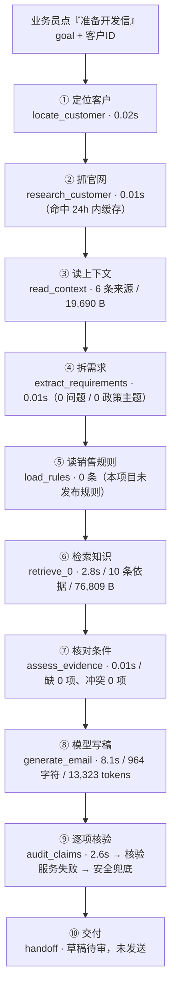

# Agent 写开发信的完整过程（含一次真实任务的数据）

> 数据来源：2026-10-21 08:32 真实执行的一次首封开发信任务
> 任务 `6ad8082804095cf2a828d859` · 客户 `Top 30 Jewelry Manufacturers In USA` · 草稿 `6ad8083604095cf2a828d85a`
> 全部数字取自已落库的任务记录与草稿审核快照，未做估算。

## 一、一图看懂



## 二、九步流水线：每一步做什么、花了多少

| # | 步骤（代码键） | 干什么 | 工具 | 真实耗时 | 产出体积 |
|---|---|---|---|---|---|
| 1 | `locate_customer` | 校验项目内是否有该客户、当前用户有没有权限 | — | 0.02s | 事件 2 条 |
| 2 | `research_customer` | 抓取/复用客户官网原文；24 小时内已成功的报告直接复用 | website | 0.01s（缓存命中） | 134 B |
| 3 | `read_context` | 读客户档案、时间线、往来邮件、已发开发信、跟进、客户附件 | crm | 0.006s | 6 条来源 / 19,690 B |
| 4 | `extract_requirements` | 从 goal + 来信里抽问题、政策主题（MOQ/交期/样品…）、已知数量与目的地 | 规则 | 0.006s | 62 B |
| 5 | `load_rules` | 读项目级销售规则（最多 4 条，超出直接报错） | rules | 0.007s | 0 条 / 2 B |
| 6 | `retrieve_0` | 语义检索已发布知识，最多 2 轮补查缺失主题 | knowledge | 2.8s | 10 条依据 / 76,809 B |
| 7 | `assess_evidence` | 汇总来源、判定缺失主题与条款冲突，形成 facts | conditions | 0.006s | 55,945 B |
| 8 | `generate_email` | 一次模型调用，产出 facts / gaps / recommendations / 邮件正文 / 跟进计划 | model | 8.1s | 3,721 B |
| 9 | `audit_claims` | 对正文逐句做依据核验，不合格就替换成安全稿 | model | 2.6s | 23,173 B |
| 10 | `handoff` | 保存草稿、写审核快照、登记待办；**不发送** | — | 0.006s | 113 B |

合计：**9 次步骤调用 / 13.6s 步骤耗时 / 13.9s 端到端**；任务预算 `19,599 / 200,000` 字符。

## 三、每步的真实数据

### 1–3. 定位 → 抓官网 → 读上下文

- 官网抓取命中缓存：`reportId 6ad80078c43044a1811c48bf`，采集时间 23:59:56，任务在 00:32 复用该报告（24 小时内已成功的报告直接复用，不重复抓取）。
- `read_context` 组装了 6 个来源：客户档案 1 + 时间线 1 + 官网证据 4。这一步决定了后面模型能"看见"多少客户事实。

### 4. 拆需求

```json
{ "questions": [], "topics": [], "known": {}, "historyLimited": false }
```

这次 goal 是"准备一封首封开发信"，没有客户来信，也没有指定 MOQ/交期，因此**没有政策主题**。后果很直接：第 7 步不会生成"待确认条件"清单，第 8 步的模型也没有明确的问题清单可回答——这是首封开发信的正常形态，但也意味着草稿风格偏介绍而非报价。

### 5. 读销售规则

本项目未发布 `sales_rules` 分类资料 → 0 条。若超过 4 条会直接报"规则过多请合并"，不会静默截断。

### 6. 检索业务依据（这次的关键一步）

- 引擎：本地语义索引（BM25 + 向量 + RRF + rerank），耗时 2.8s。
- 命中 **10 条**，每条只取命中的文本窗口，不取整篇：

| 来源 | 版本 | 取用字符 | rerank |
|---|---|---:|---:|
| 公司简介-Company-Profile | v1 | 296 | 9.93 |
| 产品资料 · Product Catalog · 第 2 部分 | v1 | 140 | 9.91 |
| 公司资料 · Company Profile | v1 | 232 | 9.90 |
| AI客服知识库-knowledge-base · 第 1 部分 | v1 | 473 | 9.44 |
| AI客服知识库-plain · 第 1 部分 | v1 | 396 | 9.43 |
| MOQ／样品／交期／付款政策 · Order Policy | v1 | 227 | 9.37 |
| 阶梯价计算器 | v1 | 229 | 9.14 |
| 行业解决方案 · 第 1 部分 | v1 | 258 | 9.01 |
| 常见询盘与回复话术 · 第 2 部分 | v1 | 171 | 8.80 |
| 行业解决方案 · 第 2 部分 | v1 | 419 | 8.73 |

10 条依据正文合计只有 **2,841 字符**，但落库的步骤记录是 **76,809 B**——差额是溯源引用（每条来源 4 条片段引用）、排序分和 manifest。这正是上一轮修复的位置：修复前同样的检索是 420,087 B，会直接触发 16 万字符的步骤上限，任务在"检索业务依据"就失败。

- 状态 `ready`，`issues: []`，`facts: 0`（因为第 4 步没有政策主题，不生成条件事实）。

### 7. 核对适用条件与缺口

```json
{ "status": "ready", "missing": [], "conflicts": [], "evidence": [10 条来源快照] }
```

无缺失、无冲突，允许进入写稿。

### 8. 模型写稿（这是它真正写出来的东西）

- 模型：`openai` 通道，8.1s，input 11,824 / output 1,499 tokens（13,323 total）。
- 产出结构化结果：**7 条事实 / 4 条缺口 / 4 条建议 / 1 个跟进计划 / 邮件正文 964 字符**。
- 草稿主题与正文（审计前）：

> **Jewelry packaging options for UVARA's OEM/ODM collections**
>
> Hi Stiles,
>
> I'm reaching out from Genesis (Xiamen) Bags Co., Ltd. We manufacture custom jewelry packaging, including velvet and microfiber pouches and rigid boxes with velvet lining — structures designed to protect pieces from scratches and present them well at retail.
>
> Your website shows that UVARA Jewelry is a B2B manufacturer in Chang'an, Dongguan, producing stainless steel, 925 silver and brass jewelry through OEM/ODM and private-label projects for brands, wholesalers and e-commerce sellers.
>
> If packaging is part of your client offer, we could put together a couple of structure and material options for your review. Standard styles start from 100 pcs…

- 同时产出的 follow-up 计划：2026-10-28 邮件跟进，附绒布袋与硬盒品类概览，问是否方便安排样品评估。

### 9. 逐项核验 → 安全兜底（最终草稿为什么变空泛）

`audit_claims` 只跑了 2.6s 就结束，核验结果是 **不可用**：

```json
{
  "status": "ready",
  "completeness": "partial",
  "claims": 0,
  "issues": [
    { "code": "claim_rewritten", "message": "原生成稿未经过完整语义支持检查；已使用有依据的条件答复，原文未直接放行" },
    { "code": "semantic_unverified", "message": "语义核验暂时失败，不能把失败当作事实已确认" }
  ],
  "factAudit": { "mode": "unavailable", "checks": 0 }
}
```

规则是"核验不通过就不放行原文"。核验服务失败时没有可保留的通过段落（`checks: 0`），于是整封正文被替换成确定性安全稿：

> Dear Top 30 Jewelry Manufacturers In USA,
> I am reaching out to introduce our team and see whether we could help with your requirements.
> Would a brief discussion about your requirements be useful?
> Best regards, Genesis Admin …

最终落库草稿：**283 字符**，主题 `A brief introduction`（模板默认主题），`status: draft`，审核快照里保留 10 条来源、0 条 claim。

> **2026-10-21 已修复**：核验服务失败不再整封替换成模板稿。现在先对核验调用重试一次；仍然失败时保留模型原稿，但要求正文里出现的每个数字都能在依据中找到，否则才退回条件答复。修复后同一客户同一任务的实际产出见下节。

### 修复后的实际产出（2026-10-21 09:0x 复跑）

- 核验模式：`semantic`，逐项 4 条；`completeness: partial`。
- 主题：`Jewelry packaging options for UVARA's OEM/ODM lines`（生成的标题通过"无数字、≤90 字符"检查后保留）。
- 正文 414 字符，以核验通过的段落开头：

> Dear Top 30 Jewelry Manufacturers In USA,
> I'm Genesis Admin from Genesis (Xiamen) Bags Co., Ltd. We manufacture custom packaging for jewelry brands, including velvet and microfiber pouches, magnetic-closure boxes and drawer boxes with velvet lining for presentation.
> Would a brief discussion about your requirements be useful?

- 如果核验整体不可用（transport 失败），正文按模型原稿保留，审核页顶部出现"本稿未完成逐项核验"横幅；含依据中没有的数字时仍退回条件答复。

## 四、一次任务的完整时间线

| 时间 (UTC) | 事件 |
|---|---|
| 00:32:40.936 | 接受草稿准备委托（发送仍由业务员操作） |
| 00:32:40.955 | 目标客户已确认 |
| 00:32:40.990 | 已读取客户官网原文 |
| 00:32:41.007 | 开始分析客户档案、时间线、邮件与报价 |
| 00:32:54.758 | 分析与草稿内容已持久保存（13.7s） |
| 00:32:54.812 | 开发信草稿已保存至 CRM |
| 00:32:54.864 | 草稿准备完成，请打开审核页面 |

## 五、四道硬上限（决定"能不能出稿"）

| 限制 | 数值 | 撞上时的表现 | 这次用量 |
|---|---:|---|---|
| 单步 payload | 160,000 字符 | 该步失败，任务报"超过处理上限" | 最大 76,809（检索） |
| 模型单次输入 | 60,000 字符 | 生成前拦截 | 实测通过 |
| 业务证据 | 16 条 / 48,000 字符 | 现改为**保留最优证据 + 写明未纳入**，不再整单失败 | 10 条 / 约 6,400 字符 |
| 任务预算 | 200,000 字符 | 任务失败，提示缩小范围 | 19,599 |

## 六、质量瓶颈与已做的修复

原本最伤体验的一点：**核验服务一失败，稿子就退化成模板**（283 字符，`A brief introduction`）。模型明明写出了带官网事实、带起订量、带下一步的稿子，却因为核验不可用被整封替换。

2026-10-21 的三处改动：

1. **核验失败重试一次**：`verifier.check` 抛错时立即重试，减少偶发 transport 失败直接降级。
2. **保留模型原稿（已被 2026-10-26 硬化取代，见下）**：重试后仍失败才降级，而且降级方式从"换成模板"变成"保留原稿 + 标注未核验"（`draft_unverified`），审核页顶部有横幅，逐项结论一律显示"需人工核对"。
3. **部分核验时不再重复开场白**：核验通过的段落在重建信件时替换通用开场白（`verifiedProse`），不再出现"我来自 Genesis… / 我来介绍一下我们团队…"两句连读。
4. **标题不再一律用模板**：生成的标题只要 ≤90 字符且不含数字/币种就保留，因此从 `A brief introduction` 变成 `Jewelry packaging options for UVARA's OEM/ODM lines`。
5. **证据优先核验**（2026-10-21 第三轮）：已移除 `assertive()` 和“unsupported 介绍文字 → non_claim”的放行路径。普通产品介绍、库存预留等新措辞统一经过现有语义蕴含核验，每句必须由授权原文支持；一个分句不过关只丢该句，不再连坐整段。`non_claim` 仅适用于有界礼貌语和完整匹配的纯信息询问。`contradicted`、`unverifiable`、遗漏、重复、无效引用均不升级为已核验。

前两轮实测效果（不是本轮模型评测）：同一客户同一任务，落库草稿从 **283 字符模板** 变成 **414–463 字符、带具体产品与下一步**的正文，主题也从 `A brief introduction` 变成 `Jewelry packaging options for UVARA's OEM/ODM and private-label lines`。

第三轮处理状态与剩余边界：

1. **数字客户描述已单独处理**：如明确归属官网的 "Your website shows that UVARA is based in Dongguan and uses 925 silver."，在语义逐句支持、引用来自当前客户授权档案/官网、数值完整匹配且不混入我方陈述或交易政策时，可以保留，包括部分核验后的重建稿。我方价格、交期、认证等仍要求商业数字、单位和条件与适用的已确认条件卡一致（不要求整段逐字复制）。数字不是子串匹配：1925 不能证明 925。
2. 称呼目前用 `customer.name`，没有联系人字段时会出现 "Dear Top 30 Jewelry Manufacturers In USA"。
3. **承诺词表漏放路径已移除**："we can hold stock for you"、中文库存预留和其它未列举表达，只要无逐句支持证据就不进入已核验正文。闭合的信息询问白名单不接受在问题中夹带承诺；首次已有否定结论后重写失败，不再借服务异常重新放回原稿。语义模型仍可能判断失误，本地测试验证的是服务端证据边界，不代表真实模型准确率。

### 引用恢复与仍保留的边界

模型引用的下标由服务端重新定位：先使用精确原文；若仅换行、空格或不换行空格不同，只在唯一匹配时恢复原文，并保存真正的 Unicode 区间。数字、词语、标点、否定和大小写均不模糊匹配；不能定位、存在歧义、引用其它客户或无原文时仍拒绝，不能为了保留客户描述编造依据。定位修复在模型适配层，最终核验仍逐字比较授权快照。

没有完整语义结论时，既有的“保留原稿 + 未核验横幅”仅适用于首次核验服务故障且数字门禁通过的场景，不表示内容已获证据支持；未配置核验服务时仍走确定性答复。服务恢复后应重新核验。

> **2026-10-26 安全硬化（P0-1/P0-2/S-1）**：核验失败、超时或断网时，模型原稿不再进入可发送正文；系统只返回确定性、有依据的条件答复，并记录 `semantic_unverified`。只要有一条引用区间对不上授权证据，该句就按 `unsupported` 处理，不再保留“部分有效引用”的普通叙述。发送前服务端强制检查知识审核：保留模型原稿的 `draft_unverified`、索引过期/失败、冲突和高风险商业承诺未获人工批准，都会被拒绝发送；`semantic_unverified` 的安全兜底不单独拦截，但会明确标记为未逐项核对。
>
> **2026-10-28 核验粒度调整（P1）**：语义核验从“整段一票否决”改为逐句核验，一句没有依据只丢该句，同段其余已核验句子保留（`semantic_partial`）。`critical()` 不再把任意数字当承诺：只有带商业单位/货币或紧挨 MOQ/价格/交期等政策词的数字才走关键承诺检查；“2–3 个方案”这类普通数字不再触发。关键句不再要求整段逐字复制条件卡，但商业数字必须能在被引用的证据里找到，单位/货币不能换（pcs=pieces 可归一），`immediately/free/guaranteed` 等额外条件不能凭空加；结构化条件卡的 `after...` 起始条件仍必须出现。重建时会合并相邻能力句（最多 3 句/650 字符），官网/档案归属句和问句独立成段，避免一封信念出五六段。硬门禁不变：`draft_unverified`、索引失效/冲突、未人工批准的高风险承诺仍不能发送。

> **2026-10-28 三段式调整**：首封正文固定 3 段、50–90 词（最多 110），第一段客户产品事实＋包装洞察，第二段身份＋一个证明点，第三段一个低负担 CTA；主题 3–7 词。现有签名/落款和 `Could you please...` 收尾不变。
>
> **2026-10-26 证据补全（E-1/E-2/E-3）**：检索命中后补相邻窗口，短节整节读取，长节保留末尾脚注/价格/交期条件；历史状态超过 128 条只告警，500 条以内正常查询不阻断；审核/核验使用保留窗口位置的 `knowledgeForAudit` 快照，模型输入继续使用精简版 `knowledgeForModel`。

回归命令：在 server 下执行 `npm run test:knowledge-facts`（含客户数字、词表外承诺、伪装询问、引用恢复和重写故障测试）。

本轮本地验证：事实核验、Agent、知识工作流、官网研究、审核治理共 **183 项测试通过**；后端构建与修改测试的严格类型检查通过。包括模型适配层的本地 HTTP 引用恢复测试；没有调用真实模型评测，也不表示远端 CI 已通过。

## 七、代码地图（想改哪里看哪里）

| 环节 | 文件 |
|---|---|
| 任务创建与调度 | `server/src/services/agent/task.service.ts` |
| 步骤定义、预算与缓存 | `server/src/services/agent/evidence-workflow.ts` |
| 证据准备（需求、规则、检索、条件） | `server/src/services/agent/sales-evidence.ts` |
| 语义检索与排序 | `server/src/services/knowledge/index.service.ts` |
| 写稿与事实核验 | `server/src/services/agent/customer-analysis.service.ts`、`fact-verifier.ts` |
| 安全兜底渲染 | `server/src/services/agent/knowledge-grounding.ts` |
| 草稿与审核快照 | `server/src/services/agent/knowledge-draft.service.ts` |

## 八、怎么自己查一次

- 页面：客户详情 → 销售助手 → 待办 → "处理详情"。展开后就是「处理过程」：四个指标（总耗时 / 依据条数 / 核验模式 / 预算占用）+ 每步耗时条 + 数据量胶囊（依据 10 条、2,841 字符、条件事实 0、正文 964 字符、13,323 tokens、记录 76.8 KB）。
- 指标由 `task.service.ts: stepMetrics()` 从落库的步骤 payload 计算，payload 本身不下发浏览器；核验步骤额外给出 `verifyMode`（`semantic` / `deterministic` / `unavailable`）。
- 接口：`GET /api/agent/tasks/:id` 的 `workflow[].metrics` 即上述字段。
- 库：`AgentTask.workflowRecords[]` 含每步 `payload`、`durationMs`、`attempts`、`reused`；`DevelopmentLetter.knowledgeReview` 是本稿的依据快照；`AgentCustomerAnalysis.facts/gaps/recommendations` 是模型的研究结论。
