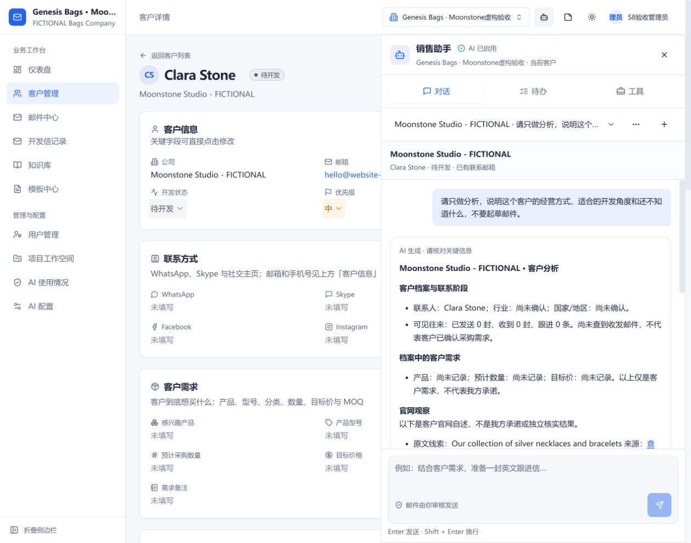
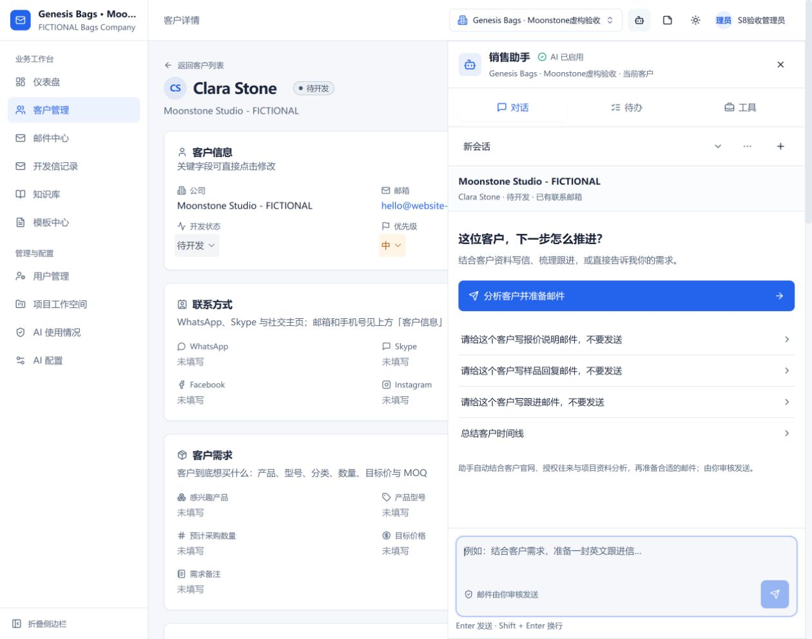
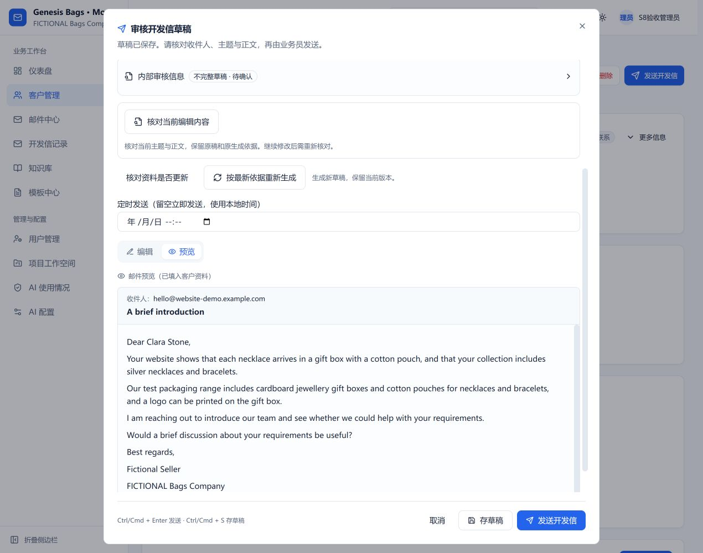

# Agent 为已有客户分析与准备邮件

2026-10-20。基线 main `e10cbcc` 已含 PR43；本次在短分支 `codex/agent-customer-context` 修正入口和工作流。用户创建/合并 PR。开发目录与 5173 分支预览不代表已合入 main。

## 业务员使用

进入客户详情，打开销售助手，直接说“分析这个客户，结合官网和历史往来准备合适的邮件，不要发送”，或点“分析客户并准备邮件”。助手自动读取该客户档案中保存的官网，结合有权访问的往来与当前项目已发布依据，准备草稿并打开原有审核页。已有收发记录时默认准备跟进；明确要求首封仍按该要求处理。

只想看分析，可以说“请只分析这个客户的经营方式和开发角度，不要起草邮件”。这一路展示档案需求、可见联系阶段、官网原文与来源、规则建议和本次尚未核实的事项；不创建写信任务。此简报由服务端按真实来源整理，不调用大模型生成新的业务事实或承诺。原文保留原语言，当前没有自动翻译。

客户列表和详情已移除独立“官网调查 / 导入 CRM”入口。官网研究成为 Agent 的内部能力，已有客户只关联来源，不重新录入、合并或覆盖字段。旧调查接口和组件保留兼容，不作为现有客户的主流程。

没有官网就使用已有资料并明确缺口；不猜网址。网址失效、受限制或只取得部分网页时允许准备部分草稿，不能当成已完成充分调查。知识不足时也不虚构我方产品、MOQ、报价、交期或认证。

草稿仍由业务员核对和发送。只分析或准备草稿不写“已发送”跟进；成功发送后的现有跟进规则不变。本次没有发送任何真实邮件。

## 本次故障与修复

截图中的真实任务停在检索，实际是本地启动器只注册 CommonJS TypeScript 加载器，检索中的动态导入报 `ERR_MODULE_NOT_FOUND`，尚未调用模型。不是把通用提示当成模型超时。仓库增加 `server/src/local-workspace.ts` 和 `npm run dev:workspace`，使用 `node --import tsx`，连接现有数据库并保留原有 Agent/知识后台处理，但不启动发件与收件派发定时器，也不播种数据。依赖故障有可识别提示，不建议业务员反复重试。

Mongo 确认当前项目没有任何有效已发布正文时，检索明确返回 `no_match / no_published_knowledge`，不再要求先加载一个空索引。已有有效发布内容但索引未就绪仍为 `index_not_ready`，不回用旧政策或词向量伪替代。真实 Genesis 项目目前发布资料为零，不会自动恢复先前清空的 82 条。

真实模型偶发的结构错误最多自动重整一次；每次仍计入配额、任务预算并重新核对租约与来源。持续不合规即失败，不缓存坏生成或保存草稿。普通对话达到工具调用上限后只允许一个无工具总结回合；忽略禁用工具的模型仍失败，不额外执行查询。

页面复测还发现只分析客户的中文结果被邮件核验器改成英文兜底信。现在只分析走有来源的客户简报；邮件起草仍走原有检索、事实核验和人工审核流程。

## 实现与边界

- `website/customer-research.ts` 为已有客户做持久研究。项目、用户和客户访问在发起、每次网络读取、等待与返回前核对；工具只接受 customerId，不接受任意 URL 或项目参数。重新分配客户立即撤销旧负责人访问。
- 当前网址一致且 24 小时内的来源可复用。网址变化或过期来源不默默带入下一次任务。失败冷却 15 分钟；显式任务重试允许重新获取。单轮研究总时限 80 秒，原有静态 HTML、公共地址、robots、DNS 固定与大小限制继续有效。
- `research_customer` 注册为只读业务工具，允许保存来源任务，不会创建客户、修改客户业务字段、写个人邮件或发送。任务增加研究步骤和来源指纹；研究结果进入当前项目知识检索与后续核验。最终证据仍保存在既有草稿快照中。
- “客户卖什么”和“我方能供什么”明确区分。欢迎批发询盘不证明正在采购；附带包装不证明稳定采购量；创始人不证明采购身份、小团队或短决策链。缺证据只能列为未知或待验证方向。
- 客户简报只整理有权限的档案、可见邮件/跟进计数和有来源的官网线索；不是完整历史邮件语义研判。写信任务才加载授权邮件正文、报价与项目依据。没有把这一版规则简报冒充全面市场调查。
- 当前官网是静态文本读取，不登录、不执行网页脚本、不绕过验证码，不核验联系人可投递性、公司登记或进口记录。原有规则覆盖有限，不能保证每位客户的开发角度都精准。

## 验证事实与仍未关闭事项

相关后端 200/200（4a85b2b），最后需求/来源链接展示增量 30/30（ac4106a）；本分支已验证真实本地索引/检索 38/38、前端 43/43，服务端/相关测试严格类型、前端构建及改动文件 ESLint 通过。前端原有审核组件一项 Hook 依赖警告未隐藏。

只有用户先前明确授权的同一份 Moonstone Studio 虚构官网、联系人和测试产品资料发往 DeepSeek。独立内存库、真实本地语义检索/重排、真实 `deepseek-flash`、本地不转发 SMTP。干净 c2053ad 页面从已有客户的 Agent 指令自动研究、保存并打开审核：客户 1、来源报告 1、草稿 1、投递 0、跟进 0。草稿保留官网项链/礼盒/棉袋与项目包装依据，但仍被保守核验为不完整草稿，不能称整封语义质量通过。

早期模型推断错误、两次结构失败和纯分析被改成英文邮件均保留为失败记录。修复后干净 4a85b2b 的只读简报页面：客户仍为 1，任务/草稿/投递/跟进均为 0，模型配额桶为 0；官网来源在夹具本地预置，没有借该步骤外传资料。来源链接与已录入需求又在 ac4106a 独立回归修正；干净 ac4106a 页面已核对原始链接、独立采集日期与只读简报，客户1、任务/草稿/投递/跟进/配额桶均为0。

真实库只读核对：本项目知识条目仍 0，其他项目仍 6，客户/收发邮件/跟进计数与此前快照一致；受控本地诊断检索新增 1 条性能指标记录。没有修改真实客户、重试真实客户生成任务、发布旧知识或发送真实邮件。

[机器记录与保留失败](customer-agent-context-results/verification.json)

## 下一步

用户创建并合并此分支的 PR 后按最新 main 复验。若要让真实邮件更具体，需要负责人审核当前项目的真实公司、产品与交易依据；不自动补写或恢复政策。后续质量工作仍应使用新的独立客户样本验证经营方式、产品适配、历史阶段和邮件商业表达，不能用同一个 Moonstone 修复复测代替质量基准。
