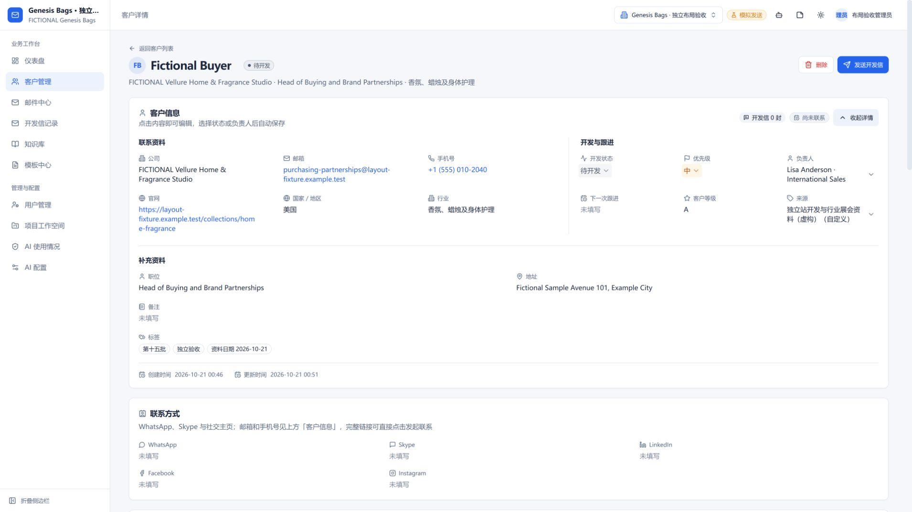
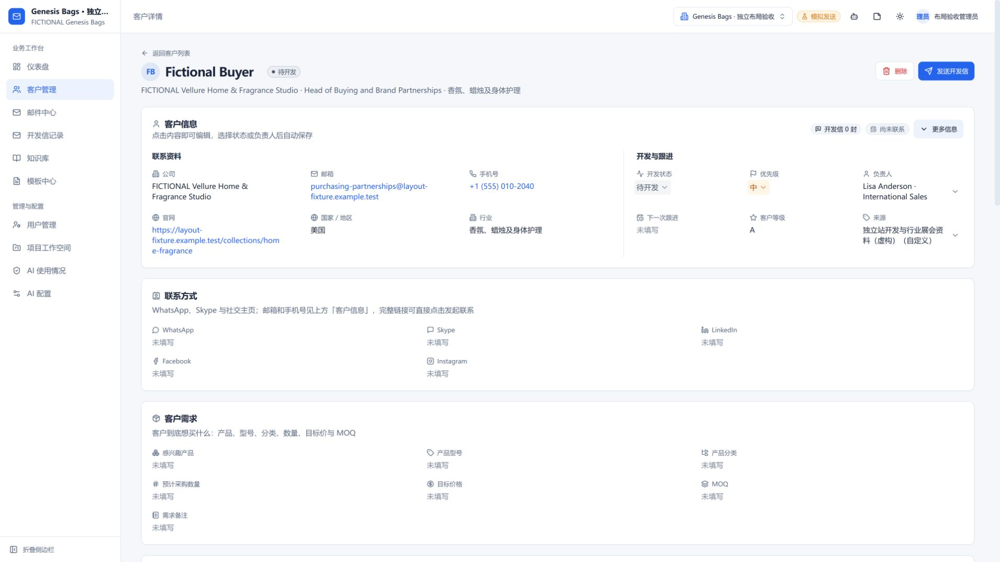

# 客户信息显示调整

2026-10-21。基线 main b707f61 已包含 PR44；本次短分支 codex/customer-info-layout，由用户创建并合并 PR。

- 联系资料按公司、邮箱、手机、官网、国家/地区、行业整理；开发状态、优先级、负责人、下一次跟进、客户等级和来源在“开发与跟进”常驻显示。
- 职位、地址、备注、标签保留在可折叠的补充资料；创建和更新时间移到紧凑页脚。没有新增独立卡片。
- 原三列网格里的 xl:col-span-6 会产生隐式列，把其他字段挤窄。现在独立分组、明确列数，备注和标签只跨当前网格全宽。长负责人和来源允许换行并提供完整名称提示，保留选择即保存和原有清空语义。

验证：前端类型与生产构建、改动文件 ESLint、已有客户字段/草稿载荷5项回归通过。独立内存库的长公司、长邮箱、长负责人、长来源、多行及空备注，在3280/1920/1440/1024/375宽度检查；客户信息各网格 scrollWidth 不超过 clientWidth，未出现隐式额外列。浏览器滚动条会占用10px，实际测量宽度见[记录](customer-info-layout-results/layout-metrics.json)。

页面实际操作：优先级从高改中，清空备注后保存、刷新，均保留结果；展开/收起正常，收起后常用跟进字段仍可见。全部是独立虚构客户，无外部模型请求或真实邮件，不改真实客户数据。纯显示调整，没有为 CSS 编写镜像断言测试。

