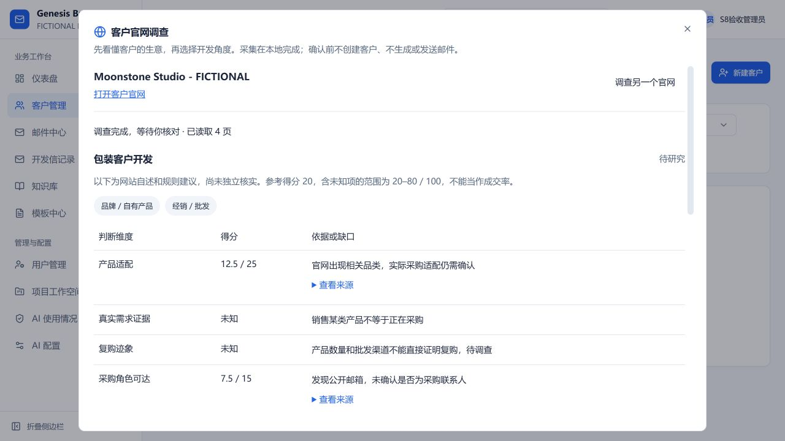
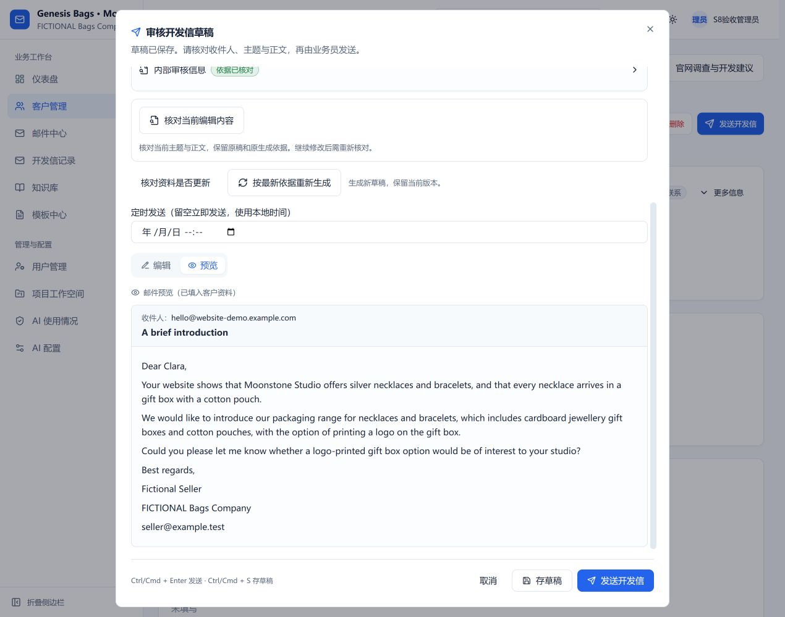
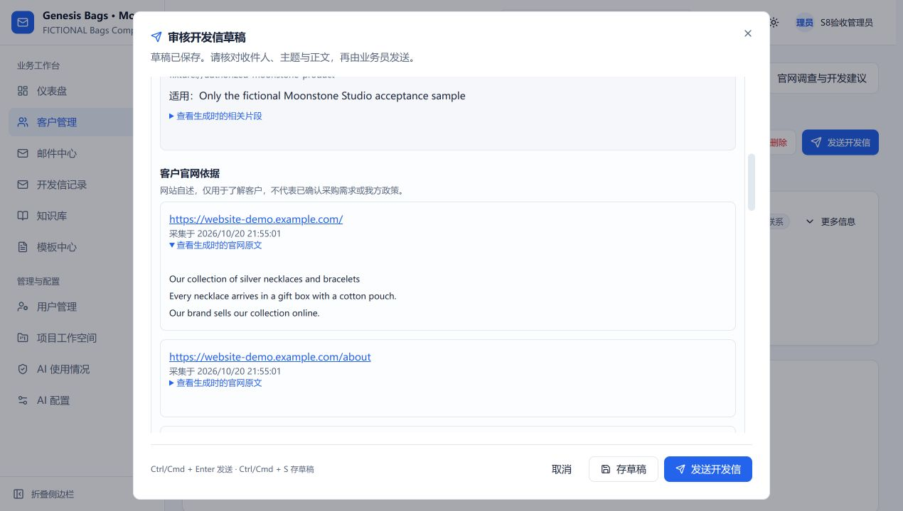
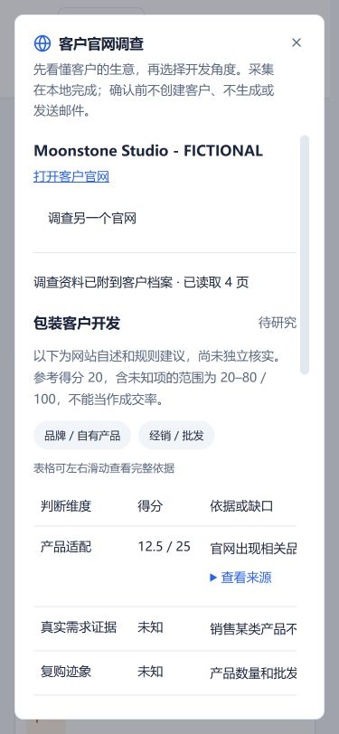

# 客户官网调查与开发信

2026-10-20。沿用现有 CRM，入口是“客户管理 → 官网调查”，已有客户可点“官网调查与开发建议”。当前为 `codex/customer-website-research` 分支预览；从 main `04c356a` 开始，不代表已经合并或上线。由用户创建、合并 PR。

## 业务员怎么用

1. 填一个客户官网网址，点“开始调查”。无需填写行业、评分、模型或供应商政策。
2. 查看客户产品、经营方式、公开联系方式及开发角度。“查看来源”能看到原文、网址和采集时间；未知采购需求、预算、复购、联系人职责保持未知。参考评分不是成交概率。
3. 核对公司名称；联系人和邮箱选填。勾选核对确认后才创建客户，归属当前账号；相同官网的可见客户会先提示关联，关联不覆盖旧字段。
4. 点“分析并准备首封开发信”。这一步才把授权客户资料交给当前配置的 AI，结合当前项目已发布资料生成并逐项核验。可关闭窗口，之后从最近调查继续。
5. 点“打开草稿审核”，进入原有写信页面。内部审核把“项目知识与版本”和“客户官网原文”分开展示；来源、精确引用和待确认内容不自动写进邮件。可以编辑、复核、保存，由业务员自己发送。准备草稿不新增“已发送”跟进。

如果项目还没有发布可用产品资料，可能得到部分草稿。请先在知识库审核发布真实有效的资料；本次没有恢复、导入或自动发布先前清空的知识。

## 从三个 Lead Scout 插件借鉴了什么

实现的是核心工作流：官网调查 → 带来源的开发判断 → 人工核对录入 → 已有 Agent 与知识库 → 人工审核邮件。没有安装扩展、运行 ZIP 内脚本或把插件里的公司介绍、MOQ、认证、交期直接当成已批准业务事实。

后端按当前项目名称、代码、标识匹配 Genesis 包装、IRONHUE 健身器材、VELATURO 墙面艺术规则，其他项目使用通用规则。前端不能指定其他项目规则。当前是少量可解释的品类与经营线索规则，不是插件全部行业策略的完整复刻，也没有校准销售预测模型。

六维参考：产品适配 25、真实需求证据 20、复购 15、采购角色可达 15、近期触发点 15、初步经济性 10。缺证据用未知及区间，不用网站商品数量猜营收或订单。已用包装只支持“备选方案/新系列”的提问，不自动断言现有包装有缺陷。

## 技术与权限边界

- `/api/website-research` 使用现有登录和项目中间件；报告查询/操作按项目与发起人，已关联客户再核对客户权限。转移客户会撤销旧负责人的访问；新负责人只能读取关联的公开资料，不能操作原负责人的任务。
- Mongo 持久任务支持幂等创建、逐页保存、失败原因、显式重试、取消和过期租约恢复；取消后的旧进程不能继续写结果。完成的来源快照不原地覆盖，重新调查创建新版。
- 原生 HTTP 采集逐连接解析并固定公共 IPv4；拒绝内网/IP 字面量/自定义端口、凭证网址、跨站及 HTTPS 降级跳转；无 cookies、登录身份、代理继承或脚本执行。初始页及最多 6 个同站相关页，重定向最多 3 次，单页总时限 12 秒、DNS 4 秒，HTML 2 MiB、robots 128 KiB。robots 拒绝/读取故障不冒充采集成功。
- 保存来源 URL、采集时间、标题、可读正文 SHA-256、HTML 解码文本 SHA-256、原文片段和规则版本。这里保存有界静态 HTML 的文本快照，不是完整网页归档或实时真伪验证。
- 分析输入最多取最新已关联调查的 4 页、每页 4000 字符；官网品类线索参与本项目知识检索，但不自动写入客户的采购需求或我方政策。
- 官网是客户自述。核验使用独立 `website:` 来源和精确 Unicode 引用；带我方主语的混合承诺及数值/交易条件不能借官网过关。我方承诺仍使用发布知识或授权客户约定的原有门禁。输入中的恶意指令不能授权跨项目读取、修改权限或发送。
- 草稿保留生成时的官网快照，复核/发送前核对当前权限和最新快照；任务恢复指纹包含官网依据，任务链接字段变化本身不会导致误失效。重新生成仍保留旧稿。
- 使用现有 Agent 任务、配额、预算、租约、草稿和发送权限，不另建 Agent 平台。`htmlparser2@10.1.0` 作为直接锁定依赖，仅解析静态 HTML。

## 已做的真实验证

新增官网模块 22 项独立测试：公共 DNS 固定、私网/重绑定/重定向拒绝、robots、格式/大小限制、静态解析、三个项目规则、未知项、权限、并发确认、恢复、取消、重复任务、恶意内容、零邮件及官网引用/快照变化。相关后端 185/185，前端原有 43/43；新增测试严格类型、后端类型和构建、前端构建通过。相关 ESLint 无错误，原有审核组件的一项 Hook 依赖警告仍在；未把它写成零警告。

原生 HTTPS 采集实际访问 `https://example.com/` 成功（HTTP 200，标题 Example Domain，正文 156 字符）。安全极端条件由独立传输/DNS 夹具验证。没有把合成网页注入的 UI 测试当成真实客户网站采集覆盖率。

真实模型仅发送用户明确授权的 Moonstone Studio 虚构官网、Clara Stone 虚构联系人和本次测试产品资料到 `https://api.deepseek.com`，模型 `deepseek-flash`。独立内存数据库、真实本地向量检索/重排、本地 SMTP 接收器不转发，没有使用真实客户、真实知识或 ZIP 政策。

首轮与第二轮虽保存了安全草稿，但个性化内容被核验降级，判定未通过。修复官网证据合同、归属识别与已知署名后，干净 `ead31b2` 复验：4 页来源，8 个工作流步骤，11764 ms，经过一次重写/两轮检查，`awaiting_review`、语义检查通过、完整草稿，0 投递、0 跟进。邮件包含客户项链/礼盒/棉袋的官网细节和本项目产品依据，没有编造价格、MOQ、交期或采购意向。最终 `f375097` 仅调整窄屏布局/状态文案；另补恢复指纹及独立回归。失败记录保留，不能将这一例修复复测称为独立质量基准或首轮全通过。

页面验证包含原文展开、核对录入、已有任务生成、打开原有审核/预览、内部官网引用和 759px/375px 布局。375px 下弹窗 clientWidth/scrollWidth 均为 341；评分表内部横向滚动。没有点击发送；现有“发送成功才记跟进”的行为由已有回归保护。

[机器记录](customer-website-research-results/verification.json) · [合成邮件和审核快照](customer-website-research-results/fictional-draft.json)









## 仍未实现及下一步

- 不运行 JavaScript、不登录、不绕过验证码/访问限制，不支持 IPv6-only、非 UTF-8 声明或不接受 identity 编码的网页。失败/缺正文会明确提示人工调查。
- 新闻、公司登记、决策人、进口记录等目前提供人工调查链接，不是假装已经自动核实的外部数据。公开邮箱没有做可投递性或采购身份验证。
- 没有插件 `/api/scout/import` 桥接、完整 40 行业规则、自动多封节奏或自动发信。下一步可先增加管理员维护的项目细分行业规则和独立质量评测，再考虑扩展导入桥接；新外部资料进入模型前仍遵守具体资料/目的地授权。
- 网页语义理解、归属判断和英文写作仍可能保守误判或格式失败。人工审核不可省略；现有 S8 的真实政策审核及独立整封邮件质量门槛没有在本次被放宽或宣布关闭。远端 CI 需创建 PR 后确认。

## 开发者复现

在 `server` 运行 `npm run test:website-research`；新增测试均创建独立 MongoMemoryServer。相关回归命令：

```powershell
node --require ./tests/os-user-info.cjs --import tsx --test --test-concurrency=1 tests/website-public-web.test.ts tests/website-research.test.ts tests/agent.test.ts tests/project-knowledge.test.ts tests/knowledge-workflow.test.ts tests/knowledge-facts.test.ts tests/knowledge-governance.test.ts
npx tsc --noEmit --strict --esModuleInterop --skipLibCheck --target ES2022 --module CommonJS --moduleResolution Node tests/website-research.test.ts tests/website-public-web.test.ts
```

这些测试的模型为 mock/可观察的独立语义测试器，验证边界和工作流；真实 DeepSeek 单例是额外获授权的本地验收，不能用 mock 代替模型质量结论。截图、结果快照只含虚构资料；凭证、数据库连接和控制令牌不入库。
