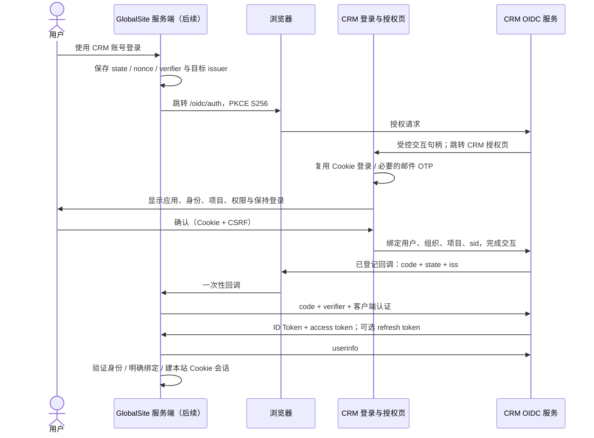

# C5：使用 GlobalCRM 账号登录 — OAuth / OIDC 设计

日期：2026-11-06
仓库：GlobalCRM；分支：feat/globalsite-c5-oauth；代码基线：7645191037b4fa9be9096639d02ffe9f75e3c5b3。
**状态：待用户确认的设计提案，尚未实现。本文不代表接口已上线。确认前只提交文档，不改业务代码、OpenAPI、冻结快照、依赖或数据库。**

## 1. 推荐方案与交付边界

用户在 GlobalSite 点击“使用 GlobalCRM 账号登录”，前往 CRM 登录并选择一个自己有权限的项目；授权页明确显示申请应用、可读取的信息、保持登录时间。确认后 CRM 证明“这个人是谁、选择了哪个组织和项目”，GlobalSite 在自己的服务端建立自己的登录会话。

推荐以下默认规则，批准本文即表示批准这些产品选择；实际生产地址和密钥仍由部署人员配置：

| 决策 | 推荐值 | 用户可理解的影响 |
|---|---|---|
| 接入应用 | 首期只开放官方 GlobalSite，由 CRM 平台管理员预先登记 | 暂不开放任意第三方自助申请 |
| 登录与业务连接 | 分开授权、分开吊销 | 用 CRM 登录不会自动同步产品或获得客户数据 |
| 组织与账号 | 不按邮箱自动合并账号，不自动加入已有 GlobalSite 企业 | 避免误把不同人的账号或不同公司的数据连在一起 |
| 项目 | 每次授权明确选择一个有权限的项目 | 不默认选择“第一个项目”，不继承 CRM 管理员在本站的管理权 |
| 保持登录 | 默认不申请；用户勾选后最长 30 天，受 CRM 原会话有效期限制 | 7 天未使用或原 CRM 会话结束，需要重新登录 |
| 运行环境 | 实现时把 CRM 的 OAuth 运行基线对齐 Node 22 的受维护补丁版本 | 保持 Express 4 / TypeScript / Mongoose 8，不升级无关依赖 |

本次只设计 CRM 身份提供端。GlobalSite 登录按钮、回调、账号绑定、本地会话加密存储和撤销检查在后续 **GlobalSite 单仓任务**实现；本任务不得修改该仓库。CRM 端通过模拟服务端客户端验收，不宣称双仓登录入口已完成。

业务同步、询盘写入仍只经 [Integration API 契约](integration-v1.openapi.yaml) 和 [双方对接设计](globalsite-对接设计.md)，继续使用 C2 服务凭证、scope 和显式绑定项目。C5 身份协议是额外的登录入口，不允许 OAuth 令牌替代 IntegrationCredential，不建立跨仓代码或数据库依赖。

## 2. 已核对的现状与必须补足的证据

以下是代码现状，不是契约差异；C5 尚无已实现的对外接口：

| 代码位置 | 现状 | C5 处理 |
|---|---|---|
| server/src/routes/auth.routes.ts、controllers/auth.controller.ts | 密码登录；启用两步验证时先发邮件验证码，验证通过后 completeLogin 才创建会话 | 复用完整链路，绝不能从“待验证码”状态授权 |
| server/src/services/auth.service.ts | 密码失败锁定、AuthSession、刷新令牌轮换、注销；部分历史 JWT 没有 sid | 授权仅接受当前有效的 CRM Cookie 会话及 sid；历史无 sid 的 Bearer 不可用 |
| server/src/models/AuthSession.ts | 保存刷新令牌哈希、到期和撤销状态；现为全局身份安全记录 skipTenant | 保持现有集合和语义，补可选认证证据；新 OAuth 业务模型必须 tenant |
| server/src/utils/auth-cookies.ts | access Cookie 路径 /api；refresh 路径 /api/auth | /oidc 看不到原 access Cookie；必须通过第 4 节的交互桥接，不能假设自动单点登录 |
| server/src/models/User.ts | organizationId、角色、项目列表、twoFactorEnabled；无邮箱验证状态 | 不声称邮箱已验证；不凭用户名、邮箱或角色建立跨系统授权 |
| server/src/middleware/auth.middleware.ts | 最新用户/组织状态检查；requireProject 有默认项目回退；viewer 限制写操作 | OAuth 显式校验选择项目，不走默认回退；自己的授权确认和撤销按账户安全权限开放给 viewer |
| server/src/services/user.service.ts、password-reset.service.ts | 改密码/禁用可撤销原会话 | OAuth 在线依赖同一个 sid，并增加安全变更版本，避免漏掉会话证据失效 |

未来新增 AuthSession.authenticatedAt、amr（仅 pwd / otp）、mfaVerifiedAt、securityVersionAtLogin；User 增加 oauthSecurityVersion。字段只在真实完成既有登录流程后写入，刷新会话不更新 authenticatedAt，不伪造 MFA。旧会话没有证据时，授权流程要求重新登录；开启 2FA 的用户必须存在本次有效 OTP 证据。修改密码、重置密码、启停 2FA、变更邮箱或禁用账号时递增安全版本，并使旧 OAuth 授权不可继续使用。该改动须回归现有登录与 2FA 测试。

首次授权、增加 scope、变更项目及客户端敏感配置要求最近 10 分钟内完成登录；超过则重新认证；如果账号启用了 2FA，重新走现有邮件 OTP。不替用户关闭或绕过 2FA，不把邮件 OTP 宣称为抗钓鱼认证。

## 3. 协议、组件与唯一契约

采用 OAuth 2.0 授权码 + PKCE S256，并以 OpenID Connect 返回身份。禁止 implicit、password、client_credentials、设备码、动态客户端注册及浏览器内公有客户端；只开放 server-side confidential client。PKCE 与客户端认证同时使用。

推荐 oidc-provider 受维护的 9.x，锁定实现时核验过的补丁版本；2026-11-06 官方仓库显示 9.13.3，官方 CI 最低 Node 22。它可挂载到 Express；CRM 仍使用 Express 4。需要先做兼容性验证，不能把“库已认证”称为本系统已通过认证。[库文档](https://github.com/panva/node-oidc-provider/blob/main/docs/README.md)、[官方运行矩阵](https://github.com/panva/node-oidc-provider/blob/main/.github/workflows/test.yml)。

实施第一步验证协议库与自定义 Mongo adapter 能满足：随机令牌只存摘要、授权码原子消费、刷新重用检测、grant 事务、tenant 上下文和 CRM 会话绑定。若适配做不到，暂停报告并修订设计；不得悄悄换成自行编写的密码学或保存明文令牌。库内部必须持久化的交互 payload、nonce/state、恢复票据等敏感值以独立用途的 credential-crypto 加密；可从随机句柄计算查找摘要，不能为兼容示例 adapter 明文保存令牌。

设计确认后，先把 C5 机器定义加入 **现有** integration-v1.openapi.yaml：新增身份协议 tag、C5 命名组件、端点级 servers 和安全定义；不新建第二份权威 OAuth YAML，也不把定义复制到 GlobalSite。新增端点显式覆盖顶层服务凭证 security（公开端点 security: []），避免误继承 Integration API 的认证。身份端点使用下表标准响应，不套业务 Integration API 的 success 包装；旧服务凭证端点继续原有包装与链路。更新双方对接设计解释版本和身份/业务边界；C5 独立冻结，旧端点与 C1–C4 快照字节不变。

单进程部署：CRM web 反向代理到同一可信 origin 下的 /api、/oidc；Express 挂载 provider，数据库用现有 CRM 数据库中的新集合，不改变库名与已有集合。多副本共享 Mongo 存储、签名 keyring 与限流后端；协议状态不得仅保存在进程内，不依赖粘性会话。Worker 只负责清理、审计归档，不参与同步签发。

## 4. 授权与回调流程

1. GlobalSite 服务端生成独立随机 state、nonce、PKCE verifier，均不少于 256 位随机熵（verifier 使用 43–128 个允许字符），保存于一次性服务端登录事务；浏览器只持有 HttpOnly 的事务 Cookie。state/nonce/verifier 不能跨请求复用。PKCE challenge 为 S256，不接受 plain。[PKCE](https://www.rfc-editor.org/rfc/rfc7636.html)
2. /oidc/auth 在登录前校验 client、精确 redirect_uri、response_type=code、scope、nonce、state、S256 和长度；无效 client/redirect 在 CRM 本地显示错误，绝不跳到未登记地址。client_id 是标识，不是证明。不得接受 request_uri、远程 JWKS 或任意 logo URL 触发服务端抓取。
3. provider 创建 10 分钟交互，跳 CRM 自有授权页面。使用独立随机交互 Cookie（生产 Secure、HttpOnly、SameSite=Lax、Path=/，不覆盖原 CRM Cookie），绑定 uid 和浏览器。UID 只是一次性句柄，不是授权凭证。原 CRM access Cookie 仍保持 /api 路径；授权页向 /api/auth/oauth/interactions/{uid} 查询，由现有登录 Cookie 识别用户。无会话则去 CRM 登录；返回地址只允许服务器保存的站内交互路径。
4. 交互 GET 不授予权限。确认/拒绝 POST 验证 CRM Cookie + sid、双提交 CSRF、可信 Origin、交互 Cookie、有效 uid、用户与认证新鲜度；重新读取当前组织和项目权限。完成后用 provider 支持的交互恢复机制产生一次性恢复票据，只能恢复原请求，不接受客户端改写 userId/projectId/scopes/redirect。并发两次确认仅一次成功。
5. 界面显示应用名称/运营方、回调主机、当前 CRM 账号与组织、单个项目、每个 scope 的中文/英文含义、保持登录时长、隐私链接、确认/拒绝/切换账号；不显示 secret。用户必须主动确认首个授权、扩大 scope 或项目变化；同一有效 grant 的同权限复用可免重复确认，prompt=consent 强制再次显示。prompt=login 强制重登；prompt=none 无法无交互完成则返回 login_required / consent_required / interaction_required，不绕过确认。
6. 授权码绑定 client、redirect、S256 challenge、nonce、用户、组织、项目、grant、sid、认证时间与安全版本。回调只带短期 code、原 state 和 issuer（iss）；不带 access/refresh token 或个人资料。登录回调与授权页 no-store、no-referrer、禁止第三方脚本，不允许写代理访问日志完整 query。
7. GlobalSite 校验 state、预期 iss 后，在服务端换令牌；严格验证 ID Token 的签名、允许算法、kid、issuer、audience、exp/iat、nonce，以及 userinfo.sub 与 ID Token.sub 一致。不可跟随 token 内任意 jku/x5u；JWKS 仅从预登记 issuer 元数据读取。[发行方混淆防护](https://www.rfc-editor.org/rfc/rfc9207.html)
8. code 换取失败且无法确认结果时，重新发起登录，不重放明文响应。回调立刻清理 URL 中的 code/state，消费并删除本地登录事务，拒绝重复回调。原 GlobalSite 密码登录仍独立可用。

## 5. 客户端登记与生命周期

首期只允许平台管理员登记官方 GlobalSite（后台页面 + 同服务的部署脚本）；普通项目管理员不能创建 OAuth 客户端冒充官方应用。各环境使用不同 client_id、secret、回调白名单。

登记字段：client_id（服务端随机不可改）、展示名称（1–80）、运营方、隐私政策和服务条款链接、redirect_uris（1–5 个精确地址，每个 <=2048）、allowedScopes、allowedOrganizationIds 或 official-active-organizations 策略、status、登记组织、创建人、secretHash、secretVersion、createdAt/updatedAt。展示文本转义，链接只允许审核过的公开 HTTPS；首期不自动抓取头像、域声明或远程配置。

- 仅允许 HTTPS 回调，无 fragment、userinfo、通配符、开放重定向；精确匹配 scheme/host/port/path/query，不自行宽松规范化。首期每个客户端回调统一主机，pairwise sector 取该主机。
- 非生产可另登记精确的 HTTP loopback（127.0.0.1 / [::1]）回调和端口；只对显式开发客户端启用，不允许任意内网、localhost 别名或生产配置继承。开发请求需从本机访问；issuer、回调与浏览器访问主机保持一致。
- 认证方法仅 client_secret_basic；secret 至少 32 随机字节，创建/轮换只返回一次，仅服务端保存，CRM 只保留带盐哈希；不支持 client_secret_post/query。secret 比较走固定时间的安全验证。
- 轮换新 secret 立即生效，旧 secret 默认即失效；如管理员明确选择，可设 <=24 小时双密钥部署宽限。宽限不延长已签发令牌，过期旧密钥不能换令牌。泄漏应急轮换同时停用客户端、撤销其 grant/family，再重新启用。
- 修改 redirect、组织允许范围或 scope 上限递增配置版本、取消未完成交互/授权码；新增权限不自动扩权，已有 grant 仍仅原 scopes；缩小权限立即在线收紧或撤销。禁用客户端立即拒绝授权、交换、刷新、userinfo。
- client secret 永不进 URL、日志、审计 detail、浏览器 storage、全局 store、截图、测试快照。管理员操作使用当前平台权限 + Cookie/CSRF + 最近 10 分钟认证，写脱敏审计。

## 6. Scope、claims 与用户资料

下列为待审批的 C5 scope；与 IntegrationCredential 的 scope 枚举完全分开，不写入 C2 凭证预设。

| scope | 默认 | 可获得内容 | 不授予 |
|---|---|---|---|
| openid | 必选 | 稳定 sub 与标准 ID Token | CRM API 访问 |
| profile | 默认 | name（CRM displayName，有则返回；不回退暴露 username） | 电话、内部角色、头像或其他未批准字段 |
| crm.context | 默认 | 用户主动选择的 organization_id、organization_name、project_id、project_name | 其他组织/项目、CRM 管理权、成员名单 |
| email | 默认不选，可选 | 当前邮箱及 email_verified=false；无邮箱则两字段均不返回 | 邮箱归属保证、邮箱自动绑定 |
| offline_access | 默认不选，独立确认 | 轮换 refresh token，可保持本次登录 | 永久授权、后台同步业务数据 |

当前 User 没有邮箱验证证据，**不能返回 email_verified=true**。邮件 OTP 登录不自动替代持久邮箱验证流程；后续另立任务增加验证状态后再升级声明。[OIDC claims 与离线访问](https://openid.net/specs/openid-connect-core-1_0.html)

ID Token 最小包含 iss、sub、aud、iat、exp、auth_time、nonce；amr 只填写真实记录的 pwd/otp。crm.context 的组织/项目字段放 userinfo 的 crm_context 对象，均为字符串且必选；仅授予该 scope 时返回。name、email 不放 URL；未授予的字段完全省略，不返回 null 冒充已授权。userinfo 总有 sub；无 profile/name 时省略 name。首期不声明 acr 等级、不返回 CRM role 或 isPlatformAdmin。Discovery 仅声明实际支持的 claims/scopes。

采用 pairwise subject：按用户真实组织 + 用户 ID + sector（登记的回调主机）生成并持久化随机 sub；同一 issuer/sector 下稳定，不能由 email、用户名、可变展示名计算。唯一 (organizationId,userId,sector) 与全局 sub 唯一，删除用户后不重用。不同 client_id 但同 sector 遵循同 sector 的标识规则；不把“每 client_id 一个 sub”误称标准 pairwise。首期不支持多主机 sector_identifier_uri 远程抓取。变更 sector 或 issuer 是迁移事件，不静默把新身份匹配旧邮箱。

## 7. 令牌、有效期与原子性

以下时长为本产品建议，不是声称标准强制值：

| 对象 | 有效期 | 服务端保存与约束 |
|---|---|---|
| 授权交互/恢复票据 | 10 分钟；恢复票据一次性 | 随机句柄摘要、加密 payload、浏览器绑定；拒绝后立即结束 |
| authorization code | 60 秒，一次性 | 随机 >=256 位，只存 SHA-256；绑定全部上下文 |
| ID Token | 5 分钟 | RS256，专用私钥，公开 JWKS；不作为业务 API Bearer |
| access token | 10 分钟 | 不透明随机 >=256 位，只存摘要，audience 固定本 issuer 的 userinfo |
| refresh token | 闲置 7 天，首次授权后绝对最长 30 天 | 每次轮换，只存摘要；受原 sid 的有效性和到期上限约束 |
| 刷新重用证据 | 至少保留至 family 绝对到期 + 7 天 | 已消费 token 摘要 retained，过期/撤销仍不能伪装为新 token |
| 时钟容差 | 最多 60 秒 | 服务器 UTC/NTP；不让容差延长 code 可消费窗口 |

每次交换、刷新、userinfo 都查当前客户端、grant、用户状态、安全版本、真实组织状态、所选项目状态和当前成员权限、原 CRM AuthSession。租户插件与显式组织/项目/用户条件共同生效；Mongo TTL 仅清理，所有权限/过期检查在请求时执行。

授权码事务：在同一事务内核对 PKCE 和绑定，条件式 usedAt 为空且未过期地消费 code，并创建 grant/family/token 记录；任一步失败整体回滚。只有提交后返回令牌。重复兑换不能产生第二组令牌；对已消费 code 的有效客户端及正确绑定重放吊销关联 family，错误 client/verifier 不得被用来吊销他人令牌。网络断开后客户端重走登录，不缓存可被反复领取的明文令牌响应。

刷新事务：校验当前摘要未消费，条件式消费旧 token，插入新摘要及 access token，更新 lastUsedAt；绝对到期不变，不延长到原 sid 当前到期之后。有效客户端重用已消费 refresh token 视为泄漏，撤销整个 family（包括新 token）。默认不设重用宽限；GlobalSite 同一个 family 串行刷新、进程间加锁。超时未知结果重新登录，不能在重试中保存/重复返回明文 refresh token。旧 access token 可存活到自身到期，但仍受 family 实时撤销检查。

仅给显式同意 offline_access 的授权签发 refresh token；token 响应 scope 返回实际授权交集。刷新不能增加 scope、组织或项目；要更换必须新的授权。令牌响应 no-store、Pragma:no-cache，不写 debug、代理 body 或错误对象。

## 8. 组织、项目与 GlobalSite 账号映射

CRM 不接收 GlobalSite 指定的任意 organizationId 当作授权身份。登录用户必须有明确真实 organizationId，且组织 active/trialing；缺失组织的历史用户或平台操作员不能借 bypass 代表任意租户登录，需先补齐合法账号归属。

项目选择仅来自“该组织内 active 项目”与用户当前权限的交集：admin 为本组织有权项目，其他角色依 projectIds；project_admin 也不能跨组织。即使 UI 选择合法，提交、code/token/refresh/userinfo 均重新校验。请求 header 的 X-Project-Id 或默认项目不得覆盖 grant.projectId。一个 grant 固定一个项目，换项目形成独立授权。

GlobalSite 后续必须遵守：

- 身份唯一键为 (issuer, sub)，而不是 email、CRM userId、projectId。
- 首次外部登录先创建待完成 onboarding 的独立身份；不能因为同 CRM 组织或项目就自动加入已有本站组织。已有本站账号绑定必须已登录该账号、CSRF 校验、近期重新认证并明确确认；发现同一外部身份已绑定别人时拒绝。
- CRM context 是候选关联信息；由 GlobalSite 组织管理员确认本站组织与 (issuer,crmOrganizationId,crmProjectId) 的关系；记录 Membership 来源与审计。多个 CRM 项目可按产品规则明确绑定，禁止默认为相同企业共享权限。
- CRM admin / project_admin 不是本站管理员。首次新建本站组织按本站注册规则建立管理员；加入已有组织遵循邀请/成员管理，不靠 CRM role 提权。
- 撤销登录授权只解除该登录通道或迫使重新登录，不删除本站企业、已同步产品、询盘；C2 服务连接保持独立。断开 C2 服务连接也不冒充撤销 OIDC 登录。

## 9. 吊销与已授权应用管理

账户安全中增加“已授权应用”：任何正常用户（包括 viewer）可查看并撤销自己的授权。展示应用名称/运营方、授权项目、scopes 的可读说明、创建/最近使用时间、到期与状态。不可查看他人 grant、client secret 或 token。撤销一个 grant 影响其全部登录 family；提供二次确认的“撤销此应用全部项目授权”。

| 触发 | CRM 侧处理 | GlobalSite 侧效果和限制 |
|---|---|---|
| POST revoke 一个 refresh/access token | 验证所属客户端；撤销该 family 及派生 token | 下次在线检查即拒绝 |
| 用户撤销某 grant | grant revokedAt，所有 family/access 失效，未使用 code 失效 | 下次在线检查退出对应外部登录 |
| CRM 退出当前会话 | sid 被撤销；由它派生的 family 即不可用 | 不把用户的其他独立 CRM 会话误撤销 |
| 改密码/重置/2FA 或邮箱变更/禁用 | 安全版本变更，吊销受影响 grant/family；原会话按原安全语义处理 | 重新认证，不继续使用旧证据 |
| 组织暂停、项目禁用或移除权限 | 在线检查 fail closed；记录并收敛相应授权 | 不允许读原项目 context |
| 客户端禁用/密钥泄漏 | 停用并撤销其全部 grant/family | 需应用恢复后重新授权 |

吊销持久化事务与审计同提交；请求时以 grant/family/sid 的状态作为实时真值，批量 token 标记可以异步，不能等 Worker 才失效。重复撤销幂等。RFC7009 对无效或已撤销 token 返回 200，不能借错误响应探测别人的 token。[令牌吊销](https://www.rfc-editor.org/rfc/rfc7009.html)

**边界：签名 ID Token 的离线验签无法即时知道撤销，CRM 也无法仅靠吊销接口删除 GlobalSite Cookie。** 后续本站实现必须在该外部身份会话每次受保护请求时由服务端在线检查 userinfo（access 到期先刷新；无 refresh 则重新登录），不缓存“仍有效”结果。超时返回可重试的连接错误并暂停此登录通道；明确无效时退出，不能把网络故障当作身份有效。后续若改为短期缓存，需要重新确认撤销延迟；Back-channel Logout / Introspection 不在本期对外开放。本站本地密码登录与 CRM 后台服务同步不受此登录通道网络故障影响。

## 10. 待实现端点草案

推荐固定发行者示例 https://crm.example.com/oidc（仅占位，不是实际部署地址）；实际 issuer 必须从可信部署配置读取，不能根据请求 Host 拼接，发布后不随意变更。下面是设计评审清单，确认后转入唯一 YAML；当前不存在已发布 C5 接口。

| 方法与路径 | 权限 / 输入 | 输出 / 关键错误 |
|---|---|---|
| GET /oidc/.well-known/openid-configuration | 公开，无用户数据 | issuer、各端点、code/S256/RS256、scopes、pairwise 等实际支持元数据 |
| GET /oidc/jwks | 公开，限流，可缓存 | keys 只含公钥与 kid；不返回私钥或对称 key |
| GET /oidc/auth | client_id、response_type=code、redirect_uri、scope、state、nonce、code_challenge、code_challenge_method=S256；可选 prompt、max_age | 受控登录/确认交互或已验证 callback 的 code/state/iss；invalid_request / invalid_scope / access_denied 等 |
| POST /oidc/token | form-urlencoded；client_secret_basic；grant_type=authorization_code + code + redirect_uri + code_verifier，或 refresh_token + token | 标准 access_token/token_type=Bearer/expires_in/scope/id_token；显式离线授权才有 refresh_token；400 invalid_grant，401 invalid_client |
| GET /oidc/me | 仅本 provider 的 OAuth Bearer access token，不接受 CRM Cookie/服务凭证 | userinfo：sub、按 scope 投影的 name/email/email_verified/crm_context；401 invalid_token，WWW-Authenticate |
| POST /oidc/token/revocation | form-urlencoded；client_secret_basic；token 与可选 token_type_hint | 有效/未知 token 均 200；客户端认证失败 401 |
| GET /api/auth/oauth/interactions/{uid} | CRM Cookie + 原 sid，交互 Cookie；未登录只返回登录要求，不暴露授权资料 | 应用公开投影、可选项目、已申请权限、近期认证要求；404 不存在/过期 |
| POST /api/auth/oauth/interactions/{uid}/decision | 同上 + CSRF/Origin；decision=approve/deny、projectId、确认的 scope 子集 | 完成交互的受控 resume 地址；409 已消费；拒绝不会形成 grant |
| GET /api/auth/oauth/applications | CRM Cookie，当前用户与组织；游标分页，limit<=100 | 自己的授权摘要；无 token/secret |
| POST /api/auth/oauth/applications/{grantId}/revoke | CRM Cookie + CSRF，自己所有；viewer 可用 | 幂等成功；他人/跨租户 404 |
| POST /api/auth/oauth/applications/revoke-all | CRM Cookie + CSRF；clientId 限制范围，明确确认 | 撤销本人对此应用所有项目授权，不动别人的 grant |
| GET/POST /api/oauth/clients | 平台管理员；创建需 CSRF + 近期登录 | 登记元数据；仅创建响应一次性 secret |
| PATCH /api/oauth/clients/{clientId} | 平台管理员 + CSRF + 近期登录；字段白名单 | 更改/停用及版本，不返回 secret |
| POST /api/oauth/clients/{clientId}/rotate-secret | 同上；graceSeconds 0..86400 | 一次性 secret 与旧密钥失效时间 |

/oidc/me 是推荐 userinfo 路径，Discovery 的 userinfo_endpoint 指向它；不与现有 /api/auth/me 混用。标准身份端点不走 Integration API 的 requireServiceToken/requireScope，也不接收 X-Project-Id 来改变上下文；私有管理接口仍按 CRM 的响应规范、会话/CSRF 和角色审计。

max_age 只能要求更近认证，不能放宽 10 分钟安全要求；max_age=0 与 prompt=login 强制重登。prompt 参数不支持的值明确拒绝；authorization 错误仅在 client/redirect 已验证后带原 state/iss 返回。请求重复参数、超长、未知敏感参数、scope 超出登记范围均校验拒绝。协议库真实路径/元数据须在实现首步验证，与此提案不一致则先修订再冻结，不能只改实际行为。

## 11. 数据结构、tenant 与迁移提案

所有新模型 import tenant-setup 并注册 tenant 插件；含 organizationId、timestamps、显式作用域过滤。下表仅为设计，不创建集合。U=唯一索引；TTL 仅用于清理。

| 模型 | 主要字段 | 索引 / 关系 |
|---|---|---|
| OAuthClient | 登记组织、clientId、元数据、回调/允许 scope/组织策略、secretHash/previousSecretHash/到期、配置版本、status | U(clientId)；(organizationId,status)；敏感字段 select:false |
| OAuthSubject | 用户真实组织、userId、sector、随机 sub | U(organizationId,userId,sector)，U(sub)；用户删除后保留不重用标识的墓碑 |
| OAuthInteraction | 所属组织、uidHash、浏览器绑定、加密请求 payload、状态、clientVersion、expiresAt、resolvedUserId | U(uidHash)，TTL(expiresAt)；匿名阶段在登记组织下，确认后生成用户真实组织内的业务记录 |
| OAuthAuthorizationCode | 用户组织、codeHash、clientId、grantId、grantRevision、userId、projectId、sid、redirect、PKCE、nonce、authTime、securityVersion、expiresAt、usedAt、familyId | U(codeHash)，(organizationId,grantId)，TTL(cleanupAt)；已消费留证据至 family 绝对到期 +7 天 |
| OAuthGrant | 用户组织、userId、clientId、projectId、sector/sub、scopes、lastConsentSessionId、安全版本、revision、revokedAt、lastUsedAt | (organizationId,userId,clientId,projectId,revokedAt)；U(organizationId,userId,clientId,projectId)；重新同意递增 revision，旧 revision 的 code/family 不复活 |
| OAuthTokenFamily | 用户组织、grantId、grantRevision、sid、generation、createdAt、absoluteExpiresAt、idleExpiresAt、revokedAt/reason | (organizationId,grantId)，TTL(cleanupAt)；一次 grant 可有多个浏览器 family |
| OAuthRefreshToken | 用户组织、tokenHash、familyId、generation、consumedAt、expiresAt、cleanupAt | U(tokenHash)，U(organizationId,familyId,generation)，TTL(cleanupAt)；保留消费证据 |
| OAuthAccessToken | 用户组织、tokenHash、familyId、grantId、audience、scopes、expiresAt、revokedAt | U(tokenHash)，(organizationId,familyId)，TTL(expiresAt) |

即使未申请 offline_access，仍创建短期 family（10 分钟，且不晚于原 sid 到期）供 access token/code 重放撤销关联。OAuthGrant 表示同意的范围与版本；原 AuthSession 绑定放 family/code，lastConsentSessionId 只用于审计，不作为所有 family 的唯一登录真值。重新登录可在同一有效授权 revision 下创建新 family；重新同意或撤销后再授权递增 revision，使旧 code/family 永久失效。同意复用只复用范围，不延长旧 family。

### 无登录时的客户端查找与租户边界

客户端登记属于平台管理员的真实登记组织，但官方 GlobalSite 被允许供多个客户组织登录。匿名授权请求还不知道用户组织，不能假造一个用户租户，也不能把 client 所属组织当成登录者组织。

提供专用、范围受限的 OAuth registry / token-handle resolver：仅按精确 clientId（或随机 token/code 的 SHA256）查找定位记录，只投影登记公开信息、不可变归属与校验所需字段；随后在该记录确定的组织内恢复 runWithTenant，执行完整 client/user/project 校验。禁止接受请求自带 organizationId 作为解析依据；禁止开放任意查询、列表、populate 或业务数据 bypass。匿名 interaction 使用登记组织；完成交互时切入已验证用户组织创建 grant/code，不把匿名记录直接改成跨组织业务记录。family/code 保存签发时 grantRevision，每次消费和 userinfo 都与当前 grant.revision 比较；新模型不使用 skipTenant；特殊 resolver 作为审查重点单独测试和审计，不能扩散到客户/产品查询。

### 迁移与回滚

建议实现时新增迁移 **011（若届时已占用则取下一个编号）**，创建上述索引，并给 AuthSession/User 增加可选安全证据字段。不改现有库名、集合名、凭证索引与现有记录归属。旧会话缺字段时要求 OAuth 重新认证，不离线填充虚假 MFA/邮箱验证。已有用户密码登录不因没有 OAuth 配置失败。

Mongo 事务要求与 C3/C4 相同的副本集能力；不具备事务/唯一索引时只关闭新 OAuth 功能并告警，不能退化为不安全的签发。迁移先查冲突，幂等执行；失败不启动新 OAuth 签发。回滚关闭 OAuth 路由与官方客户端、撤销 C5 grant，不删除旧数据或影响 IntegrationCredential；兼容保留新增可选字段与集合，后续明确清理策略。

## 12. 配置、签名密钥与部署

实现阶段才在 .env.example / production.env.example 同步新增可选配置（命名待随机器契约最终固定），本阶段不写真实配置：

| 建议配置 | 行为 |
|---|---|
| OIDC_ENABLED=false | 默认禁用；旧 CRM、Integration API 启动/运行不受影响 |
| OIDC_ISSUER | 固定公开 HTTPS issuer，可信配置，不从 Host 推断 |
| OIDC_PUBLIC_WEB_ORIGIN | CRM 授权页可信 origin，精确值，防开放返回地址 |
| OIDC_SIGNING_KEYRING_PATH | 运维挂载只读、受权限保护的私钥 keyring 路径；示例仅占位，文件不入 git |
| OIDC_ACTIVE_KEY_ID | 当前签名 kid，必须对应 keyring 内的专用 RSA 私钥 |
| OIDC_ALLOW_LOOPBACK=false | 仅非生产精确 loopback 开发客户端例外 |
| OIDC_RATE_LIMIT_STORE_URL | 可选共享限流服务；单进程内存降级，多副本启用前必须配置共享后端 |

签名 RS256，建议 RSA 3072 位；只允许批准算法，拒绝 none/对称算法混淆。专用 OIDC 签名 keyring 不复用 CRM JWT_SECRET、service token、Webhook 或邮件密钥。私钥从部署 secret 文件读取，内存使用；不通过 UI 返回、日志或 Mongo payload 保存，公开 JWKS 只输出公钥。

常规轮换先公布新公钥再签名，新旧 kid 并存；旧公钥至少保留 7 天，覆盖 ID Token、时钟容差与客户端 JWKS 缓存（建议 <=5 分钟）。紧急泄漏撤销相应客户端/授权并强制在线检查，不能声称删除 JWKS 就能清除所有离线缓存。issuer 变更需显式迁移身份映射与重新授权。

启用缺关键配置时仅新 OAuth 端点 503、readiness 报该可选功能不可用；核心 CRM 不能被可选服务阻断。日志只报缺失项名称，不输出密钥/原始地址 query。迁移与配置准备完成后灰度官方客户端，检查成功率、invalid_grant、刷新重用、拒绝授权、限流，不记录令牌值。

## 13. 安全、限流、审计与保留

| 风险 | 控制与可验证结果 |
|---|---|
| code 截获 / 登录 CSRF / 应用混淆 | S256 + secret、state/nonce、iss、严格回调、浏览器交互绑定；篡改或重放拒绝 |
| 越权与默认项目 | 用户组织与当前权限重复核验；一个 grant 一个项目；不走默认项目回退或平台 bypass |
| 假邮箱 / 账号接管 | 不声明未经证明的验证状态，不按邮箱合并；已有账号绑定需要本站强认证 |
| 原会话绕过 2FA | sid 与真实认证证据必需；旧会话重登，配置变更安全版本失效 |
| XSS / 令牌泄漏 | 服务端 BFF、HttpOnly Cookie、CSRF、CSP frame-ancestors 'none'、no-store/no-referrer、敏感页无第三方资源 |
| SSRF / 开放跳转 | 预登记精确回调；不抓任意 client metadata/JWKS/sector URL，不使用调用方 Host 拼 issuer |
| 刷新重用 / 并发消费 | Mongo 事务 + CAS + 唯一索引；跨副本单次签发；重用吊销 family |
| 日志泄漏 | 对新路径代理/access/error/APM 的 query、Authorization、Cookie、body 做路由级屏蔽；只记 event、匿名关联 ID、结果、耗时 |
| 授权后权限变化 | code、refresh、userinfo 实时查 grant/family/sid/安全版本和项目，不信过期角色缓存 |

建议初始限额：/auth 每 IP 30/分钟、每 client 300/分钟；token 每 IP 60/分钟和每 client 120/分钟；userinfo 每 client+subject 300/分钟；授权确认/撤销每用户 20/分钟；管理员登记每用户 10/分钟。均 429 + Retry-After，计数键只用服务器验证的 ID 或匿名摘要；不把公开 client_id 视为绕过 IP 限流的身份。生产精确配置 trust proxy，防伪造转发 IP；多副本统一计数。后续本站逐请求 userinfo 需求可能需调整，不能因限流失败放行未验证请求。

审计：客户端创建/轮换/停用、授权同意/拒绝/撤销、授权码重放、refresh 重用、组织/项目权限失效，包含组织、actor、clientId、grant/family 的内部 ID、项目、scope 名称、结果、requestId；不含 code、token、nonce、state、verifier、secret 或完整个人资料。脱敏失败日志不输出 provider 原始异常对象。保留建议：安全审计 180 天；已撤销 grant/family 元数据 90 天或更长的法定期限；令牌重用证据至少存至绝对到期+7天，采用 cleanupAt 取较晚值。到期任务分批按组织执行，用户删除时保留不可反向匹配个人信息的 subject 墓碑，按隐私政策处理。

## 14. 测试与验收计划（确认后实施）

使用 node:test + tsx、真实 HTTP、隔离虚构用户/组织和测试签名 key；不接触生产账户/邮箱，不抓含令牌的截图，不绕过真实测试中的 2FA。

| 层级 | 必测案例 |
|---|---|
| 协议单元 | S256 正确/错误/缺失/plain、verifier 边界；精确回调；state/nonce/client/issuer 绑定；scope 白名单；RS256/kid/过期校验 |
| 授权码与事务 | 单次兑换、并发兑换仅一次；过期拒绝；错误 client/redirect/project；提交失败无半成品；有效绑定重放撤销 family、错误 verifier 不可吊销他人 |
| 刷新 | 每次换新、旧摘要留证、重用撤销新旧；并发单次成功；绝对 30 天与闲置 7 天；原 sid 过期/注销；无 offline_access 无刷新令牌 |
| 两步与 Cookie | 未完成 OTP 不能授权；旧会话缺证据重登；登录刷新不重置 auth_time；原 /api Cookie 到 /oidc 的桥接真实 HTTP；CSRF/Origin/交互 Cookie 缺失拒绝 |
| 隔离 | A 组织不能授权 B 项目；同组织无项目权限拒绝；project_admin/平台操作者无跨组织例外；乱传 X-Project-Id 不改上下文；resolver 无列表/任意查询通道 |
| 用户资料 | 未授权字段不出现；无邮箱省略；当前邮箱永不伪报 verified；name 不回退暴露 username；userinfo.sub 一致，pairwise sector 正确 |
| 吊销与权限 | 撤销应用/token、禁用 client/user/org、移除项目；viewer 可撤销自己，不能撤销别人；新 family 不被旧 sid 误绑定 |
| 存储与泄密 | DB 无明文 code/access/refresh/secret；adapter 加密敏感 payload；日志、URL、审计、异常、浏览器 storage、快照均无 secret/token |
| 客户端管理 | 仅平台管理员；回调审核、客户端禁用与密钥轮换宽限；审批版本变化取消旧 code；任意远程配置不触发网络抓取 |
| 集成/契约 | C5 YAML 请求响应验证与独立冻结；legacy/C1–C4 快照不变；OAuth token 不能调用业务 Integration API，service token/CRM JWT 不能调用 userinfo |
| E2E（CRM 单仓模拟客户端） | 开始登录→真实登录及 OTP→选择项目与授权→回调→换令牌/userinfo→刷新→授权管理撤销→在线拒绝；拒绝/取消/超时/重复回调 |
| 后续本站 E2E | 新身份 onboarding、已有账号明确绑定、组织管理员关联、撤销在线退出、CRM 不可用 fail closed、本地登录不受影响 |

实施交付必须运行根 npm run typecheck / build / lint，server test:integration / test:security / test:health、新增 test:oauth 与 UI 浏览器验证、node scripts/check-integration-contract.cjs；Node 22 目标环境验证依赖与 ESM 挂载，CI 同步；依赖审计与 Gitleaks。未通过兼容性、冻结与隔离测试不得启用生产 OAuth。仅文档阶段执行现有基线检查，不能用其通过声称新 OAuth 已验收。

## 15. 实施顺序、风险与确认点

1. 用户确认本文推荐方案；保留设计 PR 待审，不在确认前合并或实施。
2. 在本仓完成 Node 22 + 受维护协议库/adapter 的最小兼容性验证；失败先回报。然后先更新唯一 OpenAPI 与对接流程、独立 C5 契约冻结，再修改业务实现。
3. 新模型、迁移索引、安全会话证据、令牌事务与显式 tenant/context 校验；复用原 CRM 登录/OTP。
4. CRM 授权页面、平台客户端登记与个人已授权应用页，中英双语、沿用语义颜色；只在一次性 secret 关闭后用虚构数据截图。
5. 安全/契约/HTTP/E2E 与旧接口回归；配置默认关闭。创建实现 PR，按用户既有“检查通过且无冲突可合并”授权交付。
6. 后续单独 GlobalSite 任务实现服务端客户端、登录入口、绑定、在线撤销检查，再双方联调；不在本仓引用本站代码。

主要风险是第三方登录增加了账号绑定/远程撤销责任，以及逐请求在线检查使该登录通道依赖 CRM 可用性。首期只接官方服务端应用，显式确认和最小 scope 降低误授权；不扩展为通用第三方平台。

请确认的业务选择即第 1 节六项。部署前还需提供：正式 CRM issuer/可信授权页地址、GlobalSite 正式回调地址、官方客户端运营方/隐私链接、密钥保管人。现在不要求提供真实密钥；这些地址可在实现完成后由管理员登记，不阻止设计审批。

## 16. 标准依据与维护

- [OAuth 2.0 安全最佳实践 RFC9700](https://www.rfc-editor.org/rfc/rfc9700.html)：用于核对授权码安全、重定向和刷新防护；上文时长、组织映射和限流是本系统策略。
- [PKCE RFC7636](https://www.rfc-editor.org/rfc/rfc7636.html)：S256 与 verifier 规则。
- [OpenID Connect Core 1.0](https://openid.net/specs/openid-connect-core-1_0.html)：身份与授权的协议语义、claims、pairwise、离线访问；本设计只开放所列子集。
- [OIDC Discovery](https://openid.net/specs/openid-connect-discovery-1_0.html)：发行者与端点元数据。
- [RFC9207](https://www.rfc-editor.org/rfc/rfc9207.html)：授权响应发行者识别。
- [RFC7009](https://www.rfc-editor.org/rfc/rfc7009.html)：令牌吊销端点。
- [oidc-provider 官方文档](https://github.com/panva/node-oidc-provider/blob/main/docs/README.md)：挂载与 adapter/interaction 扩展；具体版本、配置和数据库 adapter 由实施测试确定。

本文为待审设计；批准后实现阶段的唯一机器契约仍为 integration-v1.openapi.yaml，双方流程与映射以 globalsite-对接设计.md 为准。发生不一致先停下报告，不按本文推测未发布接口的实际响应。
