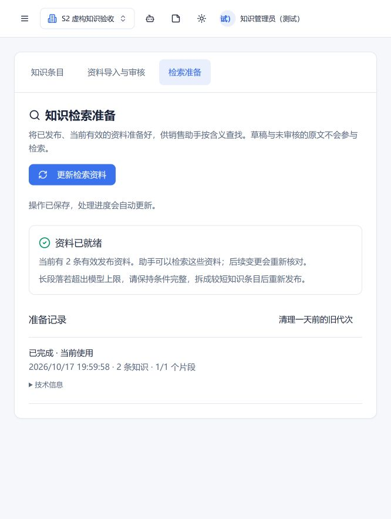
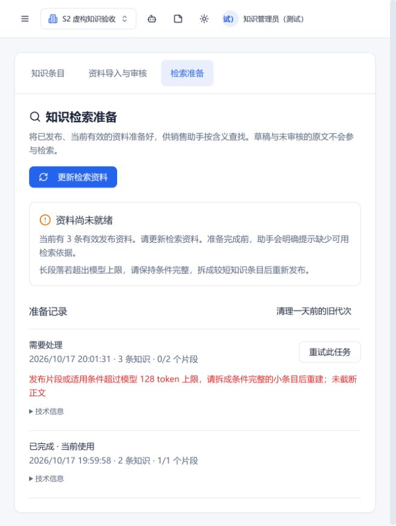
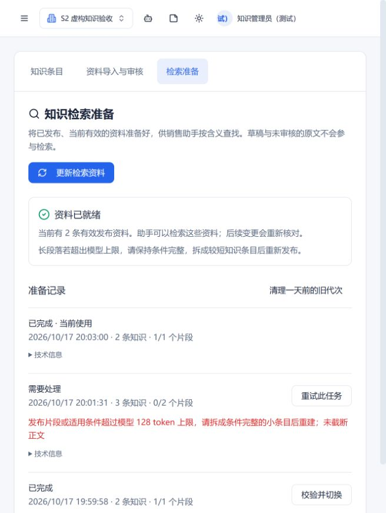

# S2：本地语义索引、发布生命周期与管理

基线 main：635acf2（S1 PR #32）；S0 eb9f54f 已在祖先链中。沿用现有 Express/Mongoose、知识修订、原文解析、Agent 与人工审核，不接入独立平台。此文与实际接口共同作为 S3 入口。

## 可用功能与边界

- 管理员在“知识库 → 检索准备”发起重建，查看进度、失败原因、重试/停止、已完成代次切换、一天前旧代次清理。新任务采用客户端 UUID 幂等键；后台自动同步采用发布清单与模型标识的幂等键。
- MongoDB 的 `AgentKnowledge.approvedVersion`、有效期、停用状态及项目权限是唯一权威；82 条真实草稿未迁移、未发布。没有读取真实客户、生成真实业务邮件或启动发送任务。
- 现有 `retrieveKnowledge` 默认进入本地语义检索，Agent 的知识工具、客户分析、询盘回复和草稿审核沿用现有入口。语义服务失败/未就绪/落后均明确返回状态，不回退关键词。旧关键词实现通过显式 `KNOWLEDGE_RETRIEVAL_MODE=keyword` 保留，用于兼容回归和冻结 S0 基线；它不是语义失败时的兜底。
- 基础销售规则仍由 Mongo 稳定加载（最多四条，超过则明确列为缺口），不依赖语义 top-k。当前检索代次也必须就绪，规则才和证据一起进入工作流。
- 只索引当前有效且已审核发布的正文/条件记录；原始 `KnowledgeChunk.indexEligible` 不构成发布许可。历史手工条目也可以索引，无需伪造文档 ID。
- 公开范围为“本项目成员”或“仅管理员”，保存在不可变知识修订中，随发布生效。个人邮箱、客户附件、客户专属报价不进入通用向量库。专属报价继续由原有客户授权与有效期查询提供。

## S2 架构决策（ADR-002）

### 模型与适配边界

真实本地模型为 S0 选定的 `sentence-transformers/paraphrase-multilingual-MiniLM-L12-v2`，revision `e8f8c211226b894fcb81acc59f3b34ba3efd5f42`，AVX2 uint8 ONNX，384 维，attention-mask mean pooling、L2、cosine。文件 SHA-256、固定组件版本和 128 token 上限见 `server/semantic/model.json`。Apache-2.0；sqlite-vec 0.1.9（MIT/Apache-2.0），SQLite 本地持久库、精确 cosine 扫描，不宣称已经实现 ANN/混合召回。

`EmbeddingAdapter.embed` 是文本→真实向量的接口；`SemanticAdapter.run` 是批量写入/校验/候选查询/清理的本地进程协议。生产仅绑定 `localEmbedding`，使用真实 ONNX Runtime CPU。LLM/mock 邮件渠道与 Embedding 是不同配置：测试禁用真实 LLM、邮件渠道，不会把向量替换成随机数、散列或关键词向量。测试中的故障注入适配器只用于指定错误路径，恢复仍调用真实适配器。

适配合同版本 `genesis-semantic-s2.1` 同时锁定发布原子分块与 project/admin ACL 规则；S3 修改这些规则必须升级合同版本并重建。模型标识为模型锁及适配脚本的摘要；包括 repo、revision、权重摘要、维度、池化、距离与最大长度。每个进程校验实际安装包版本和全部模型文件哈希，禁止运行时下载。查询前与证据返回前再次核对当前模型标识；代次和查询不兼容即拒绝。Windows 采用 Job Object，Linux 采用内存/CPU rlimit；120 秒墙钟、1.5 GiB Windows 进程内存/3 GiB Linux 地址空间、4 个推理线程。每个 CRM 进程最多同时执行两个本地语义进程，额外等待最多八个；超出显式繁忙。子进程环境不继承 CRM/邮箱凭据；网络和额外子进程禁止。不是完整 OS 沙箱的替代品。

### 发布片段与来源合同

`KnowledgeIndexItem` 是发布衍生片段，不覆盖 S1 的原始解析片段。记录 projectId、generation、knowledgeId、publicationVersion、itemId、contentHash、model identity、dimension、scope、ordinal、documentIds、sourceChunkIds、sourceRefs、发布正文区间/条件记录序号。

正文保持原子完整，适用产品与条件在向量输入中重复；结构化条件各自保持值、币种/单位、数量范围和 conditions 完整。超长正文不自动按句子/段落切开，不猜测后文的限制属于哪一个 MOQ。真实 tokenizer 禁止截断；超过 128 token 则该代次失败并提示拆成条件完整的知识条目。这是明确可见的首版限制，复杂自动重分块须在后续独立验证后引入。

发布文本区间与 S1 原文件位置是不同概念：审核人员修改过正文后，原文 `sourceRefs` 只代表来源关系，不能冒充修改后的逐字原文位置。历史知识缺少文档关联时保留为空，不虚构页码。

### 任务、断点与切换

`KnowledgeIndexState`：项目启用标记、发起人、active/pending generation、revision、短期切换锁。`KnowledgeIndexGeneration`：清单摘要、模型快照、持久状态、租约/fencing token、尝试次数、重试时间、完成批次、总片段、复用/生成计数、校验值与错误。

1. 管理员首次发起后启用该项目索引维护；未启用项目不自动访问/处理真实资料。
2. 发布清单只包含当前有效发布修订与访问范围。修改草稿保留旧发布；新发布、停用、失效、生效、删除和范围变更改变清单。
3. 每批最多 16 个片段。SQLite 事务先持久化，Mongo 再记录完成偏移；中断在两者之间时允许重放，主键和内容不可变校验保证幂等。
4. 30 秒持久租约，2 秒心跳；权限、项目状态及租约持续复核。真实进程退出后，新 worker 取过期租约，从已记录偏移继续。超时/本地进程故障/不完整批次最多三次、递增等待自动重试；模型、条件或安装问题明确失败，管理员可重试。
5. 最新任务合并排队中的旧任务；旧 worker 可留下独立代次的派生数据，但不能越过 fencing/当前 pending 指针激活。
6. 全代次 ID/内容摘要清单、向量长度、有限数值及归一化通过校验后，复核 Mongo 发布状态，再切换 active 指针。构建失败不覆盖当前可用代次。
7. 若当前有效资料有变化，旧代次即便物理存在，也立即被读取门禁拒绝；不等待后台同步。重建相同资料时，完整且仍匹配当前政策的 active 代次可继续服务，不算回用旧政策。
8. 发布服务提供尽力入队提示，轮询协调器弥补入队间隙、生效/失效、直接数据库删除和激活前进程退出。持久状态没有放在进程内队列。
9. 切回已有代次同样验证模型、物理完整性与**当前**发布清单；不能回滚到旧业务政策。清理先在切换锁内标记 deleting，排除 active/pending；SQLite 和 Mongo 清理可重试，保留任务审计。

### 权限、缓存与证据

- 查询先重新验证当前用户/项目，按有效修订、产品适用及管理员范围得到候选 ID，再在 SQLite 临时授权表 JOIN 后计算距离；不先拿全项目私有候选再给客户端过滤。
- 向量缓存复用键为 `(projectId, accessScope, modelIdentity, fullContentHash)`；缓存是文档向量计算结果，不包含候选排名/权限决定。改为更广范围或跨项目必须重新向量化。
- S2 没有查询/证据结果缓存，因此不存在遗漏主体/ACL/代次的旧结果缓存键。S3 若增加，必须纳入项目、主体与权限指纹、发布清单和索引代次。
- 返回证据前重新查 Mongo 的发布清单、当前角色/项目和 active 指针；变更则清空候选并返回 `index_stale`。SQLite 缺失/不完整是 `retrieval_failed`，不能冒充 `no_match`。
- 明确选择的知识 ID 只在当前授权且有效、已进入完整代次的来源中优先；外项目/私有/失效 ID 不生效。
- 邮件的知识来源快照附带代次、模型名称/revision/标识、内容哈希、发布片段与原文关联，保存进原有草稿 `knowledgeReview`。内部审核折叠区可查看，客户邮件正文不含这些技术信息。现有旧草稿不重写，重新生成仍是新草稿。

## 安装和业务操作

在 server 目录，使用 S1 虚拟环境；依赖锁复用 S1 并增加 sqlite-vec：

```powershell
.cache\knowledge-parser\Scripts\python.exe -m pip install -r semantic/requirements.lock
.cache\knowledge-parser\Scripts\python.exe semantic/setup_runtime.py --model-dir .cache/knowledge-semantic/model
```

设置私有本地配置（示例路径须按实际目录调整，不包含密钥）：

```dotenv
KNOWLEDGE_PYTHON=D:/Trade/genesis/CRM/Genesis_CRM/server/.cache/knowledge-parser/Scripts/python.exe
KNOWLEDGE_MODEL_DIR=D:/Trade/genesis/CRM/Genesis_CRM/server/.cache/knowledge-semantic/model
KNOWLEDGE_INDEX_DIR=D:/Trade/genesis/CRM/Genesis_CRM/server/.cache/knowledge-semantic/index
```

`KNOWLEDGE_EMBEDDING_PYTHON` 可选，未设置时使用 S1 的解释器。首次安装脚本只下载固定公开模型，服务不联网。模型/数据库/索引均不提交 Git。当前开发机已安装并验证公开模型文件；真实知识仍需管理员审核发布和发起准备，不自动处理 82 条草稿。

业务顺序：选项目 → 导入/整理资料 → 核实条件并发布 → 检索准备 → 更新检索资料 → 看到“资料已就绪” → 让助手写信 → 在草稿内部审核中检查知识版本、条件及来源 → 业务员决定发送。超长片段请回知识条目拆成条件完整的短条目；重试不会自行删字或修改政策。

管理 API 均经 requireAuth/requireProject/admin 和服务层再次授权：GET `/api/knowledge-index`；POST `/rebuild`（requestKey UUID）；POST `/:id/retry|cancel|rollback`；POST `/cleanup`。不接受模型传入项目/角色覆盖范围。

SQLite 是单机派生索引，Mongo 是重建来源。S2 不支持多个服务器各持独立本地索引后共享一个 active 指针；上线前应部署同一个受控索引服务/共享存储协议并完成 S7 运维验收。SQLite 目录丢失后发起新代次重建，不把旧文件当业务权威。

## 验证、限制与 S3 入口

运行 `npm run test:knowledge-index`；必须具备真实锁定模型和本地依赖，不满足会失败，不会悄悄 mock。测试自建 `s2_isolated_fictional` 内存 Mongo 和临时 SQLite，不读取生产数据库。结果与回归汇总见 `knowledge-s2-results/verification.json`，页面截图见同目录。

维度迁移测试将旧代次标为不兼容的 768 维元数据，再以真实 384 维模型建立新代次；没有运行第二个 768 维模型，不声称跨模型质量/成本已验证。单独 Embedding 测试直接检查真实向量维度、有限数、L2 范数和跨语言相似度。

尚未达到最终质量验收：35 个相近恢复样本同时存在时，一个中文自由查询未返回目标来源（尚未隔离分词、候选截断及排序的各自影响），文档来源合同测试采用显式授权知识选择，未把此改动包装成自由检索质量提升。保留该自由检索未命中诊断。S0 冻结 120 题与历史分数不改；S3 完成分组/去重、BM25/向量融合、Rerank、适用条件及完整保留集质量报告。当前 0.8 cosine 距离门槛只是初始候选边界，不能当“置信度”。

本轮运行是小样本工程验证、单个查询进程包含冷启动；不是 10000 个独立片段、并发 2、完整向量＋检索＋重排 P95≤5秒的最终性能验收。原有 Recall@10≥90%、回答充分性≥90%、来源支持≥95%、关键承诺100%有据、负例分类≥95%及零越权目标不变。

S3 从用户合并 S2 的最新 main 开始，先读本文、架构合同、进度、评测程序和实际生成记录。复用 S2 的发布清单、模型适配、授权门禁、代次与证据追踪，不另建业务系统。Windows 本地通过不代表 GitHub Linux runner 已通过；CI 状态由用户创建 PR 后确认。

查询本身也受 128 token 上限约束：S2 不静默截断长邮件/多主题输入，超过上限会显式检索失败；查询拆解/预算控制由 S3/S5 完成。原有产品适用词项过滤继续保留，跨语言产品名称规范尚未补齐，不应绕过产品条件来美化召回。管理员页面目前展示最近 20 项准备记录，活动指针另行核对。

本轮功能提交 8ff0e33，兼容编辑权限修复 a783a4c；实际独立工程测试 23/23，本轮回归及评测合同合计 250 项。操作页面烟测在 8ff0e33 启动的独立后端完成，未填写 ACL 的旧编辑器由 a783a4c 的第 23 项另行验证。截图为虚构项目：






