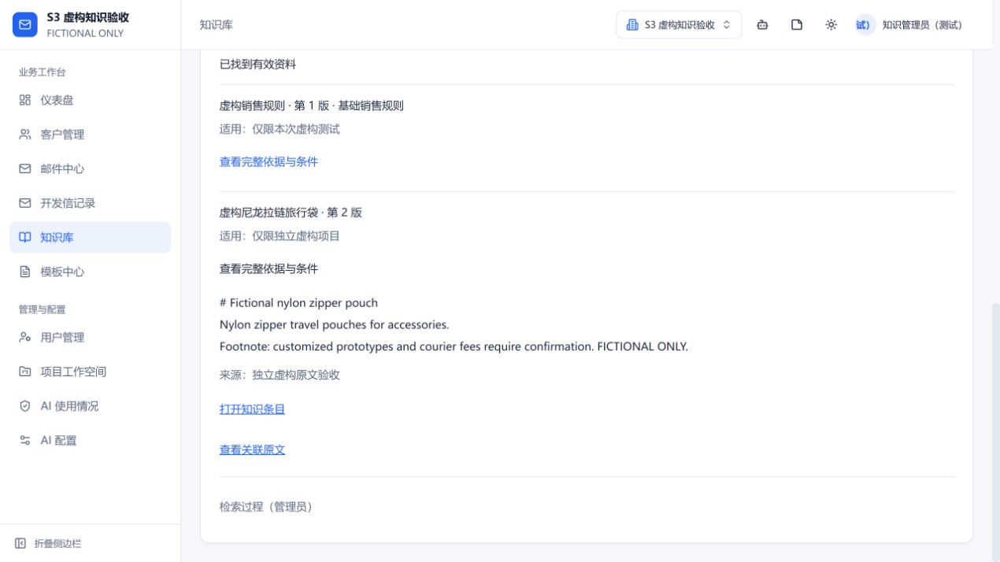
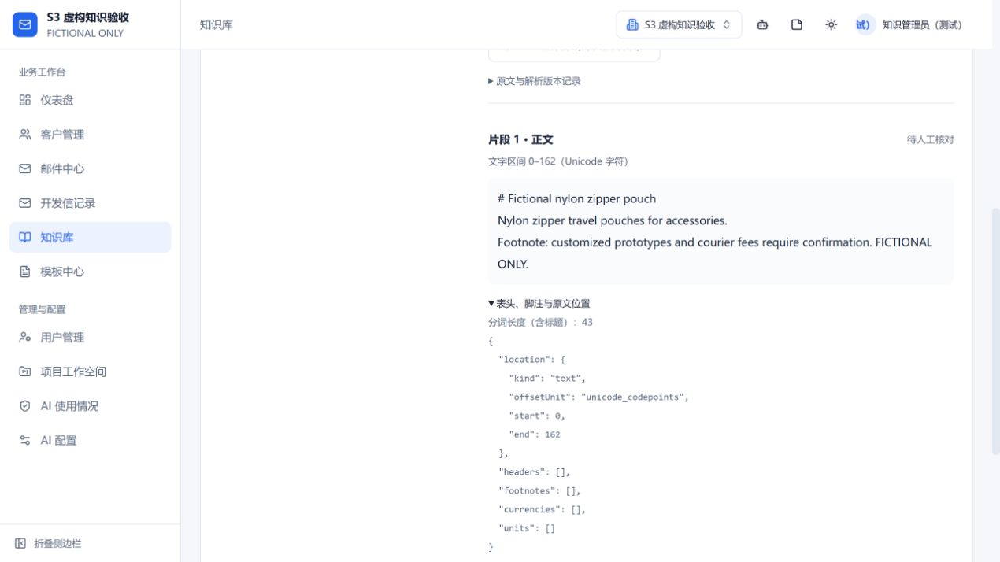

# S3 实际验证记录

基线为S2 main `0021b59`，最终生产实现 `75a2814`。模型/实现哈希、机器、逐项结果见 [verification.json](verification.json)。Embedding、向量索引、FTS5和重排真实本地运行；LLM/邮件为隔离mock。这不是生成邮件质量或真实投递验收。

| 数据/用途 | Recall@10 | MRR@10 | 负例状态正确率 | 越权 | 操作P95 |
| --- | ---: | ---: | ---: | ---: | ---: |
| 原保留集首次失败 | 98.75% | 98.75% | 75.00% | 0 | 2536.7 ms |
| 原固定120题最终回归 | 98.75% | 98.12% | 97.50% | 0 | 2513.3 ms |
| 新保留60题首次独立检查 | 100.00% | 100.00% | 95.00% | 0 | 2780.8 ms |
| 新保留60题最终回归 | 100.00% | 100.00% | 95.00% | 0 | 2589.0 ms |

原保留集首次检验后只作回归，不再宣称未见；进一步优化前冻结transfer：64来源/120题，正例产品和依据在开发/保留间分离。原题库、哈希、标签不改，目标不降低。新保留首次检查通过后，只加权限/状态安全修复；后续复跑明确是回归。

## 开发集消融

| 方式 | Recall@10 | MRR@10 | 负例状态 |
| --- | ---: | ---: | ---: |
| FTS5/BM25 | 93.75% | 95.00% | 85.00% |
| 仅向量 | 96.25% | 88.28% | 100.00% |
| RRF混合 | 93.75% | 92.92% | 85.00% |
| 混合＋本地重排 | 98.75% | 97.50% | 100.00% |

前三项代码94e10b0，最终默认75a2814补标题二次ACL和状态聚合，未改召回/重排算法或阈值。各报告保留自己的implementationHashes。原S0历史排名含基础规则、其他来源上限6；S3规则单列且其他来源上限10，不能把预算差异的提升全归因模型。

## 分组、失败和限制

原120题：英文Recall97.92%，中文100%，跨语言98.81%。新保留集三组有依据题Recall均100%；但中文负例仅6题，正确5题（83.33%），总体19/20达95%。不能说所有中文状态都已解决。

剩余题目见verification.json的remainingOriginalCases/remainingIndependentCases。复合问题仍可能漏公司/证书的一项依据；部分已有依据的问题被安全地标为缺口/过期；一例未发布标题跨语言诊断为no_match。未发布正文没有泄漏或成为政策。S4需完善条件、否定和逐项充分性，不能改标签抹掉失败。

P95为小型评测整组操作wall time，含冷启动/哈希校验，也含快速权限操作；真实阶段耗时另留row.trace。它不是1万独立片段、并发2或热服务容量证明。质量报告去重复候选全文，摘要映射改为明确path/sha256记录（值不变），逐题required/ranked、状态、issue和耗时保留，rawReportSha256对应未改本地报告。S0最终门槛保持不变，S4/S7未在此冒充完成。

## 页面实测

独立临时Mongo，虚构管理员，真实本地模型，5187/5007，不启动真实邮件任务。中文查询命中英文v2知识，完整正文保留样品/运费待确认脚注，点击可到原文修订并显示Unicode区间0–162。

