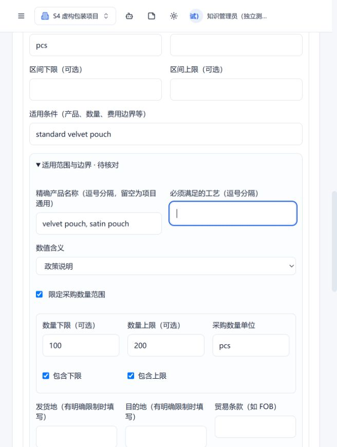
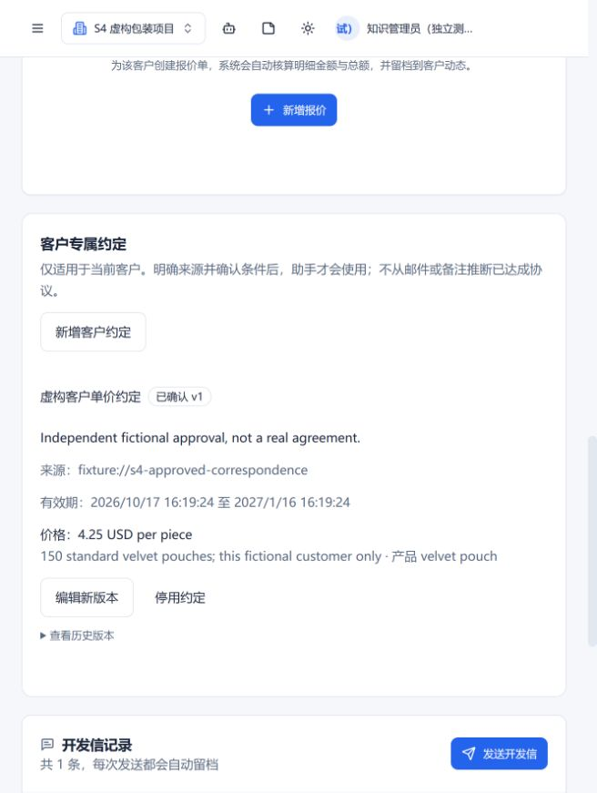
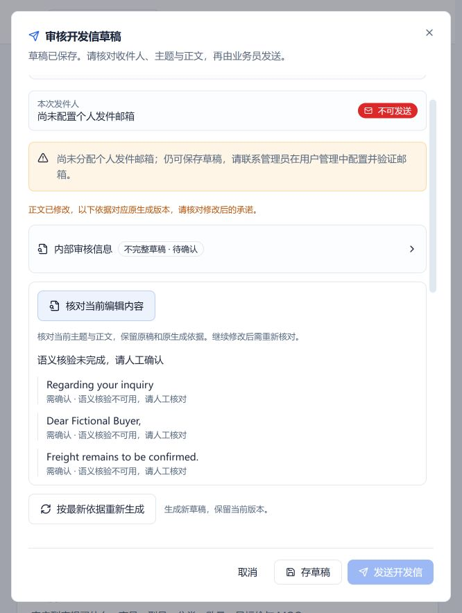

# S4 本地交付记录（2026-10-18）

工程已实现并测试，**S4 质量验收尚未通过**。基线 main `57a3adc`，功能检查点 `f3d0d78`、`05bb230`；最后代码以本分支后续修复为准。由用户创建/合并 PR，不直接推 main。

## 实际验证

[机器可读记录](verification.json)分别列出测试数量。S4 28项覆盖真实临时 MongoDB 的约定版本/客户权限、条件范围/有效期/否定/冲突、模板数字和未知运费、精确 Unicode 引用、一次重写上限、人工改稿复核及原稿不变。受控语义 fixture 可以故意返回错误答案，验证服务端硬门禁；它不是事实支持率测量。

新增本地 HTTP fixture 经真实 OpenAIResponsesProvider 发送到随机 localhost 端口，验证无工具、store=false、JSON协议、唯一原文引用位置、非法JSON/工具调用拒绝；没有真实语义模型。S2/S3 的23/13项则确实运行锁定的本地 Embedding/重排/索引。不能混称为同一类“真实模型通过”。

Agent62、知识15、邮件/POP3 96、解析11、集成24、安全5、模板3、随手记3、AI配置6、评测合同9、前端33通过。前后端构建与新文件严格类型检查通过。初次S2旧fixture未填写审核范围，正确阻断了原先73/19输出；仅在独立测试补齐scope后最终23/23，未放宽适用性门禁或改真实政策。

生产审计按仓库现有门禁通过；原始 npm audit 仍有既有 SheetJS high（没有npm补丁）及前端moderate，不是零漏洞。既有xlsx例外到2026-10-26，本轮未新增豁免。Gitleaks v8.24 全历史扫描退出0，直接捕获退出码，脱敏报告留在本地输出目录。

## 真实模型测量没有结果

用户明确授权冻结44项虚构样本只发往 http://124.222.23.70:18744；当前模型配置 grok-4.7，未打印密钥。首次仅运行开发22项，全部连接失败，没有一项模型判断。后续只读探测为 [ECONNREFUSED](s4-gateway-diagnostic.json)，没有自动换其他目的地。

[首次原始报告](s4-facts-first-dev.json)逐字节保留。初版统计器把连接失败算作0准确率，因此该报告里的 ordinaryAccuracy=0 **不可解释成真实模型准确率0**；有效判断数量为0，应记“不可测”。当前程序在0有效判断时输出null，任何连接失败仍使门槛不通过。22项保留组从未发送/运行，不用于调参，题目、标签和金标准未改。

首次失败后补全长条件原样保留，评测包装将critical样本的全局适用条件统一为既有`standard product`，避免内部fixture标识误成为客户业务条件。44项冻结JSON字节/金标准/划分不变；保留组仍未暴露给模型。后续每份报告记录代码哈希，不覆盖首轮。

恢复后先跑开发组诊断，开发达到普通事实≥95%、关键承诺覆盖100%且无依据放行0后再首次运行保留组。若首次保留失败，保留原始结果，不能改标签或降低门槛；再优化需要新的独立题库。44句微型支持性评测也不能替代S5五类邮件端到端/S8完整业务验收。

## 页面验收

临时前端5188、后端5008与独立MongoMemoryServer，AI_PROVIDER/MAIL_CHANNEL=mock，无SMTP、无邮件worker、无真实资料。测试后关闭临时服务，未影响真实5000/5173。

- 知识条款编辑多产品和数量区间后旧“已核对”清除；保存新草稿保留发布v1。
- 客户约定能查看单价/币种/150件范围/来源/有效期，待审v2不会替代确认v1。
- 改稿旧结果失效，当前内容复核显示“语义核验未完成”；退出未保存编辑原稿不变。

## 待完成及限制

当前网关可用性是S4真实质量门槛的阻塞项，不能宣布S4全部验收完成或自动进入S5。下阶段统一五类任务、恢复与证据补查仍按roadmap，S7规模/多实例/运维指标不变。详见[操作合同](../knowledge-s4-facts.md)。
