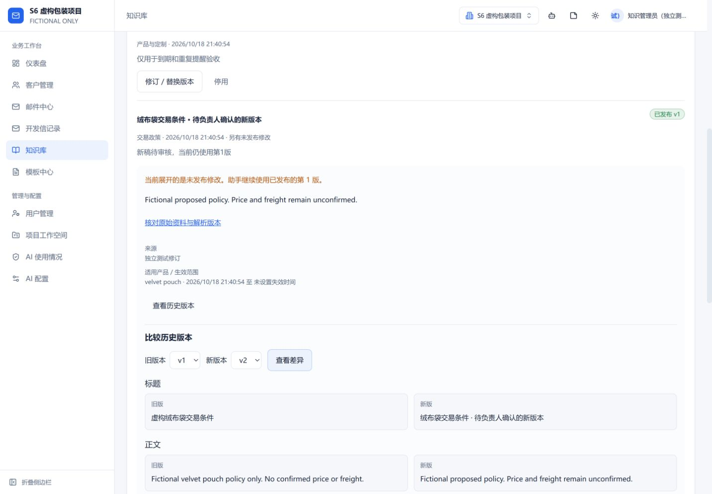
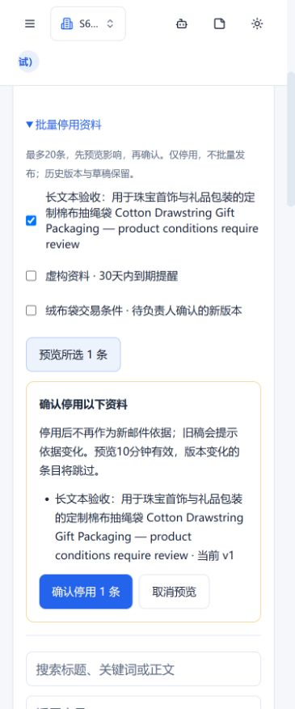
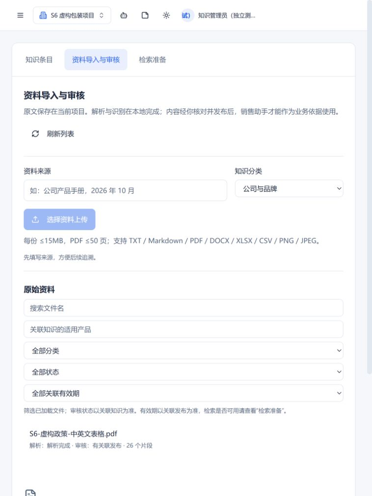
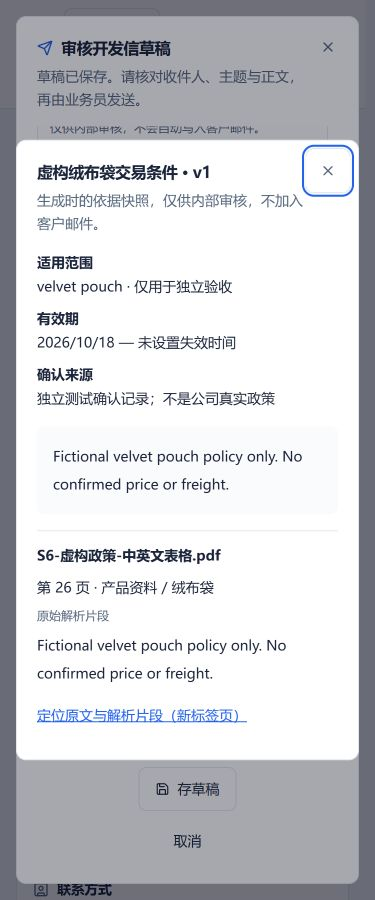
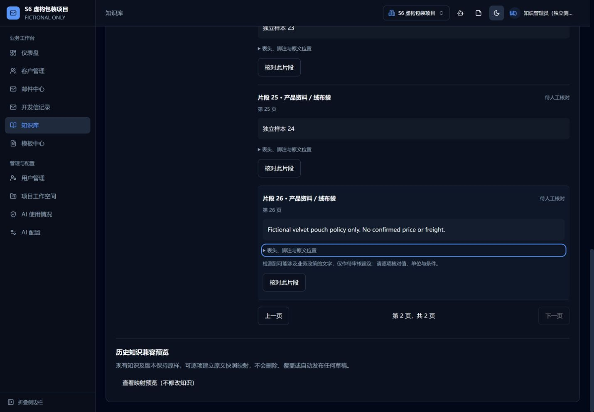
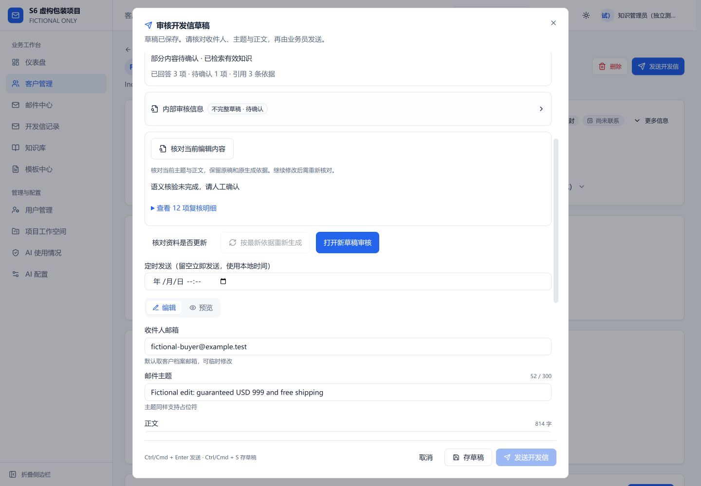
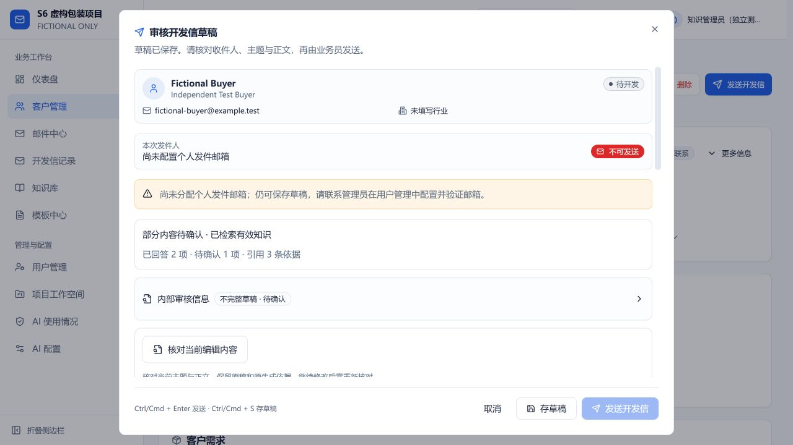

# S6 本地验收（2026-10-18）

工程功能已实现并本地验证；真实模型的最终事实/邮件质量仍待S4/S5补测，不将功能通过写成质量达标。基线main 4894e47；最终代码8fd1b9d。完整合同见[ADR-006](../knowledge-s6-governance.md)，运行记录见[verification.json](verification.json)。

## 实际结果

| 范围 | 结果 |
| --- | --- |
| S6治理、HTTP、权限、恢复、五类重生成 | 24/24 |
| 原知识 / 条件事实 / S5持久工作流 | 15/15、28/28、23/23 |
| Agent / 邮件与POP3 / 安全 | 62/62、96/96、5/5 |
| 真本地解析/OCR / 真本地语义检索 | 11/11、14/14 |
| 前端输入/工作流/Markdown及依赖 | 33/33 |
| 前后端构建、新测试严格类型 | 通过 |
| 既有生产依赖门禁/全历史脱敏扫描 | 通过；未新增豁免 |

合计311项，不重复累计同一测试多次运行。24项S6中真实HTTP验证登录、最新角色、严格请求体、项目隔离及预览后执行；其他包含预览过期/改版本跳过、写入与日志间隙恢复、重复提交、原片段第二分页、私有历史引用、五类重生成幂等保留和带线程样品回复。写入间隙模拟恢复不是S7多机/真实宕机恢复验收。

## 真实页面

- 在5190/5010独立内存数据库，虚构项目和example.test客户，mock模型与显式关键词模式。没有调用外部模型，没有真实SMTP或收件worker。UI模型不可用时明确需人工确认。
- 1440桌面版本比较；768平板资料列表及来源弹窗；375手机长标题、批量预览和引用弹窗。测得页面宽度1440/1430、768/758、375/365（含滚动条差异），均未横向溢出。375引用框左16、右359，内容宽341与可视宽341相同。
- 引用可定位原PDF第26页、解析片段26与第二分页，自动聚焦；键盘Tab可达片段操作，Escape退出引用框并回到入口。深色模式实际检查并还原。
- 客户问题的已回答/未回答、关键承诺/来源、无运费资料/语义不可用可辨认；编辑主题后出现提醒，复核未改写主题/正文。客户预览无内部审核标题、来源卡片或模型诊断。
- 独立发布v3后旧稿明确提示依据变化；刷新只更新内部依据状态，手工主题不变；重新生成另存新稿并保留当前编辑。
- 首轮[数据库记录](ui-first-run-audit.json)暴露未绑定线程的询盘重生成为first_outreach。没有将其当通过；修复显式传递原taskKind，新增五类和线程样品六项测试，全部通过。最终[页面记录](ui-final-regeneration.json)与截图确认新稿仍为Regarding your inquiry，两份草稿都在。最终临时进程在清理请求前已退出，没有获取最后一次DB审计文件；这点与首轮数据库记录明确区分，不伪造最终DB快照。两轮均未点击发送；首轮DB为发送0/跟进0，最终页面已发送0。
- 原用户标签页未操作。所有临时标签页关闭，尺寸/主题还原，5010/5190临时监听已退出。真实客户、真实82条草稿和既有本地服务保持原样。

## 截图

## 未完成/限制

维护提醒最多500条，文件筛选针对已加载分页。重复为规范化正文，冲突为相同显式范围下不同值的疑似提醒，不能当作完备语义审计。原文件仍管理员权限；销售仅看发布范围。没有浏览器内PDF坐标框选、Office编辑、自动通知或批量发布。S7承担容量/并发/多实例/恢复门槛；S4授权44项真实模型质量及S5五类模型邮件尚未达标，本轮未重跑或改写其原始结果。最终S8不能跳过。
