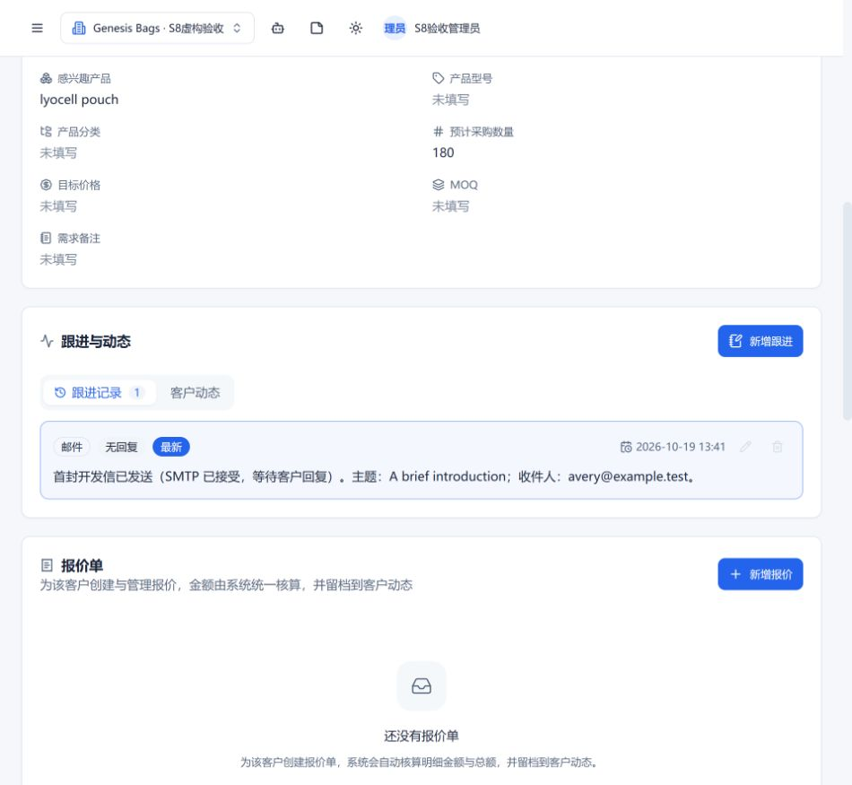
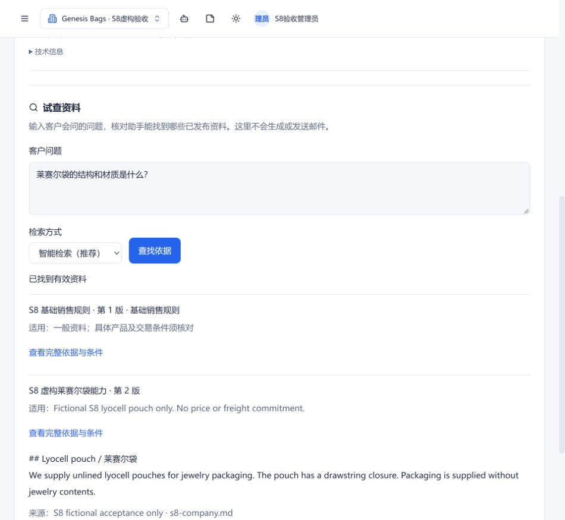
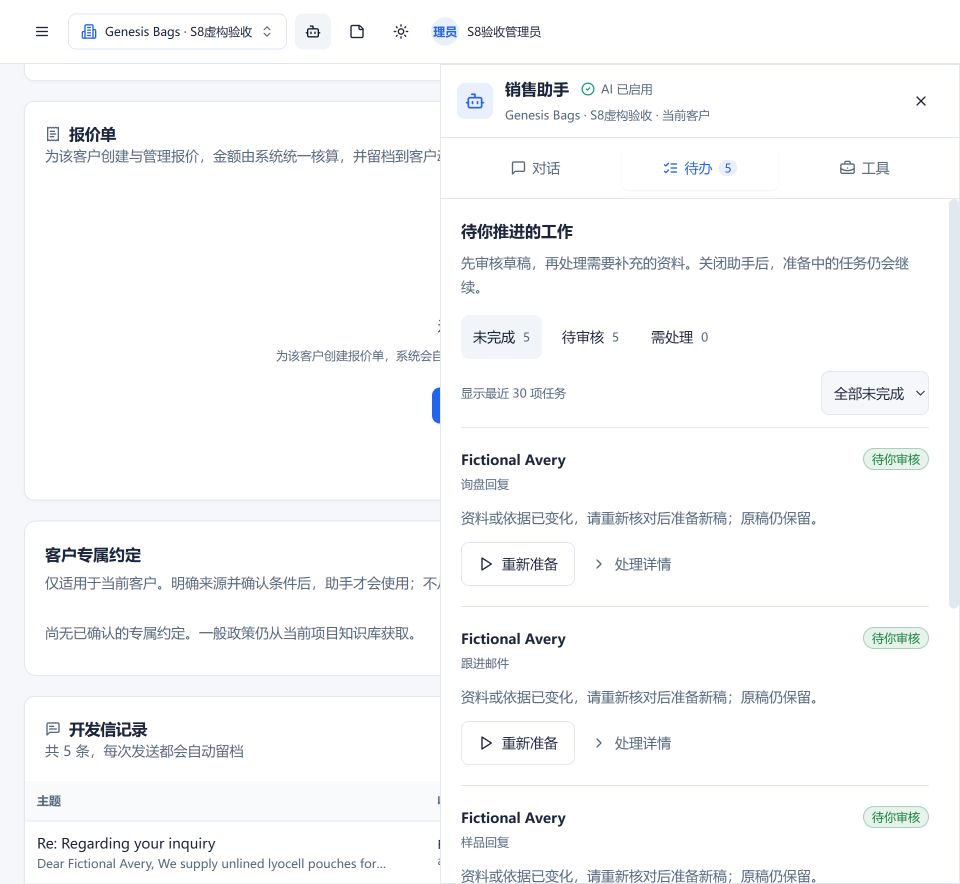

# S8 本地验收与交接（2026-10-19）

本轮工程链路已经实际运行并交付修复，**S8 总验收尚未关闭**：本分支未合入 main，真实业务政策未审批；首次独立事实保留测量失败后，修复后的同集只能算回归。有限句子分类不能代替大样本整封邮件质量或真实业务员签字。没有放宽 roadmap 的固定门槛。

## 版本、环境与真实/模拟边界

- 基线 main a450e84，S0–S7 已合入；最终工程修复 4658f74，分支 codex/knowledge-s8-acceptance。人创建/合并 PR，未推 main。
- 完整页面主运行 eb7d3d5、dirty=false，真实本地 Embedding + sqlite-vec/FTS5 + RRF + Rerank，真实 DeepSeek deepseek-flash；最终正文缺项修复另在干净 4658f74 页面复验。两次运行及失败均分开记录，不能声称整个链路已在最新 main 验过。
- MongoMemory 独立库和两个虚构项目；SMTP 是只绑定 loopback、拒绝非 @example.test 收件人的不转发接收端。产品界面的“SMTP 真实发送”标签仅表示使用 SMTP 适配器，本次 **不是外网真实邮件送达**。
- 用户授权仅覆盖既有 44 项虚构事实资料及两项目/五类任务的虚构验收数据，目的地 https://api.deepseek.com。82 条真实草稿、真实客户及 ZIP 未外传、未修改、未发布。密钥、控制回执、原始模型追踪不进仓库。
- 固定机器 Windows 11 / 10.0.26200，Core Ultra 7 265F、20 逻辑核、31.65 GiB，Node 24.19.0、Python 3.12.14；本地推理 CPU，每 worker 4 线程、最多 2 worker；没有用 GPU 成绩替代固定机目标。
- 模型身份见 scale 报告及 S0/S3 模型清单：paraphrase-multilingual-MiniLM-L12-v2 固定修订 e8f8c211226b894fcb81acc59f3b34ba3efd5f42，384 维、128 token。长文按真实 tokenizer 分窗口、返回完整发布条件；并非改成无限输入。OCR/Rerank 的锁定版本、许可沿用 S0/S3，不接入整套第三方知识平台。

## 实际修复

1. 同一命题的明确否定翻转仍拒绝；不再用否定词数量拒绝 empty / without contents 等真实同义表达。普通事实仍要求完整语义支持及精确引文，交易承诺仍要求完整适用事实卡。
2. 核验使用显式结构化输出，重写使用纯文本；DeepSeek 受限输出使用已有 no-reasoning 选项，截断 Responses 不当成功。普通 Agent 对话行为不变。
3. 销售检索剥离工作流指令/收件元数据噪声，产品和政策相关性与数量/目的地条件分别处理；只找到基础规则不冒充找到产品依据。
4. 一次整稿重写后仍有无依据段落时，只保留完整核验通过的非关键段落，组合完整已确认条件与待确认项。不切割失败段落、不补造价格，不因模型失败直接放行。
5. 即便所有已有段落安全，若漏答客户问题，仍转为明确的不完整答复，正文补齐有依据条件及价格/运费缺项说明；不仅在内部审核栏提示。20,000 字符边界整段控制。
6. 实际评测发现 evaluator 原先提供了生产禁止提供的原始交易正文；现共享生产 evidenceForCheck。保留错误适配器的失败报告，未改冻结标签。

## 页面闭环及逐项结果

完整主运行见 [虚构数据快照](ui-business-run.json)，截图见下方。

| 环节 | 实际结果 |
| --- | --- |
| 导入/解析/OCR | Markdown 成功并有位置；PNG 扫描识别出英文，明确部分识别/待审核；NUL 文本逐文件失败，有原因与重试入口，不把空文当成功 |
| 审核与发布 | 从片段保存草稿、人工发布产品 v2；关键词不会扩大产品范围，中文精确产品别名经审核后跨语言检索命中 |
| 两项目对照 | Bags 中文问题召回其英文产品依据；IRONHUE 查询 pouch MOQ 明确无依据，自身 rowing machine 问题命中自己的来源 |
| 五类任务 | 首封、询盘、报价说明、样品、跟进均由真实页面创建持久任务并保存草稿；主运行第一轮 sample 的模型格式失败安全降级，保留该失败，修订后重新生成语义核验成功 |
| 问题覆盖 | 首轮样品 scope 错将 courier 填入需人工确认的排除栏，正确阻断样品费；UI 发布政策 v2，完整 conditions 中仍保留 courier excluded，询盘/样品均回答 3/3 有依据问题；运费 1/1 无依据另列待确认 |
| 事实与条件 | MOQ 61 pcs；23 working days 从 deposit and artwork approval 起算；USD 8 per prototype，限 one plain lyocell pouch prototype、courier excluded；价格与运费无数字编造 |
| 人工修改 | 无依据 USD 999/free freight 编辑经复核明确缺依据，取消未保存；另加入中性地址问题、复核、保存后重开，正文保留，原始生成快照不被改写 |
| 依据变化 | 政策 v1→v2 后任务提示变化，原询盘 draft ID 保留且 body 字节未变，新 draft ID 不同，旧稿不静默覆盖 |
| 人工投递 | 生成/编辑/保存前 deliveries=0、followups=0；人工点击发送后本地 sink=1、跟进=1，首封任务 completed，客户已联系；其他任务仍待审核 |
| 最终增量复验 | 4658f74 干净 SHA 的真实报价页面：3 个已知条件完整呈现，未知价格和运费直接在正文待确认，0 投递/0 跟进。此轮未重新导入产品能力，因此不替代主运行的普通产品语义结果 |

## 指标与失败，不混淆分母

| 测量 | 结果 | 解释 |
| --- | --- | --- |
| 固定原集 120 题 | Recall@10 95%；MRR@10 95.625%；负例 39/40=97.5%；越权 0 | 保留有答案 Recall/MRR 96.25%，保留负例 95%；按题必要依据平均，不含无答案题 |
| 固定 transfer 120 题 | Recall/MRR 100%；负例 97.5%；越权 0 | 两集已在 S3 使用，本轮都是回归，不再叫独立未见集 |
| 原集/transfer 小语料 P95 | 194.237 / 340.727 ms | 非 1 万片段规模结果，分语言/分类/失败题在原始报告 |
| 44 项真实模型事实检查 | 修正生产证据边界后，开发/保留普通各16/16；无依据关键承诺各0，支持的关键正例各1/1；核验服务失败0 | 这是句子分类回归，关键正例极少，不能推断大规模整封邮件质量 |
| 首次独立事实开发/保留 | 普通各15/16=93.75%，均失败 | 首次保留未达95%；看过失败后改一般性解释，后续同集仅算回归。另有 strict-output evaluator 边界错误导致关键正例漏判的失败报告 |
| 实际五类邮件 | 第一轮语义4/5，sample安全降级；后续sample/询盘/首封重生成语义成功 | 不只保留最好一次；不能用5封宣称稳定100%模型可用率 |
| 已知问题覆盖 | 主运行政策 v2 的询盘/样品各3/3；无运费不是正确答案 | 旧v1样品人为排除应阻断；旧报价/跟进已标过期，不用于当前覆盖率分母 |
| 真实1万向量/并发2 | 全部10000嵌入、复用0；建索引266.47s；热40次 P95=3320.031ms ≤5000ms | 预期来源39/40，1次no_match，服务失败0；性能通过不替代召回质量 |
| 资源 | Node峰值RSS711.50MiB；两个语义worker采样各约856MiB | 单机有限负载，不是长期/多机/混合高峰容量承诺 |
| 工程回归 | 最终后端370/370；前端33/33；根运维7/7；类型/构建/既有依赖安全门禁通过 | 工程测试计数不当质量分数；最初362/363失败及未复现根因保留在进度中 |

检索原始报告保留 dirtyTree/源码哈希的原始值，不篡改成干净 main。规模报告记录起始源码LF摘要，完整UI记录加载的干净SHA。各测量只对其实际源码和数据负责。最终改动集中在销售工作流/事实核验，没有改冻结检索权重与模型。

成本：主页面实例 quota 记录 34 次请求、输入99,616、输出21,719、合计121,335 tokens、未结预留0。含该实例的重写/复核，不含此前实例和独立44题的全部成本。任务预算 charged 是上限预留核算，不能当账单。未取得供应商实际结算、缓存价格和费用明细，货币金额未核算；不杜撰总费用。最终增量实例用量单独存档。

## 仍有限制与总门槛

- 当前生产模型仍会对过渡语/中性问题/签名保守误报，也可能不遵守结构化引文格式。安全失败不等于普通事实质量好；保留所有失败并交人工审核，不无限重试。
- 最终增量报价虽然完成3个条件答复，factAudit.mode=unavailable：实际两个核验请求返回了结果，但没有可保留的非关键语义段落，走了结构化安全稿。该字段此时不等于网络断连；不将此轮算完整语义通过。主运行五类语义结果单独记录。
- 冻结集已被多轮检查；独立新增UI资料能验证一般流程，规模也使用不同文本，但这些不是新的平衡整封邮件盲测。进入真实试用前仍需业务员独立标注典型整封邮件、确认普通引用支持≥95%和问题覆盖≥90%，不得用模型自己打分替代人工金标准。
- 跨语言产品名仍需审核范围/别名；128-token窗口有边界，复杂跨表格/脚注和低质量OCR仍人工核对。无向量分数绕过精确条件。
- 单机进程池有限资源约束不等于原生OS安全沙箱；多机一致性、通用生产介质备份、长时间高峰负载及外网真实投递未在本轮通过。
- main 尚无本轮修复，CI结果需以用户建PR后远端状态为准；本地全绿不能代替远端CI。

## 业务资料与下一步

ZIP本地CRC正常、12/12成员结构可读，未执行内含脚本、未传模型、未自动发布。结构可读不代表已经解析进生产或业务事实获批。仍由负责人核对公司/签名、产品工艺、MOQ单位及条件、样品币种/退款/快递费、交期起算、报价有效期、认证范围到期、支付物流与冲突来源；82草稿保持不变。

1. 用户为本分支创建并合并PR；参考 [操作手册](../knowledge-s8-acceptance.md)。
2. 合入后fetch并核对commit，按同一隔离夹具在干净main重验变动范围/五类任务及投递跟进；不直接使用真实客户邮箱验收。
3. 负责人逐条批准真实政策；业务员提供/独立标注典型邮件金标准。新增真实资料外传须先明确资料与模型目的地授权。
4. 最终安全/质量硬门槛、业务签字和main复验齐备才关闭S8。服务器/域名/TLS/备份介质/部署/回滚及是否真实发信另开上线任务。

