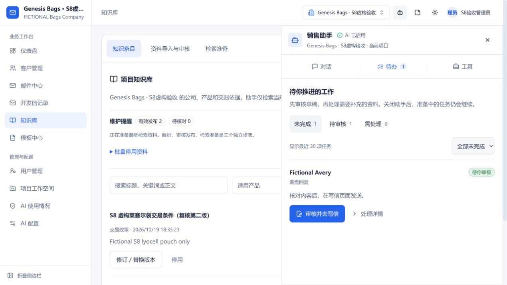
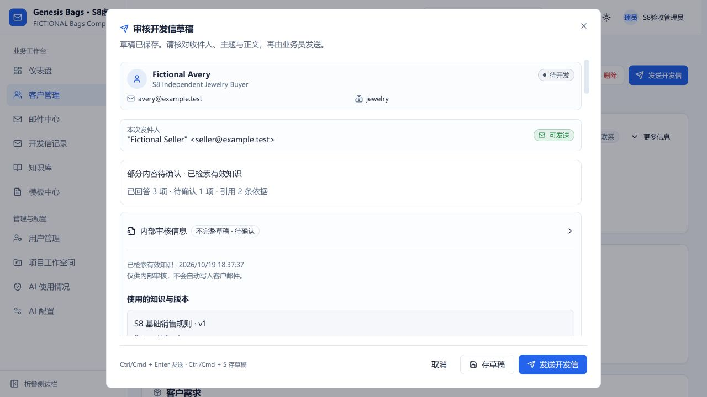

# S8 合并后复验与累计时间修复（2026-10-19）

PR #39 已合入 main **f3240d2**，合入祖先关系已核实。真实页面夹具记录该干净 SHA。复验发现新的任务累计时间问题，因此 **S8 仍未关闭**。修复 **8da9f6f** 已在短分支 codex/s8-main-verification 提交推送；人创建/合并 PR，不直接推 main。远端 CI 状态未取得，不能以本地通过代替。

## 干净 main 的实际结果

- 实际导入虚构 Markdown 和扫描 PNG：Markdown 3 片段及文本位置，PNG 本地 OCR 明确部分识别/待审核。人工从片段保存产品草稿并发布 v2，检索准备 3 来源/8 片段。中文“莱赛尔袋的结构和材质是什么？”召回英文产品 v2 及规则。
- 首封、报价说明、样品回复、跟进和询盘均由页面创建持久任务；最终五稿 factAudit.mode 均为 semantic。询盘首轮 OPENAI_INVALID_STRUCTURED_OUTPUT 保留，一次重试后成功，不把最终五稿解释为首轮成功率100%。四类政策答复均 3/3 已知问题；报价价格/运费、其他运费列为待确认。
- 条件完整：MOQ61 pcs；23 working days 从 deposit and artwork approval 起算；USD8 per prototype，限 one plain lyocell pouch prototype、courier excluded。原始恶意来信未触发跨项目读取或自动发送。
- 首封主题人工改为 Lyocell pouch packaging introduction，复核/保存/重开保留。五稿准备后0投递/0跟进；业务员界面手动发送一次后，本地不转发 SMTP 接收1、跟进1、首封任务完成。不是外网邮件送达。
- 产品仅改标题并发布 v3，任务显示依据变化，旧稿正文保持；重新准备生成了新 v3 草稿，却在 handoff 因 TASK_WORKFLOW_LIMIT 失败。这个 main 复验结果为失败，不写成“全链路通过”。证据见 main-after-version-update.json。

## 原因和修复合同

原实现每个模型步骤预留120000ms、其他步骤1000ms；完成或已知失败后均没有按实际耗时结算。初次失败、重试和依据更新会把这些预留累计到600000ms，最终阻止交付已保存的新稿。这与人工审核等待时长无关。

完成和明确失败的步骤现在使用单调时钟结算实际耗时，以同一 running lease + 精确运行中检查点（key/epoch/inputHash/attempts/startedAt）原子保存并结算一次。进程中断/租约丢失继续保留完整预留，不能结算新所有者的步骤。30次累计步骤、600000ms、步骤5次、原任务尝试/epoch/token上限均未提高，也不在重试时清零。

没有对历史任务计数做追溯迁移：已经终止的旧任务保留旧结果与错误，需要缩小范围后新建任务；没有修改真实数据库或清空真实计数。

## 修复版本真实页面复测

加载干净 **8da9f6f**，新独立内存库、真实本地检索、授权 DeepSeek、loopback SMTP。

1. 初次询盘任务 awaiting_review，9步骤，实际11320ms。另用草稿界面直接重新生成成功保留旧稿；这是非持久任务入口，单独记录，不算持久任务重试。
2. 在知识页面只改虚构交易政策标题并人工发布 v2；同一持久任务提示依据已变，点击重新准备。模型格式错误，任务 failed，可重试，16步骤/16331ms/预算charged24175；没有发送。
3. UI 一次重试后同一任务回 awaiting_review，epoch1、25累计步骤、实际 **28460ms**、预算charged42389/60000。生成/审计/交付均完成；已有失败和步骤计数保留。按旧计费5个模型步骤加普通步骤会超过600000ms并挡住handoff。
4. 新草稿确实引用政策v2，三项已知条件完整，运费待确认，旧稿原文不变。共有3份草稿（含直接入口重生成），0投递/0跟进。最终临时服务已保存快照并退出。

当前持久任务的新稿是 **安全部分稿**，factAudit.mode=unavailable，界面明确“语义核验未完成”。模型对礼貌语/签名仍会保守误判；不把此次计数修复验收称为普通语义质量通过。直接入口的第二稿 mode=semantic，另列，不能混用分母。

## 工程证据与下一入口

- 先加独立回归，旧实现25/26，累计模型预留案例失败；修复后工作流27/27，含明确失败实际结算、租约丢失保留预留和真正600000ms耗尽仍阻断。
- 固定修复完整后端 **373/373**、失败/跳过0，146127.7291ms；服务端构建、新测试/页面夹具严格类型通过。main相关149项通过，计数重叠不相加。前端无改动，未冒充重新跑旧33项/根运维7项。
- 固定检索/44事实标签、模型/索引及S0门槛未变；没有借此重新报告未见集质量。全部样本虚构、无真实客户写入/真实邮件发送/82条草稿发布。密钥、控制回执、原始模型追踪保留私有输出，不入库。
- 合并本修复并做干净main针对性复查；确认PR远端门禁；业务负责人批准真实政策；独立标注整封邮件金标准并满足原质量门槛后，才关闭S8。此处不授权上线。

机器记录见 [verification.json](verification.json)，首次格式失败及测试失败见 [failures.json](failures.json)。原S8报告为当时测量，原始失败不覆盖；本附录是最新状态。
