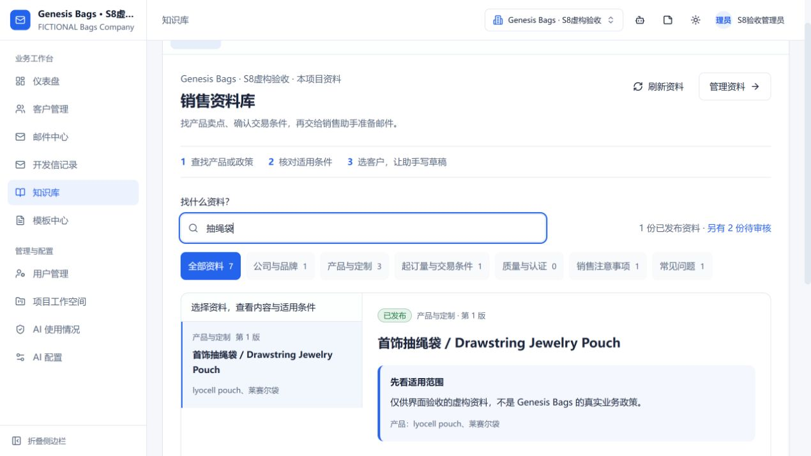
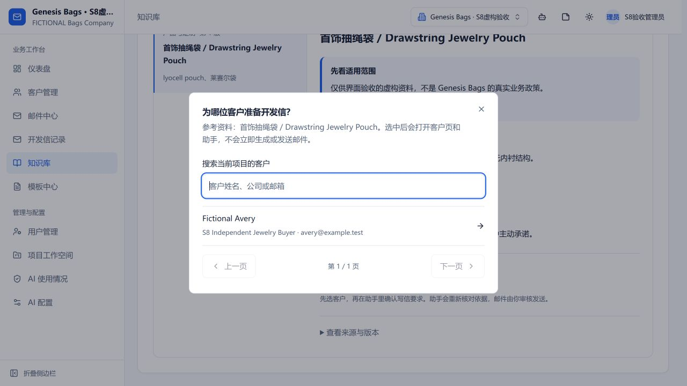

# 销售资料库：使用与验收（2026-10-19）

本次从已合入 PR40 的 main 8a5dafb 开始，短分支 codex/knowledge-sales-workspace，功能提交 a1502e8。让业务员从“找资料—看条件—选客户准备开发信”开始日常工作。沿用原 CRM、知识权限、发布版本及人工审核发送，没有另建知识平台。

## 业务员怎么用

1. 打开导航中的“知识库”，默认进入“销售资料”。按公司、产品、起订量与交易条件、质量与认证、销售注意事项、常见问题查找；搜索框输入产品、工艺或政策关键词。
2. 点选资料，先看适用范围，再读产品卖点或交易条件。数量范围、币种单位、起算条件、目的地、例外及证书覆盖不能省略；参考条件和过期条件都有明确标记。“来源与版本”按需展开。
3. 点击“用这份资料准备开发信”，选择当前账号有权访问的客户。系统打开客户详情和销售助手，把写信要求填进输入框；你可以修改要求，再点击发送消息开始准备草稿。此处“发送消息”是向助手提问，不是向客户发邮件。
4. 助手仍需重新检索当前有效依据并核对客户适用条件，草稿准备好后，由业务员审核、修改并在写信页面发送。选一份资料不会强行套用过期版本，也不会把它的条件应用到所有客户。

## 第一次为什么没有可用资料

本轮只读核对时，真实 Genesis Bags 项目有82份待审核草稿、没有有效发布资料。新首页直接显示待审核原因和入口。不能为了让页面有内容而自动发布。

管理员进入“资料审核与维护”，核对标题、正文、适用产品、条件和来源，再逐条发布；带数值的政策继续使用原条件编辑和范围审核。文档导入在“导入文件”，检索任务在“检索维护”。到期、版本冲突及批量停用收在维护工具中。未完成审核的内容不出现在业务员销售资料中；有已发布旧版和新草稿时，默认只展示已发布版。

## 实际交付

- 销售页改为分类检索与列表/正文阅读；宽窗口并排，窄窗口点开详情并可返回列表，减少整页展开长文和无关操作。
- 页面只采用当前有效的已发布修订；管理员的新草稿不覆盖业务员看到的正式版。项目/账号切换重置页面数据，异步请求卸载后不回填。
- 客户选择使用已有后端客户列表及权限。写信要求只在项目、登录用户、客户上下文三者一致时带入，并创建新的输入上下文；不会自动提交、调用模型、生成草稿或发信。已过时的面板加载结果不能覆盖新上下文。
- 保留旧来源链接和管理员知识定位链接：documents/index查询参数仍可用；旧knowledge定位在管理员端进入维护，在业务员端进入阅读。没有改变后端接口和授权。

## 验收记录

41项前端测试全部通过（新增8项正式版/草稿分离、状态与时效、条件筛选、项目/用户/客户上下文隔离、条件限定完整展示），改动文件ESLint无错误/警告，前端生产构建通过，功能提交全Git历史敏感信息扫描通过。原后端/模型/索引未改，没有重复宣称373项后端或S8质量验收。

独立MongoMemory虚构项目：管理员可查看已发布v1和维护中的草稿v2；业务员仅看到正式资料，直接访问manage也不展示管理操作；另一业务员选不到管理员拥有的虚构客户。页面实际完成关键词查询、读取条件、选客户、进入对应客户助手并带入要求。即时数据库快照tasks=0、letters=0、deliveries=0、followups=0。没有点击助手提交或客户发送。

截图包含宽/窄阅读、选客户、深色交易条件和业务员视图，全部为虚构样本。真实项目截图只留私有本地输出，不进入Git。最后取最终快照时临时进程意外退出，最终DB快照未取得；此处仅引用已保存的选客户后即时快照，不能把缺失结果写成0。前端使用Vite热更新，本次不是新的干净main复验。

## 范围与下一步

- 这是当前接口最多500条记录内的关键词筛选，不冒充新增自然语言问答或全库召回评测。页面达到上限时明确提示。
- 这次接通首封开发信的导航与输入；询盘继续从现有邮件线程操作。没有自动发布真实资料、修改真实客户或新增外传授权。
- 人创建/合并本分支PR，远端CI另行确认；真实政策仍需业务负责人批准。S8整封邮件质量门槛及其他未关闭项不因UI改版而变成已完成。

机器记录见 [verification.json](knowledge-sales-workspace/verification.json)。
