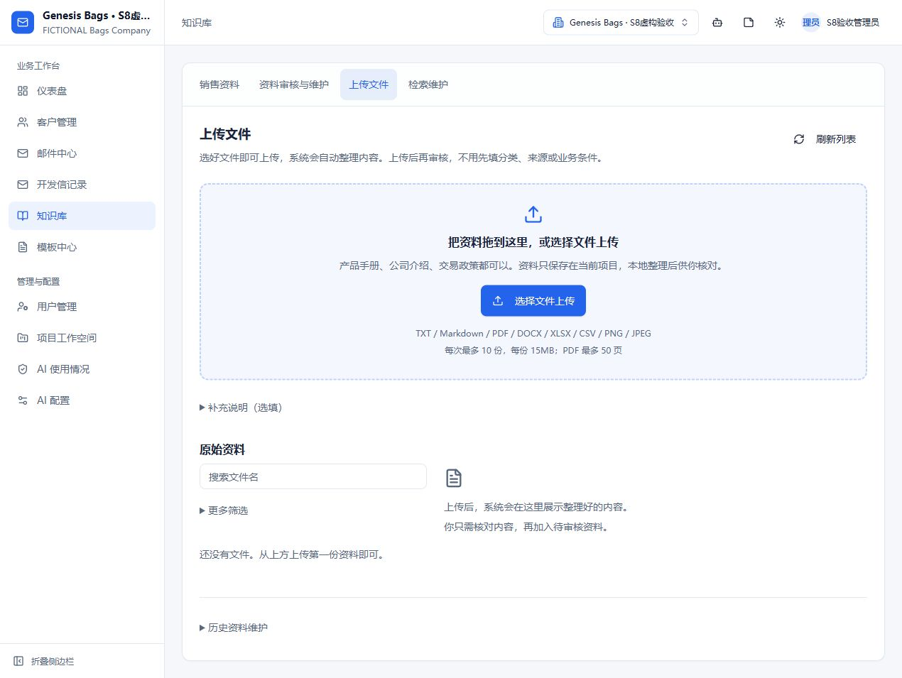
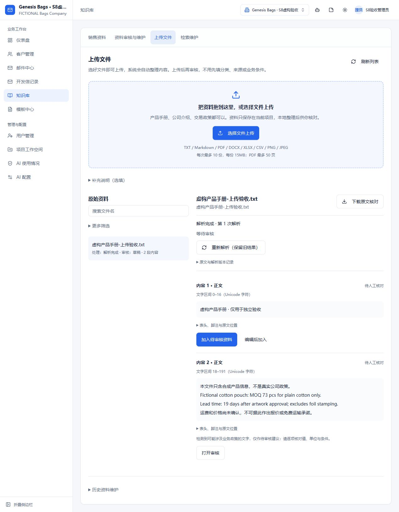
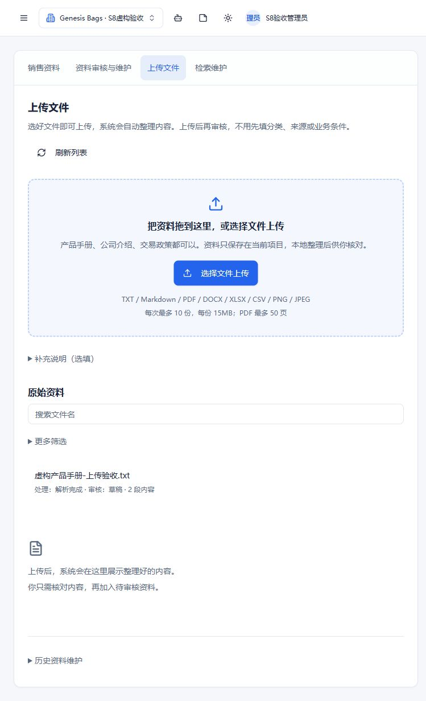

# 上传知识资料（2026-10-20）

## 管理员怎么操作

1. 打开“知识库”，点击“上传文件”。知识库为空时，首页的主要按钮也会直接进入这里。
2. 点击“选择文件上传”，或者把文件拖入上传区。可以一次选择多份；**不需要先填写来源、分类或业务条件**。
3. 等待本地处理，选择文件查看整理后的内容。失败原因会显示在文件详情，可以重新处理；重复文件会保留原记录。
4. 对需要使用的内容点“加入待审核资料”，即可保存草稿，不再先填表，也不会强制跳转。需要调整文字时点“编辑后加入”。
5. 点“打开审核”，核对实际适用产品、交易条件及有效期，再发布给本项目销售助手使用。原文件可以下载核对；上传和加入待审核均不等于发布。

“补充说明（选填）”里仍可填写自定义来源和分类。不填时，来源自动记录文件名，原文件内部标记为待归类；加入待审核后的中性默认分类为“产品与定制”，不是系统完成了语义分类。管理员可以在审核时修改。正文与数字原样保存，条件显示待审核，没有自动补写政策。

销售人员日常仍从“销售资料”查找已发布内容。上传、原文和发布审核沿用现有管理员权限，没有扩大普通成员访问范围。

## 支持的文件和边界

- TXT / Markdown / PDF / DOCX / XLSX / CSV / PNG / JPEG。每批最多 10 份，每份最多 15MB，PDF 最多 50 页；其余安全、工作表、解压和超时限制沿用 S1。
- 扫描 PDF、图片仍用现有本地 OCR；低质量或不能识别的内容明确提示，不能当作已确认政策。
- 当前保留按内容段预览和保存；不是上传一份大文件后自动发布所有内容。超过 12,000 字符的原子段必须先人工整理，后端不会静默截断。
- 文本文件超过解析片段上限时由上传阶段自动拆分，不需要管理员先手工切文件（见下节）。
- 不支持旧式 DOC/XLS、PPT、ZIP、带宏文档等未列出的格式。单个文件失败不阻止同批后续文件上传；后端仍逐文件校验。
- 来源版本、标题路径、页码/文字区间、表头、脚注、币种和单位仍保留。技术记录、额外筛选和历史映射工具默认折叠。
- 资料在本地现有解析服务处理，本次没有调用外部模型来给真实文件分类或抽取交易承诺。

## 上传阶段的自动拆分（2026-10-21）

**问题**：本地解析器对一个文件最多接受 1,200 个片段（段落、标题、Markdown 表格行各算一段）。一份 175KB 的中文 Markdown 知识库约 96,000 字符、1,700 多段，上传能成功，但解析直接失败并提示“正文或片段过多，请拆分文档”，管理员只能自己把文件切成几份再逐份上传。

**现在的行为**：TXT / Markdown 在上传接口里先按解析器的同一套段落规则估算片段数；超过 1,200 时按章节和空行边界拆成 N 份（最多 20 份），每份命名为「原名（第 i/N 部分）」，各自走原有的解析、审核与收录流程。接口返回 `{id, ids, count, duplicate}`，页面提示“文件较长，已自动拆成 N 份，分别读取中”。

- 拆分点只落在空行或标题之前，不切断段落、表格行和英文邮件正文。
- 拆分不改变安全边界：每份仍受 15MB、1,000,000 字符、1,200 片段、8MiB 输出和 180 秒超时约束；超出时照常明确报错，不静默截断。
- 拆分只发生在 TXT/Markdown。PDF、DOCX、XLSX 无法在不解压的情况下按结构切分，超过片段上限仍报错。
- 拆分后各份仍是草稿，需要在审核页确认适用产品、条件与有效期后发布；收录时再按 11,000 字拆成“第 N 部分”。
- 重复上传同一文件时按每份的内容摘要去重，不会重复生成。

**实际验证（本机，2026-10-21）**：`GENESIS BAGS_Outreach_KB_V2.2_2026-10-19.md`（175KB / 96,629 字符 / 1,758 段）上传后自动拆成 2 份，分别解析出 859 与 899 段；收录预览各 4 段，最大 10,998 字，均在上限内。改动前的同一文件在解析阶段失败（`content_limit`）。回归用例见 `server/tests/knowledge-ingestion.test.ts` 的 “a Markdown file above the parser block limit is split at upload”。

## 本次数据清理

按用户明确要求，仅清理当前 Genesis Bags 项目的知识数据。清理前为 82 条未发布草稿，关联原文件、解析记录和索引均为 0。已先做 AES-256-GCM 加密本地备份，校验密文摘要、解密、BSON 类型和 82 条版本记录，再按项目及备份 ID 精确删除。

清理后该项目知识集合为 0；其他项目 6 条知识保留；客户、邮件、开发信和跟进记录清理前后计数一致。最终页面验收后又只读复核了一次。没有删除历史客户邮件/草稿中的审核快照，也没有自动发布其他项目知识。

备份、恢复密钥、原始数据和清理凭据仅在本机验收输出目录，不进入 Git。恢复工具默认只做只读完整性验证；恢复必须另行明确要求，且项目仍为空时才允许恢复，不能覆盖新上传的知识。备份与密钥位于同一机器，因此只作为本次误操作恢复，不代表完成异地备份或磁盘加密。

旧阶段文档中“保留 82 条草稿”是当时验收事实；本次用户主动清理以后，当前数量以本记录为准。

## 实际验证

代码从最新 main `6e90e87`（PR41）开短分支 `codex/knowledge-simple-upload`；首个功能提交 `b388db1`。本轮未创建或合并 PR，交由用户操作。

| 检查 | 实际结果 |
| --- | --- |
| 本地解析/OCR、免表单 HTTP 上传、草稿和知识权限回归 | 28/28 通过，独立 Mongo 内存库及虚构资料 |
| 前端回归 | 43/43 通过，含可选元数据和文件限制 |
| 前端生产构建、相关组件 ESLint、后端类型检查 | 通过 |
| 新增后端测试严格 TypeScript 检查 | 通过，与 CI 选项一致 |
| 页面：来源/分类空白直接上传 | 通过；文件实际本地处理为 2 段 |
| 页面：一键加入待审核、不强制跳转、进入现有审核 | 通过；新增草稿发布版本为 0 |
| 页面：重复文件 | 通过；仍为 1 份原文件，没有重复创建 |
| 页面：默认折叠与窄屏 | 通过；默认桌面与 759px，主要入口、说明、列表未重叠 |
| 真实客户/邮件 | 未写入测试数据、未发送真实邮件；独立验收 SMTP 接收数 0 |

页面用现有 S8 独立验收宿主，所有客户与资料虚构，生成模型为 mock；上传/解析使用真实本地解析器和 OCR。浏览器执行了文件选择上传，未以模拟事件冒充拖放实测；拖放入口共用相同上传队列，真实操作系统拖放未实测。页面证据不是邮件质量或整个 S0–S8 最终质量达标结论。

宿主启动于 `b388db1` 干净工作树；其后 HMR 加载了完成提示及空状态按钮的小改动。截图对应的源码文件摘要见 [source-manifest.json](knowledge-simple-upload-results/source-manifest.json)，不是将启动时的旧 commit 冒充最终页面版本。最终代码、文档均在同一短分支提交推送；远端 CI 待用户创建 PR 后检查。

### 页面证据（独立虚构项目）

